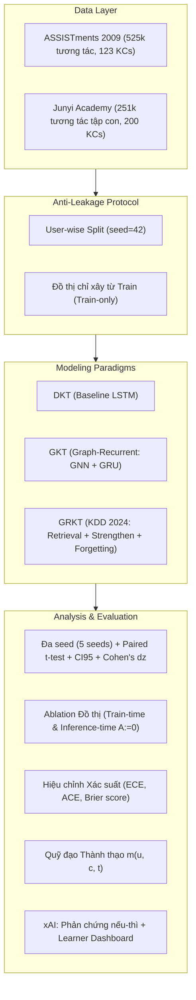
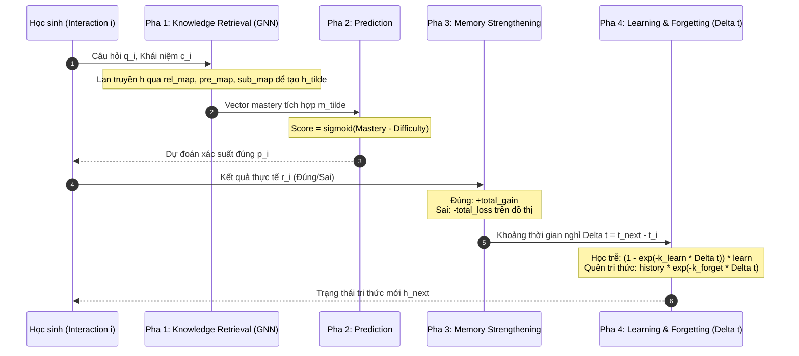

# Knowledge-Tracing: Theo dõi Tri thức Người học bằng Học máy trên Đồ thị

> **Kho mã nguồn và Cẩm nang Học tập Toàn diện (Comprehensive Study & Reference Guide)**  
> Dự án nghiên cứu, thực nghiệm và đánh giá chuẩn mực các mô hình **Knowledge Tracing (KT)** từ đường nền không đồ thị (**DKT**) đến mô hình hồi quy trên đồ thị (**GKT**) và mô hình truy xuất kết hợp động học quên thời gian thực (**GRKT**, KDD 2024).

---

## 1. Tổng quan & Bản đồ Hệ thống

Dự án tập trung vào bài toán **Knowledge Tracing (KT)**: Dựa trên chuỗi lịch sử làm bài của người học $(q_1, r_1), (q_2, r_2), \dots, (q_t, r_t)$ (với $q_i$ là khái niệm tri thức / bài tập và $r_i \in \{0, 1\}$ là kết quả đúng hoặc sai), mô hình cần dự đoán chính xác xác suất người học trả lời đúng câu hỏi tiếp theo:
$$P(r_{t+1} = 1 \mid q_{1:t}, r_{1:t}, q_{t+1})$$



### 1.1 Cấu trúc Thư mục

| Thư mục / Tệp | Vai trò kỹ thuật | Tài liệu giải thích chi tiết |
| --- | --- | --- |
| [`GKT/`](file:///root/Knowledge-Tracing/GKT) | Mã nguồn upstream GKT & DKT (Nakagawa et al., 2019): `models.py`, `layers.py`, `processing.py`, `metrics.py`. | [docs/01_gkt_module.md](file:///root/Knowledge-Tracing/docs/01_gkt_module.md) |
| [`GRKT/`](file:///root/Knowledge-Tracing/GRKT) | Mã nguồn upstream GRKT (Cui et al., KDD 2024 - đã patched & package-hóa): `model/GRKT.py`, `BaseModel.py`. | [docs/02_grkt_module.md](file:///root/Knowledge-Tracing/docs/02_grkt_module.md) |
| [`level1/`](file:///root/Knowledge-Tracing/level1) | Gói điều phối Cấp độ 1: nạp dữ liệu, chống rò rỉ, huấn luyện DKT/GKT, xAI phản chứng (`explain.py`), dashboard (`dashboard.py`). | [docs/03_level1_module.md](file:///root/Knowledge-Tracing/docs/03_level1_module.md) |
| [`level2/`](file:///root/Knowledge-Tracing/level2) | Gói điều phối Cấp độ 2: Hợp đồng 8 cột CSV, chuẩn hóa Junyi streaming, đếm $rel/pre$ train-only, `grkt_api`, quỹ đạo mastery (`trajectory.py`), calibration (`calibration.py`), nén định kỳ (`archive.py`). | [docs/04_level2_module.md](file:///root/Knowledge-Tracing/docs/04_level2_module.md) |
| `kt_common/` | Tiện ích dùng chung hai cấp: tiền xử lý CSV một nguồn (`interactions.py`), checkpoint/fingerprint/tên file (`checkpoint.py`), metric AUC/ACC (`metrics.py`), seed, logger. | [docs/tasks/improve_checklist.md](docs/tasks/improve_checklist.md) |
| `tests/` | Test chống rò rỉ (split theo người học, đồ thị chỉ từ train, dự đoán nhân quả), quy ước checkpoint, smoke đầu-cuối Level 1/2. | — |
| [`kaggle_level1_full.ipynb`](file:///root/Knowledge-Tracing/kaggle_level1_full.ipynb) | Notebook 39 cells chạy Cấp độ 1 trên Kaggle GPU: 7 mô hình × 5 seed, kiểm định paired t-test, ablation suy luận, 10 case study có bằng chứng. | [docs/05_kaggle_level1_notebook.md](file:///root/Knowledge-Tracing/docs/05_kaggle_level1_notebook.md) |
| [`kaggle_level2_full.ipynb`](file:///root/Knowledge-Tracing/kaggle_level2_full.ipynb) | Notebook 37 cells chạy Cấp độ 2 trên Kaggle GPU: ASSIST09 + Junyi tập con 3.000 learners, quỹ đạo mastery, calibration, dashboard Cấp 2, đóng gói tự động. | [docs/06_kaggle_level2_notebook.md](file:///root/Knowledge-Tracing/docs/06_kaggle_level2_notebook.md) |
| [`results/level1_out/`](file:///root/Knowledge-Tracing/results/level1_out) | Artifact thực nghiệm đầy đủ của Cấp độ 1 (7 mô hình × 5 seed, metrics, paired tests, ablation, calibration, figures). | [GAP_LEVEL1.md](file:///root/Knowledge-Tracing/GAP_LEVEL1.md) |
| [`results/level2_moderate/`](file:///root/Knowledge-Tracing/results/level2_moderate) | Artifact thực nghiệm Cấp độ 2 (ASSIST09 + Junyi, GRKT train/zero, baselines, trajectory metrics, calibration, figures). | [GAP_LEVEL2.md](file:///root/Knowledge-Tracing/GAP_LEVEL2.md) |
| [`docs/`](file:///root/Knowledge-Tracing/docs) | Hệ thống 9 chuyên đề tài liệu kỹ thuật chi tiết phục vụ học tập và nghiên cứu. | [docs/README.md](file:///root/Knowledge-Tracing/docs/README.md) |

---

## 2. Lý thuyết Cốt lõi: So sánh Toàn diện BKT vs DKT vs GKT vs GRKT

Để học sâu và nắm bắt bản chất của lĩnh vực Knowledge Tracing, bảng so sánh dưới đây đối chiếu 4 thế hệ mô hình tiêu biểu:

| Tiêu chí | BKT (Corbett & Anderson, 1994) | DKT (Piech et al., 2015) | GKT (Nakagawa et al., 2019) | GRKT (Cui et al., KDD 2024) |
| --- | --- | --- | --- | --- |
| **Biểu diễn tri thức** | Biến ngẫu nhiên nhị phân $P(L_t) \in [0, 1]$ độc lập cho từng kỹ năng. | Một vector ẩn toàn cục $h_t \in \mathbb{R}^H$ ($H=128$ hoặc $32$) đại diện chung cho mọi kỹ năng. | Ma trận trạng thái tri thức $h_t \in \mathbb{R}^{C \times H}$: mỗi khái niệm có 1 vector ẩn riêng biệt ($H=32$). | Vector mastery $h[c] \in \mathbb{R}^{KH}$ ($KH=16$) kèm bộ đếm số lần làm bài $count[c]$. |
| **Cơ chế cập nhật** | Công thức Bayes dựa trên 4 tham số: $P(L_0), P(T), P(G), P(S)$. | Mạng hồi quy LSTM/RNN cập nhật $h_{t+1} = \text{LSTM}(h_t, x_t)$. | GNN neighbor aggregation $\rightarrow$ Erase-Add Gate $\rightarrow$ GRUCell cập nhật mọi khái niệm. | 4 pha tường minh: Truy xuất GNN $\rightarrow$ Dự đoán $\rightarrow$ Củng cố Đúng/Sai $\rightarrow$ Học trễ & Quên theo $\Delta t$. |
| **Cấu trúc Đồ thị** | Không có (coi các kỹ năng độc lập hoàn toàn). | Không có (mô hình ẩn tự học tương quan ngầm qua trọng số LSTM). | 1 ma trận quan hệ $A \in \mathbb{R}^{C \times C}$ (tĩnh: Transition/Dense hoặc tự học: PAM/MHA/VAE). | 2 ma trận nhị phân hướng: Đồng xuất hiện ($rel\_map$) và Tiên quyết ($pre\_map$, $sub\_map = pre^T$). |
| **Mô hình hóa Thời gian** | Không sử dụng mốc thời gian. | Không sử dụng mốc thời gian (chỉ xét thứ tự chuỗi $t$). | Không sử dụng mốc thời gian (bỏ qua khoảng cách làm bài). | **Trung tâm**: Hàm suy giảm lũy thừa $\exp(-(count+1)\Delta t \cdot k)$ cho cả học trễ và quên. |
| **Không gian Chỉ số** | Độc lập | 0-based: $q \in [0, C-1]$, feature $x = 2q + r$. | 0-based: $q \in [0, C-1]$, feature $x = 2q + r$, padding $-1$. | 1-based: Index 0 dành cho padding. Khái niệm và Bài tập đều bắt đầu từ 1. |
| **Thời điểm Dự đoán** | Dự đoán $P(r_{t+1})$ từ $P(L_t)$. | Đầu ra $y_t$ dự đoán câu tiếp theo $r_{t+1}$. | Trạng thái $h_t$ cập nhật xong mới dự đoán câu tiếp theo qua $h_t[q_{t+1}]$. | Dự đoán $score_t$ được tính **trước** khi dùng đáp án $r_t$ để củng cố trạng thái. |
| **Khả năng Giải thích** | Rất cao (xác suất thành thạo trực tiếp). | Thấp ("hộp đen", khó tách rời trạng thái từng kỹ năng). | Trung bình (có ma trận $h_t$, nhưng GRU trộn lẫn làm mất tính đơn điệu). | Rất cao: Tách bạch rõ lượng tăng khi đúng, giảm khi sai, và độ suy giảm theo thời gian thực. |
| **Chi phí Tính toán** | Rất nhẹ (giải tích). | Rất nhẹ ($O(S \cdot H^2)$). | Trung bình ($O(S \cdot C^2 \cdot H)$ do phép nhân ma trận kề $A$). | Nặng ($O(S \cdot K_{hop} \cdot NK^2 \cdot KH)$ do 3 kênh lan truyền trên đồ thị). |

---

## 3. Cấp độ 1 — Mô hình Đồ thị Tĩnh & Động (GKT & DKT)

### 3.1 Bản chất Thuật toán GKT

Tại mỗi bước $t$, học sinh trả lời câu hỏi khái niệm $q_t$ với kết quả $r_t \in \{0, 1\}$.

1. **Đặc trưng tương tác**: $x_t = 2 q_t + r_t \in \{0, 1, \dots, 2C-1\}$.
2. **Tổng hợp thông tin (`_aggregate`)**: Trạng thái ẩn $h_t[c]$ được ghép nối với embedding tương tác (cho $c = q_t$) hoặc embedding khái niệm thuần túy (cho $c \neq q_t$):
   $$\tilde{h}_t[c] = [h_t[c] \parallel e_c] \in \mathbb{R}^{H + E}$$
3. **Lan truyền lân cận GNN (`_agg_neighbors`)**:
   - Đối với chính khái niệm $q_t$: $m_{next}[q_t] = f_{self}(\tilde{h}_t[q_t])$.
   - Đối với các khái niệm lân cận $c \neq q_t$:
     $$m_{next}[c] = A[q_t, c] \cdot f_{in}([\tilde{h}_t[q_t] \parallel \tilde{h}_t[c]]) + A[c, q_t] \cdot f_{out}([\tilde{h}_t[q_t] \parallel \tilde{h}_t[c]])$$
4. **Cổng Xóa - Thêm (Erase-Add Gate)**:
   $$e_t = \sigma(W_e \tilde{h}_t + b_e), \quad a_t = \tanh(W_a \tilde{h}_t + b_a), \quad h_t' = h_t \odot (1 - e_t) + a_t$$
5. **Cập nhật bằng GRUCell**:
   $$h_{t+1}[c] = \text{GRUCell}(m_{next}[c], h_t'[c])$$
6. **Dự đoán câu tiếp theo (`_predict`)**:
   $$P(r_{t+1} = 1) = \sigma(W_p h_{t+1}[q_{t+1}] + b_p)$$

### 3.2 Sửa lỗi Cốt tử từ Upstream GKT trong `level1/`

1. **Sửa lỗi kích thước One-Hot ($res\_len$)**: Upstream mặc định `binary=False` dẫn đến $res\_len = 12$ ($12 \times 123 = 1476$ chiều), lãng phí 6 lần bộ nhớ và tham số. Package `level1/pipeline.py` ép `binary=True` $\rightarrow res\_len=2$ ($2 \times 123 = 246$ chiều).
2. **Khắc phục lệch Device trong `_one_hot_cache`**: Bảng `torch.eye` không phải parameter nên khi chuyển model sang GPU bảng vẫn ở CPU. `level1` cache bảng theo đúng device của tensor đầu vào.
3. **Đánh giá AUC Toàn cục (Global AUC)**: Thay vì tính trung bình AUC theo batch (rất nhiễu), `level1` gom toàn bộ nhãn và xác suất của test set để tính 1 giá trị `roc_auc_score` duy nhất.
4. **Đồ thị Chuyển tiếp chỉ xây từ Train**: Ma trận $A_{Transition}$ chỉ đếm tần suất chuyển tiếp giữa các khái niệm từ các chuỗi trong tập train, triệt tiêu hoàn toàn rò rỉ cạnh từ tập val/test.

---

### 3.3 Kết quả Thực nghiệm Cấp độ 1 (7 Mô hình × 5 Seed trên ASSISTments 2009)

Dữ liệu: `skill_builder_data.csv` (525.534 tương tác, 4.217 học sinh, 123 KCs). Split theo người học cố định (`seed=42`): Train 2.330 / Val 776 / Test 778 người học. 5 seed huấn luyện: `[42, 123, 456, 789, 1011]`.

#### Bảng 1: Kết quả Tổng hợp Đa seed (Mean ± Std trên 5 seed)

| Mô hình | Loại Đồ thị | Số tham số | Test AUC | Test Accuracy | Test NLL (batch mean) | Thời gian 1 seed |
| --- | --- | ---: | --- | --- | --- | ---: |
| **DKT** | Không dùng | 39.899 | **0.7862 ± 0.0006** | **0.7343 ± 0.0013** | **0.5273 ± 0.0005** | **35.1 s** |
| **GKT-Transition** | Tĩnh (Transition) | 34.140 | 0.7609 ± 0.0096 | 0.7127 ± 0.0077 | 0.5567 ± 0.0105 | 1.379.0 s |
| **GKT-Identity** | Tĩnh (Đơn vị $A=I$) | 34.140 | 0.7578 ± 0.0056 | 0.7099 ± 0.0077 | 0.5546 ± 0.0068 | 2.755.5 s |
| **GKT-Zero** | Tĩnh (Bỏ cạnh $A=0$) | 34.140 | 0.7576 ± 0.0055 | 0.7098 ± 0.0077 | 0.5562 ± 0.0073 | 2.912.4 s |
| **GKT-Shuffled** | Tĩnh (Xáo trộn toàn cục) | 34.140 | 0.7579 ± 0.0039 | 0.7094 ± 0.0064 | 0.5594 ± 0.0063 | 3.409.4 s |
| **GKT-ShuffledRow** | Tĩnh (Xáo theo hàng, giữ out-degree) | 34.140 | 0.7576 ± 0.0127 | 0.7113 ± 0.0121 | 0.5555 ± 0.0119 | 3.789.0 s |
| **GKT-MHA** | Động (Multi-Head Attention) | 38.236 | 0.7668 ± 0.0095 | 0.7213 ± 0.0087 | 0.5505 ± 0.0088 | 4.072.8 s |

#### Bảng 2: Kiểm định Thống kê Ghép cặp theo Seed (Paired t-test so với DKT, $n=5$)

| So sánh | $\Delta\text{AUC}$ | Khoảng tin cậy 95% (CI95) | Thống kê $t$ | Giá trị $p$ | Kích thước ảnh hưởng (Cohen's $d_z$) | Kết luận thống kê |
| --- | ---: | --- | ---: | ---: | ---: | --- |
| **DKT − GKT-Transition** | **+0.02536** | [+0.01158, +0.03914] | 5.110 | 0.0069 | 2.285 | DKT vượt trội có ý nghĩa ($p < 0.01$) |
| **DKT − GKT-Identity** | **+0.02838** | [+0.02034, +0.03641] | 9.807 | 0.0006 | 4.386 | DKT vượt trội có ý nghĩa ($p < 0.001$) |
| **DKT − GKT-Zero** | **+0.02862** | [+0.02084, +0.03640] | 10.216 | 0.0005 | 4.569 | DKT vượt trội có ý nghĩa ($p < 0.001$) |
| **DKT − GKT-Shuffled** | **+0.02832** | [+0.02267, +0.03397] | 13.913 | 0.0002 | 6.222 | DKT vượt trội có ý nghĩa ($p < 0.001$) |
| **DKT − GKT-MHA** | **+0.01943** | [+0.00649, +0.03237] | 4.169 | 0.0140 | 1.864 | DKT vượt trội có ý nghĩa ($p < 0.05$) |
| **DKT − GKT-ShuffledRow** | **+0.02863** | [+0.01054, +0.04672] | 4.395 | 0.0117 | 1.965 | DKT vượt trội có ý nghĩa ($p < 0.05$) |

#### Bảng 3: Ablation Đồ thị lúc Suy luận (Inference Ablation: ép $A := 0$ trên Checkpoint Seed 42)

| Mô hình | AUC có đồ thị gốc | AUC khi ép $A := 0$ | $\Delta\text{AUC}$ | $\Delta\text{NLL}$ | Mean $\|\Delta p\|$ | Max $\|\Delta p\|$ | Nhận xét cơ chế |
| --- | ---: | ---: | ---: | ---: | ---: | ---: | --- |
| **GKT-Transition** | 0.7427 | 0.7317 | **−0.0109** | +0.0080 | 0.0259 | 0.4933 | Mô hình thực sự đọc và sử dụng ma trận $A$ lúc tính toán |
| **GKT-Identity** | 0.7549 | 0.7549 | 0.0000 | 0.0000 | 0.0000 | 0.0000 | Trùng khớp tuyệt đối do cơ chế self-update ghi đè |
| **GKT-Zero** | 0.7549 | 0.7549 | 0.0000 | 0.0000 | 0.0000 | 0.0000 | Bản thân mô hình đã là $A=0$ |
| **GKT-Shuffled** | 0.7542 | 0.7511 | −0.0031 | +0.0019 | 0.0075 | 0.4913 | Độ phụ thuộc vào cạnh ngẫu nhiên yếu hơn |
| **GKT-MHA** | 0.7454 | 0.7425 | −0.0029 | +0.0021 | 0.0026 | 0.1806 | Attention phân tán vào nhiều vị trí |
| **GKT-ShuffledRow** | 0.7651 | 0.7542 | **−0.0109** | +0.0080 | 0.0248 | 0.6868 | Mức giảm y hệt Transition dù cạnh bị hoán vị |

#### Bảng 4: Hiệu chỉnh Xác suất (Probability Calibration trên 47.358 dự đoán Test)

| Mô hình | AUC | Brier Score (càng thấp càng tốt) | ECE (Expected Calibration Error) | Mean Predicted $P$ | Tỉ lệ nhãn thực ($y=1$) |
| --- | ---: | ---: | ---: | ---: | ---: |
| **DKT** | **0.7866** | **0.1765** | 0.0154 | 0.6348 | 0.6263 |
| **GKT-Transition** | 0.7427 | 0.1951 | 0.0507 | 0.6758 | 0.6263 |
| **GKT-Identity / Zero** | 0.7549 | 0.1886 | 0.0223 | 0.6103 | 0.6263 |
| **GKT-Shuffled** | 0.7542 | 0.1933 | 0.0706 | 0.5559 | 0.6263 |
| **GKT-ShuffledRow** | 0.7651 | 0.1841 | **0.0105** | 0.6189 | 0.6263 |

---

### 3.4 Bốn Phát hiện Khoa học Cốt lõi của Cấp độ 1

1. **DKT chiến thắng áp đảo mọi biến thể GKT**:
   - DKT vượt mọi mô hình GKT từ $+0.0194$ đến $+0.0286$ AUC với $p < 0.05$ và $d_z > 1.8$.
   - **Lý do bản chất**: ASSISTments 2009 có cấu trúc 1 khái niệm duy nhất cho mỗi câu hỏi. DKT sở hữu một vector ẩn toàn cục $h_t \in \mathbb{R}^{32}$, cho phép LSTM tự do học các tương quan phi tuyến giữa các khái niệm mà không bị gò bó. Trong khi đó, GKT chia nhỏ bộ nhớ thành 123 vector riêng biệt ($123 \times 32$), việc cập nhật qua ma trận chuyển tiếp $A$ thưa thớt khiến thông tin bị phân mảnh và lan truyền nhiễu.
2. **Không có bằng chứng thống kê chứng minh ưu thế của cấu trúc đồ thị khi huấn luyện**:
   - So sánh giữa các loại đồ thị:
     - $\text{Transition} - \text{Zero} = +0.00326$ ($p = 0.5462$, không có ý nghĩa).
     - $\text{Transition} - \text{Shuffled} = +0.00296$ ($p = 0.4952$, không có ý nghĩa).
     - $\text{Transition} - \text{ShuffledRow} = +0.00328$ ($p = 0.7403$, không có ý nghĩa).
   - Việc xáo trộn hoàn toàn các cạnh đồ thị (phá vỡ quan hệ ngữ nghĩa "khái niệm nào đi trước khái niệm nào") **không hề làm giảm hiệu năng** của GKT. Lợi ích nhỏ (nếu có) đến từ mật độ kết nối tổng thể chứ không phải từ hình dạng cấu trúc chuyển tiếp.
3. **Chứng minh Toán học: Identity $\equiv$ Zero trong GKT**:
   - Trong `GKT/models.py:250-260`:
     Với mọi $c \neq q_t$: trong ma trận đơn vị $A=I$, $A[q_t, c] = 0$ và $A[c, q_t] = 0$, do đó $neigh\_features = 0$.
     Tại vị trí $c = q_t$: mặc dù $A[q_t, q_t] = 1$, nhưng ở dòng 290:
     `m_next[qt_mask] = m_next[qt_mask].index_put(self_index_tuple, self_features)`
     Giá trị tại vị trí $q_t$ bị **ghi đè hoàn toàn** bởi $self\_features$.
   - **Hệ quả**: Biểu thức tính toán của $A=I$ và $A=0$ hoàn toàn đồng nhất. Sai khác loss ở mức $10^{-9}$ chỉ là sai số làm tròn float. Do đó, ablation "ma trận đơn vị" không tách biệt được khỏi ablation "bỏ hết cạnh".
4. **Ý nghĩa của Ablation lúc Suy luận ($A := 0$)**:
   - Khi triệt tiêu $A := 0$ lúc test, cả GKT-Transition và GKT-ShuffledRow đều giảm chính xác $-0.0109$ AUC.
   - Điều này chứng minh mạng nơ-ron **thực sự sử dụng các đường truyền ma trận kề** để tính toán dự đoán (nếu cắt đứt mạng sẽ bị sốc), nhưng nó coi đồ thị chuyển tiếp thật và đồ thị xáo theo hàng là tương đương nhau về mặt dung lượng thông tin.

---

## 4. Cấp độ 2 — GRKT (KDD 2024) & Quỹ đạo Tri thức

### 4.1 Cấu trúc 4 Pha Forward của GRKT

GRKT (Graph-based Retrieval-Knowledge Tracing) giải quyết nhược điểm "hộp đen" của GKT bằng cách xây dựng quy trình cập nhật tri thức 4 pha tường minh:



1. **Pha 1: Knowledge Retrieval (Truy xuất Tri thức qua GNN)**:
   - Sử dụng hai ma trận đồ thị: $rel\_map$ (đồng xuất hiện) và $pre\_map$ (tiên quyết, cùng $sub\_map = pre^T$).
   - Trạng thái hiện tại $h$ được lan truyền qua $K_{hop}$ bước GNN:
     $$\tilde{h} = h + \text{GNN}_{rel}(h \odot \alpha) + \text{GNN}_{pre}(h \odot \alpha) + \text{GNN}_{sub}(h \odot \alpha)$$
   - Độ thành thạo tích hợp: $master = \text{proj}(\tilde{h})$.
2. **Pha 2: Dự đoán Xác suất (Prediction)**:
   - Độ khó bài tập $diff = \text{MLP}([e_{prob} \parallel e_{know}])$.
   - Xác suất làm đúng: $P(r_i = 1) = \sigma(master - diff)$.
3. **Pha 3: Củng cố Bộ nhớ (Memory Strengthening)**:
   - Nếu học sinh làm **Đúng** ($r_i = 1$): Tính lượng tiếp thu tri thức $total\_gain$, lan truyền trên đồ thị và cộng vào trạng thái: $h \leftarrow h + total\_gain$.
   - Nếu học sinh làm **Sai** ($r_i = 0$): Tính lượng suy giảm $total\_loss$, lan truyền trên đồ thị và trừ khỏi trạng thái: $h \leftarrow h - total\_loss$.
4. **Pha 4: Động học Học trễ & Quên theo Thời gian Thực (Learning & Forgetting)**:
   - Dựa trên khoảng cách thời gian $\Delta t = t_{i+1} - t_i$ và số lần làm bài $count$:
   - **Học trễ**: Tăng dần theo thời gian ngẫm nghĩ: $(1 - \exp(-(count+1)\Delta t \cdot \kappa_{learn})) \cdot total\_learn$.
   - **Quên tri thức**: Tri thức tích lũy bị phân rã theo đường cong suy giảm Ebbinghaus: $history\_gain \cdot \exp(-(count+1)\Delta t \cdot \kappa_{forget})$.

---

### 4.2 Bảy Sửa đổi Kiểm soát trong Upstream GRKT (`level2/`)

Mã nguồn gốc upstream của GRKT ([JJCui96/GRKT](https://github.com/JJCui96/GRKT)) tồn tại nhiều cạm bẫy phương pháp luận nghiêm trọng. Package `level2/` đã thực hiện 7 sửa đổi lớn:

1. **Loại bỏ Hoàn toàn `Runner.py` (Chặn Rò rỉ K-Fold Cửa sổ)**: Upstream cắt chuỗi thành các cửa sổ con rồi chia K-Fold ngẫu nhiên trên tập cửa sổ. Điều này khiến các cửa sổ của **cùng một học sinh** vừa nằm ở tập train vừa nằm ở tập test $\rightarrow$ rò rỉ danh tính người học cực kỳ nghiêm trọng. `level2/grkt_api.py` thay thế bằng pipeline phân tách độc lập theo User ID.
2. **Đồ thị $rel\_map$ và $pre\_map$ chỉ xây từ Train**: Upstream chạy `assist09_preprocess.py` trên toàn bộ tệp CSV để tính xác suất chuyển tiếp trước khi chia fold. `level2/grkt_data.py` chỉ tính $rel/pre$ từ chuỗi của tập train.
3. **Quy chuẩn hóa Trục Thời gian & Chặn Trần 240 Phút**: Upstream dùng đơn vị giây thô không chặn; học sinh nghỉ vài ngày dẫn đến $\Delta t$ khổng lồ làm sập số mũ $\exp(-\Delta t) \rightarrow 0$ (quên sạch tri thức). `level2` đổi sang phút và áp dụng trần `gap_cap_min=240`.
4. **Hook Thu thập Quỹ đạo Mastery không tốn Chi phí**: Bổ sung cờ `rec` vào `forward()`, cho phép trích xuất 3 mốc quỹ đạo ($m_{\text{pre}}, m_{\text{tilde}}, m_{\text{strong}}$) khi đánh giá mà không làm chậm tốc độ huấn luyện.
5. **Kẹp Ngưỡng Nhị phân Đồ thị Tường minh**: Chuyển đổi $rel\_map = (rel\_map > 0.6)$ rõ ràng trên tensor PyTorch.
6. **Thay thế `eval()` Bằng Registry Mô hình An toàn**: Khắc phục lỗ hổng thực thi mã tùy ý trong upstream `Training.py`.
7. **Cơ chế Checkpoint Bền vững & Khôi phục Sau 12h**: Lưu fingerprint cấu hình và vị trí batch đang dở, tự động resume mượt mà trên Kaggle.

---

### 4.3 Kết quả Thực nghiệm Cấp độ 2 (ASSISTments 2009 & Junyi Academy)

Chạy trên 2 tập dữ liệu công khai với cùng split seed 42 và cùng độ dài chuỗi tối đa `max_seq_len=200`:

- **ASSISTments 2009**: 3.884 học sinh, 237.943 tương tác, đồ thị train: 2.720 cạnh rel, 2.642 cạnh pre.
- **Junyi Academy (tập con chuẩn hóa)**: 3.000 học sinh, 251.598 tương tác, top 200 khái niệm, đồ thị train: 17.866 cạnh rel, 10.173 cạnh pre.

#### Bảng 5: So sánh GRKT vs Đường nền (Baselines) trên 2 Tập Dữ liệu

| Tập dữ liệu | Mô hình | Đồ thị | Test AUC | Test Accuracy | Test NLL | Best Val AUC | Ghi chú so sánh |
| --- | --- | --- | ---: | ---: | ---: | ---: | --- |
| **assist2009** | **GRKT** | **train** | **0.7972** | **0.7441** | **0.5217** | **0.8016** | **Thắng mọi baseline** (+0.0113 so với DKT) |
| assist2009 | GRKT-zero | zero | 0.7840 | 0.7303 | 0.5311 | 0.7915 | Thấp hơn GRKT train $-0.0132$ AUC |
| assist2009 | DKT | — | 0.7859 | 0.7347 | 0.5284 | 0.7909 | Baseline không đồ thị mạnh nhất |
| assist2009 | GKT-Transition | Transition | 0.7536 | 0.7078 | 0.5607 | 0.7634 | GKT train lại trong cùng harness C2 |
| assist2009 | GKT-Zero | Zero | 0.7644 | 0.7142 | 0.5487 | 0.7728 | GKT bỏ cạnh |
| **junyi** | **GRKT** | **train** | **0.7896** | **0.8124** | **0.4378** | **0.7877** | **Thắng mọi baseline** (+0.0395 so với DKT) |
| junyi | DKT | — | 0.7501 | 0.7946 | 0.4630 | 0.7513 | Baseline DKT trên Junyi |
| junyi | GKT-Zero | Zero | 0.7225 | 0.7831 | 0.4789 | 0.7225 | Baseline GKT bỏ cạnh |
| junyi | GKT-Transition | Transition | 0.7202 | 0.7800 | 0.4790 | 0.7208 | Baseline GKT Transition |

*Đa seed GRKT trên ASSISTments 2009 (3 seed)*: Test AUC = **0.7983 ± 0.0009**, Acc = $0.7424 \pm 0.0023$, NLL = $0.5170 \pm 0.0037$.

---

### 4.4 Phân tích Quỹ đạo Tri thức $m(u, c, t)$: Bằng chứng Thật vs Cạm bẫy Bằng chứng Giả

Đo đạc trên 150 người học ngẫu nhiên trong tập test của từng bộ dữ liệu:

| Tập dữ liệu / Đồ thị | Precedence Ratio | Precedence Gap | Stability (Spearman) | Stability Changed Frac | Forget Slope ($\times 10^{-4}$) | Pearson $(r_{\Delta t, \Delta m})$ | Abs $\Delta$ Retrieval |
| --- | ---: | ---: | ---: | ---: | ---: | ---: | ---: |
| **assist2009 / train** | 0.3418 | **−0.1108** | 0.9712 | 0.4459 | −4.63 | −0.6104 | 0.0335 |
| **assist2009 / zero** | 0.2015 | **−0.0776** | 0.9936 | 0.0081 | −2.38 | −0.2290 | 0.0000 |
| **junyi / train** | 0.3651 | **−0.1014** | 0.9861 | 0.5120 | +0.10 | −0.0002 | 0.0209 |

#### Bốn Bài học Khoa học Sâu sắc từ Quỹ đạo Tri thức

1. **Vạch trần Cạm bẫy Bằng chứng Giả (Structural Artifacts)**:
   - Ba chỉ số thường được các báo cáo đưa vào: `consistency_strengthen`, `consistency_spread`, `locality` đều **đạt giá trị tuyệt đối 1.0 (100%)**.
   - **Bản chất**: Đây không phải bằng chứng khoa học! Do mã nguồn GRKT sử dụng hàm kích hoạt `relu()` và phép cộng `scatter` trực tiếp, về mặt cấu trúc toán học $total\_gain \ge 0$ và $total\_loss \ge 0$. Do đó, việc làm đúng bắt buộc mastery phải tăng và làm sai bắt buộc mastery phải giảm. Đây chỉ là **kiểm chứng cài đặt code chạy đúng**, không chứng minh được tính hợp lý giáo dục của mô hình.
2. **Sự thật Khách quan về Tiêu chí Tiên quyết (`precedence_gap` âm)**:
   - `precedence_gap` đo mức chênh lệch giữa tỉ lệ mastery khái niệm tiên quyết cao hơn khái niệm phụ thuộc trên đồ thị thật so với đồ thị hoán vị ngẫu nhiên.
   - Kết quả: Trên cả 2 tập, `precedence_gap` đều mang **giá trị âm** (assist: $-0.1108$; junyi: $-0.1014$).
   - **Kết luận khoa học**: Mô hình **chưa chứng minh được tính nhất quán tiên quyết**. Báo cáo trung thực phải ghi nhận điều này, không được bóp méo số liệu hay đảo dấu.
3. **Bằng chứng Thực tế về Động học Quên (Forgetting Dynamics)**:
   - Trên ASSISTments 2009: `forget_slope = -4.63e-4` và tương quan Pearson $r(\Delta t, \Delta m) = -0.6104$. Khoảng cách thời gian giữa hai bài tập càng lớn, độ thành thạo tri thức càng suy giảm rõ rệt.
   - Trên Junyi Academy: `forget_slope \approx 0` và $r \approx 0$. Đây là **giới hạn của tập dữ liệu**: 88.1% các tương tác trong log Junyi có $\Delta t = 0$ do hệ thống làm tròn timestamp theo chu kỳ 15 phút.
4. **Đồ thị Thực sự Lan truyền Tri thức qua Cơ chế Truy xuất (`abs_delta_retrieval`)**:
   - Khi có đồ thị (`train`), mức lan truyền mastery qua truy xuất đạt $0.0335$ (assist) và $0.0209$ (junyi). Khi tắt đồ thị (`zero`), giá trị này về đúng $0.0000$. Đây là bằng chứng cơ chế khẳng định GNN có thực hiện lan truyền tri thức giữa các khái niệm liên quan.

---

## 5. Hệ thống Chống Rò rỉ Dữ liệu (Anti-Leakage Protocol)

Repo thiết lập 5 tầng bảo vệ chống rò rỉ dữ liệu khoa học nghiêm ngặt:

1. **Phân chia theo Người học (User-wise Splitting)**:
   - Toàn bộ dữ liệu được chia theo `user_id` với tỉ lệ cố định 60% Train / 20% Val / 20% Test (seed 42).
   - Kiểm toán tự động qua `leak_report.txt`:
     $$\text{Train} \cap \text{Val} = \emptyset, \quad \text{Train} \cap \text{Test} = \emptyset, \quad \text{Val} \cap \text{Test} = \emptyset$$
2. **Đồ thị Chỉ Xây dựng từ Tập Huấn luyện (Train-only Graphs)**:
   - Cả ma trận chuyển tiếp của GKT và đồ thị quan hệ của GRKT ($rel\_map, pre\_map$) chỉ được tính toán dựa trên các chuỗi làm bài của học sinh trong tập train. Tuyệt đối không nhìn trước dữ liệu tương lai của tập kiểm thử.
3. **Tuân thủ Nhân quả Thời gian (Temporal Causality)**:
   - Nhãn kết quả $r_t$ tại bước hiện tại chỉ được dùng để cập nhật trạng thái sau khi đã hoàn thành dự đoán, bảo đảm không bao giờ rò rỉ đáp án vào bước tính điểm.
4. **Khóa Cấu hình Thực nghiệm (`run_config.json`)**:
   - Lưu trữ mã hash SHA-256 của file dữ liệu thô cùng toàn bộ siêu tham số. Ngăn chặn việc chạy lẫn lộn giữa bản smoke test và bản full data.
5. **Hàng rào Cách ly Dữ liệu Lớn (`.meta.json`)**:
   - Tệp tiền xử lý Junyi luôn lưu hash dữ liệu và tham số cắt mẫu. Nếu phát hiện thay đổi tham số, hệ thống buộc tái sinh file canonical mới, không dùng cache sai lệch.

---

## 6. Hướng dẫn Thực thi & Tái lập (Reproducibility Guide)

### 6.1 Chạy Local bằng Python CLI

```bash
# 1. Cài đặt môi trường (chạy mọi lệnh từ THƯ MỤC GỐC repo)
pip install -e ".[dev]"            # hoặc: pip install -r requirements.txt
# Tái lập đúng phiên bản của lần chạy báo cáo: pip install -r requirements-lock.txt

# 2. Bộ test chống rò rỉ + smoke (CPU, ~20 giây)
python -m pytest

# 3. Smoke test Cấp độ 1 (15 học sinh) — CLI
python -m level1 --quick --graph-types Transition Zero

# 4. Smoke test Cấp độ 2 (kiểm tra pipeline GRKT trên 15 học sinh)
python -c "from level2.experiment import run_level2; run_level2(datasets=['assist2009_smoke'], epochs=2)"

# 5. Lint
ruff check .
```

Tiền xử lý (`kt_common/interactions.py`, `DATA_VERSION = "dedup-sorted-v1"`): chuỗi mỗi người học
được sắp theo `order_id` và các dòng trùng một lượt của ASSIST09 được gộp (bỏ rò nhãn — xem
`docs/tasks/improve_checklist.md` §0). **Số liệu trong `results/` và `archive/` được tính TRƯỚC bản
sửa này** nên không so trực tiếp với lần chạy mới; checkpoint cũ (không có `data_version`) bị từ chối.

Quy ước checkpoint: mọi file mới mang seed trong tên (`DKT-seed42.pt`, `GRKT-train-seed42.pt`)
kèm `checkpoints_manifest.json`; tên cũ không hậu tố (`DKT.pt`) vẫn được đọc như seed 42
(`kt_common.checkpoint.find_checkpoint`). `GKT/` là package (import tương đối): dùng
`from GKT.metrics import KTLoss`, không chèn `GKT/` vào `sys.path`.

### 6.2 Chạy Thực nghiệm Đầy đủ trên Kaggle GPU

#### Thực nghiệm Cấp độ 1

1. Mở Kaggle Notebook, chọn môi trường GPU (Tesla T4 x2 hoặc P100).
2. Tải lên tệp [`kaggle_level1_full.ipynb`](file:///root/Knowledge-Tracing/kaggle_level1_full.ipynb).
3. Cấu hình cell 0.2: `QUICK_RUN = False` (chạy trên full ASSISTments 2009), `SEEDS = [42, 123, 456, 789, 1011]`.
4. Chạy toàn bộ notebook. Kết quả được đóng gói tự động thành `level1_output.zip`.

#### Thực nghiệm Cấp độ 2

1. Thêm dataset Junyi Academy vào Kaggle: Bấm *Add Input* $\rightarrow$ tìm `junyiacademy/learning-activity-public-dataset-by-junyi-academy` (Lưu ý: Bấm *Agree/Subscribe* điều khoản dataset trước).
2. Tải lên tệp [`kaggle_level2_full.ipynb`](file:///root/Knowledge-Tracing/kaggle_level2_full.ipynb).
3. Cấu hình cell 0.2: `QUICK_RUN = False`, `DATASETS = ["assist2009", "junyi"]`, `JUNYI_MAX_USERS = 3000`.
4. Cơ chế luồng nền `PeriodicPackager` sẽ tự động đóng gói `level2_moderate_output.zip` mỗi 20 phút. Nếu phiên Kaggle bị ngắt sau 12 giờ, chỉ cần gắn file zip vào input của phiên mới và tiếp tục chạy (Resume).

---

## 7. Hệ thống Tài liệu Học tập Chuyên sâu (`docs/`)

Để tìm hiểu sâu từng khía cạnh lý thuyết, thuật toán và triển khai mã nguồn, người học có thể theo dõi hệ thống 9 tài liệu được biên soạn kỹ lưỡng trong thư mục [`docs/`](file:///root/Knowledge-Tracing/docs):

```
docs/
├── README.md                       # Bản đồ hướng dẫn lộ trình học tập & tra cứu
├── 01_gkt_module.md                # Phân tích sâu kiến trúc GKT, GNN neighbor aggregation, Erase-Add Gate
├── 02_grkt_module.md                # Phân tích sâu GRKT (KDD 2024), 4 pha forward, 7 lỗi upstream đã sửa
├── 03_level1_module.md              # Chi tiết package level1: Pipeline, Anti-leakage, xAI phản chứng, Dashboard
├── 04_level2_module.md              # Chi tiết package level2: Chuẩn hóa 8 cột, Trajectory metrics, Calibration, Archive
├── 05_kaggle_level1_notebook.md     # Giải thích cặn kẽ 39 cells của notebook kaggle_level1_full.ipynb
├── 06_kaggle_level2_notebook.md     # Giải thích cặn kẽ 37 cells của notebook kaggle_level2_full.ipynb
├── GIAI_THICH_GKT_GRKT.md           # So sánh đối chiếu giải thuật, toán học và cấu trúc dữ liệu giữa GKT & GRKT
└── GIAI_THICH_LEVEL1_LEVEL2.md      # Hướng dẫn chi tiết luồng dữ liệu, dataflow và cơ chế kết nối hai cấp độ
```

| Tệp tài liệu | Trọng tâm học tập | Liên kết trực tiếp |
| --- | --- | --- |
| [**docs/README.md**](file:///root/Knowledge-Tracing/docs/README.md) | Lộ trình học tập tổng thể, bản đồ kiến thức KT từ cơ bản đến nâng cao. | [`docs/README.md`](file:///root/Knowledge-Tracing/docs/README.md) |
| [**01_gkt_module.md**](file:///root/Knowledge-Tracing/docs/01_gkt_module.md) | Giải thích chi tiết mã nguồn `GKT/`, các lớp nơ-ron, hàm mất mát và danh mục lỗi upstream. | [`docs/01_gkt_module.md`](file:///root/Knowledge-Tracing/docs/01_gkt_module.md) |
| [**02_grkt_module.md**](file:///root/Knowledge-Tracing/docs/02_grkt_module.md) | Giải thích chi tiết mã nguồn `GRKT/`, thuật toán 4 pha, động học quên $\Delta t$, và 7 sửa đổi lớn. | [`docs/02_grkt_module.md`](file:///root/Knowledge-Tracing/docs/02_grkt_module.md) |
| [**03_level1_module.md**](file:///root/Knowledge-Tracing/docs/03_level1_module.md) | Hướng dẫn tầng điều phối Cấp độ 1, xAI phản chứng (flips, ablation), và learner dashboard. | [`docs/03_level1_module.md`](file:///root/Knowledge-Tracing/docs/03_level1_module.md) |
| [**04_level2_module.md**](file:///root/Knowledge-Tracing/docs/04_level2_module.md) | Hướng dẫn tầng điều phối Cấp độ 2, phân tích quỹ đạo $m(u, c, t)$, calibration, và periodic packager. | [`docs/04_level2_module.md`](file:///root/Knowledge-Tracing/docs/04_level2_module.md) |
| [**05_kaggle_level1_notebook.md**](file:///root/Knowledge-Tracing/docs/05_kaggle_level1_notebook.md) | Đi từng cell trong `kaggle_level1_full.ipynb`: 5 seed, paired t-test, ablation suy luận, 10 case study. | [`docs/05_kaggle_level1_notebook.md`](file:///root/Knowledge-Tracing/docs/05_kaggle_level1_notebook.md) |
| [**06_kaggle_level2_notebook.md**](file:///root/Knowledge-Tracing/docs/06_kaggle_level2_notebook.md) | Đi từng cell trong `kaggle_level2_full.ipynb`: đa tập dữ liệu, đối chiếu split, quỹ đạo mastery. | [`docs/06_kaggle_level2_notebook.md`](file:///root/Knowledge-Tracing/docs/06_kaggle_level2_notebook.md) |
| [**GIAI_THICH_GKT_GRKT.md**](file:///root/Knowledge-Tracing/docs/GIAI_THICH_GKT_GRKT.md) | So sánh đối chiếu giải thuật chuyên sâu giữa GKT (GNN+GRU) và GRKT (Retrieval+Strengthen+Forgetting). | [`docs/GIAI_THICH_GKT_GRKT.md`](file:///root/Knowledge-Tracing/docs/GIAI_THICH_GKT_GRKT.md) |
| [**GIAI_THICH_LEVEL1_LEVEL2.md**](file:///root/Knowledge-Tracing/docs/GIAI_THICH_LEVEL1_LEVEL2.md) | Cầu nối kỹ thuật: luồng chuyển đổi tensor qua từng bước, định dạng dữ liệu và cơ chế resume. | [`docs/GIAI_THICH_LEVEL1_LEVEL2.md`](file:///root/Knowledge-Tracing/docs/GIAI_THICH_LEVEL1_LEVEL2.md) |
