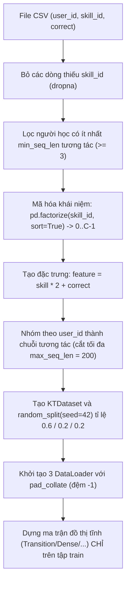
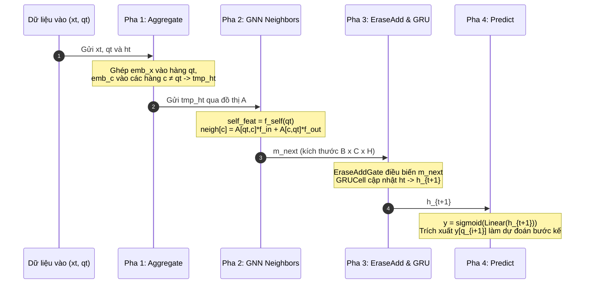

# Chi tiết Mã nguồn Module GKT (Graph-based Knowledge Tracing)

Tài liệu này giải thích chi tiết toàn bộ mã nguồn của thư mục [`GKT/`](file:///root/Knowledge-Tracing/GKT), bao gồm mô hình đường nền **DKT** (Deep Knowledge Tracing) và mô hình **GKT** (Graph-based Knowledge Tracing, Nakagawa et al., 2019), các lớp mạng nơ-ron, tiền xử lý dữ liệu, 9 biến thể đồ thị, hàm mất mát và phân tích chuyên sâu các lỗi/hạn chế trong mã nguồn upstream.

---

## 1. Bản đồ File và Vai trò từng Module

Thư mục `GKT/` chứa mã nguồn tham khảo gốc từ bài báo của Nakagawa et al. (WSDM 2019):

| File | Vai trò | Các lớp / Hàm chính |
|---|---|---|
| [`GKT/models.py`](file:///root/Knowledge-Tracing/GKT/models.py) | Định nghĩa các mô hình tri thức chính. | [`GKT`](file:///root/Knowledge-Tracing/GKT/models.py#L18), [`DKT`](file:///root/Knowledge-Tracing/GKT/models.py#L665), [`MultiHeadAttention`](file:///root/Knowledge-Tracing/GKT/models.py#L482), [`VAE`](file:///root/Knowledge-Tracing/GKT/models.py#L560) |
| [`GKT/layers.py`](file:///root/Knowledge-Tracing/GKT/layers.py) | Các khối mạng nơ-ron cơ sở. | [`MLP`](file:///root/Knowledge-Tracing/GKT/layers.py#L14), [`EraseAddGate`](file:///root/Knowledge-Tracing/GKT/layers.py#L54), [`ScaledDotProductAttention`](file:///root/Knowledge-Tracing/GKT/layers.py#L86), [`MLPEncoder`](file:///root/Knowledge-Tracing/GKT/layers.py#L123), [`MLPDecoder`](file:///root/Knowledge-Tracing/GKT/layers.py#L159) |
| [`GKT/processing.py`](file:///root/Knowledge-Tracing/GKT/processing.py) | Đọc CSV, nhóm chuỗi, chia split và dựng đồ thị tĩnh. | [`load_dataset`](file:///root/Knowledge-Tracing/GKT/processing.py#L41), [`KTDataset`](file:///root/Knowledge-Tracing/GKT/processing.py#L14), [`pad_collate`](file:///root/Knowledge-Tracing/GKT/processing.py#L30), [`build_transition_graph`](file:///root/Knowledge-Tracing/GKT/processing.py#L176), [`build_dense_graph`](file:///root/Knowledge-Tracing/GKT/processing.py#L166) |
| [`GKT/metrics.py`](file:///root/Knowledge-Tracing/GKT/metrics.py) | Tính hàm mất mát và chỉ số đánh giá. | [`KTLoss`](file:///root/Knowledge-Tracing/GKT/metrics.py#L12), [`VAELoss`](file:///root/Knowledge-Tracing/GKT/metrics.py#L56) |
| [`GKT/utils.py`](file:///root/Knowledge-Tracing/GKT/utils.py) | Dựng các biến thể đồ thị, Gumbel-Softmax, KL divergence. | [`build_shuffled_graph`](file:///root/Knowledge-Tracing/GKT/utils.py#L29), [`gumbel_softmax`](file:///root/Knowledge-Tracing/GKT/utils.py#L71), [`kl_categorical`](file:///root/Knowledge-Tracing/GKT/utils.py#L106), [`nll_gaussian`](file:///root/Knowledge-Tracing/GKT/utils.py#L127) |
| [`GKT/train.py`](file:///root/Knowledge-Tracing/GKT/train.py) | CLI huấn luyện, vòng lặp epoch, lưu checkpoint upstream. | `main()`, `train()`, `test()` |
| `GKT/data/` | Dữ liệu kiểm thử. | `skill_builder_data.csv` (ASSIST09), `assistment_test15.csv` (15 học sinh) |

---

## 2. Tiền xử lý Dữ liệu: `processing.py`

### 2.1 Quy ước dữ liệu vào và không gian chỉ số

Trong GKT, toàn bộ chỉ số là **0-based**:
- Số lượng khái niệm tri thức (Knowledge Concepts - KC): $C = \text{concept\_num}$ (với ASSIST09 là 123).
- Chỉ số khái niệm: $q \in \{0, 1, \dots, C-1\}$.
- Nhãn kết quả: $r \in \{0, 1\}$ (0: sai, 1: đúng).
- Điểm đặc trưng (feature) tại mỗi bước:
  $$\text{feature} = q \times 2 + r \in \{0, 1, \dots, 2C-1\}$$
- Giá trị đệm (padding value) cho các chuỗi ngắn hơn độ dài tối đa trong batch: **$-1$**.

### 2.2 Hàm `load_dataset`

Hàm [`load_dataset`](file:///root/Knowledge-Tracing/GKT/processing.py#L41) thực hiện quy trình xử lý dữ liệu qua các bước tuần tự:

1. **`KTDataset`**: Lưu giữ ba danh sách song song cho mỗi học sinh: `features`, `questions`, `answers`.
2. **`pad_collate`**: Trong mỗi batch kích thước $B$, tìm độ dài lớn nhất $S = \max(\text{lengths})$, đệm $-1$ vào tất cả các vị trí còn thiếu. Kết quả trả về 3 tensor cùng shape $[B, S]$:
   - `features`: $[B, S]$
   - `questions`: $[B, S]$
   - `answers`: $[B, S]$
3. **Tính chất thời điểm quan trọng**: `features[:, i]` đã chứa đáp án của câu hỏi tại bước $i$. Mô hình nhận thông tin này để cập nhật trạng thái ẩn rồi dự đoán câu hỏi ở bước $i+1$. Do đó, nhãn dùng để tính mất mát lấy từ `answers[:, 1:]`, và tensor dự đoán có kích thước $[B, S-1]$.

---

## 3. Kiến trúc Mô hình GKT: `models.py` & `layers.py`

### 3.1 Cấu trúc bộ nhớ và Trạng thái Tri thức

Khác với DKT chỉ duy trì một vector ẩn tổng thể, GKT xem trạng thái tri thức của một học sinh là một **ma trận**:
$$h_t \in \mathbb{R}^{C \times H}$$
Trong đó mỗi hàng $h_t[c] \in \mathbb{R}^H$ biểu diễn mức độ hiểu biết đối với khái niệm tri thức $c$ tại thời điểm $t$ ($H = \text{hidden\_dim} = 32$).

Khởi tạo ban đầu: $h_0 = \mathbf{0} \in \mathbb{R}^{B \times C \times H}$.

### 3.2 Các thành phần nơ-ron trong lớp `GKT`

Trong [`GKT.__init__`](file:///root/Knowledge-Tracing/GKT/models.py#L20):
1. **Embedding**:
   - `emb_x`: `nn.Embedding(res_len * C, E)` biểu diễn tương tác $(q_t, r_t)$. ($E = \text{embedding\_dim} = 32$).
   - `emb_c`: `nn.Embedding(C + 1, E, padding_idx=-1)` biểu diễn khái niệm tri thức thuần túy; vị trí index $C$ dành cho vector 0 khi padding.
2. **Hàm biến đổi đặc trưng**:
   - `f_self`: [`MLP`](file:///root/Knowledge-Tracing/GKT/layers.py#L14) nhận đầu vào kích thước $H + E \rightarrow H \rightarrow H$, biến đổi trạng thái của chính khái niệm vừa được làm.
   - `f_neighbor_list`: danh sách các MLP nhận đầu vào $2(H + E) \rightarrow H$. Với đồ thị tĩnh có 2 MLP (`f_in` và `f_out`). Với MHA/VAE có `edge_types` MLP.
3. **Cổng Xóa và Thêm (`EraseAddGate`)**:
   Được định nghĩa trong [`layers.py`](file:///root/Knowledge-Tracing/GKT/layers.py#L54), mô phỏng cơ chế của bộ nhớ phân tán:
   $$\text{erase} = \sigma(W_e m + b_e)$$
   $$\text{add} = \tanh(W_a m + b_a)$$
   $$m' = m - w_c \cdot \text{erase} \odot m + w_c \cdot \text{add}$$
   Trong đó $w_c \in \mathbb{R}$ là tham số vô hướng học được riêng cho từng khái niệm $c$.
4. **GRU Cell**:
   `self.gru = nn.GRUCell(H, H)` cập nhật trạng thái ẩn của từng khái niệm:
   $$h_{t+1}[c] = \text{GRUCell}(m'[c], h_t[c])$$
5. **Dự đoán (`predict`)**:
   `self.predict = nn.Linear(H, 1)` chiếu trạng thái ẩn sang logits:
   $$y_{t}[c] = \sigma(W_p h_{t+1}[c] + b_p)$$

---

## 4. Luồng Forward 4 Bước của GKT

Tại mỗi bước thời gian $i \in \{0, 1, \dots, S-1\}$, với câu hỏi $q_i$ và tương tác $x_i = q_i \times 2 + r_i$:

### Bước 1: Tổng hợp Embedding (`_aggregate`)
Hàm [`_aggregate`](file:///root/Knowledge-Tracing/GKT/models.py#L79) gán vector biểu diễn cho toàn bộ $C$ khái niệm:
- Với các khái niệm không được làm ($c \neq q_i$): $e[b, c] = \text{emb\_c}(c)$.
- Với khái niệm đang làm ($c = q_i$): ghi đè bằng embedding tương tác $e[b, q_i] = \text{emb\_x}(x_i)$.
- Ghép nối với trạng thái ẩn cũ:
  $$\text{tmp\_ht}[b, c] = [h_t[b, c] \,\|\, e[b, c]] \in \mathbb{R}^{H + E}$$

### Bước 2: Lan truyền trên Đồ thị (`_agg_neighbors`)
Hàm [`_agg_neighbors`](file:///root/Knowledge-Tracing/GKT/models.py#L111) thực thi phép biến đổi đồ thị GNN:
- Với chính khái niệm đang làm $q_i$:
  $$\text{self\_feat} = f_{\text{self}}(\text{tmp\_ht}[b, q_i]) \in \mathbb{R}^H$$
- Với các khái niệm láng giềng $c \neq q_i$:
  Tạo vector ghép nối $\text{neigh\_in} = [\text{tmp\_ht}[b, q_i] \,\|\, \text{tmp\_ht}[b, c]] \in \mathbb{R}^{2(H + E)}$.
  Lan truyền dựa trên ma trận kề $A \in \mathbb{R}^{C \times C}$:
  $$\text{neigh}[c] = A[q_i, c] \cdot f_{\text{in}}(\text{neigh\_in}) + A[c, q_i] \cdot f_{\text{out}}(\text{neigh\_in})$$
  *(Lưu ý: $A[q_i, c]$ là cạnh từ $q_i \rightarrow c$, $A[c, q_i]$ là cạnh từ $c \rightarrow q_i$. Do đó dùng 2 MLP riêng biệt).*
- Tập hợp lại: $m_{\text{next}}[b, q_i] = \text{self\_feat}$; $m_{\text{next}}[b, c] = \text{neigh}[c]$ với mọi $c \neq q_i$.

### Bước 3: Cập nhật Trạng thái Ẩn (`_update`)
Hàm [`_update`](file:///root/Knowledge-Tracing/GKT/models.py#L300):
1. Đưa $m_{\text{next}}$ qua cổng xóa/thêm:
   $$m_{\text{gated}} = \text{EraseAddGate}(m_{\text{next}})$$
2. Cập nhật qua GRU cho từng khái niệm:
   $$h_{t+1}[b, c] = \text{GRUCell}(m_{\text{gated}}[b, c], h_t[b, c])$$
   Chỉ cập nhật cho các học sinh có $q_i \neq -1$ (loại trừ padding).

### Bước 4: Dự đoán Xác suất Đúng (`_predict` & `_get_next_pred`)
Hàm [`_predict`](file:///root/Knowledge-Tracing/GKT/models.py#L340):
$$y_t[b, c] = \sigma(\text{Linear}(h_{t+1}[b, c])) \in (0, 1) \quad \forall c \in \{0, \dots, C-1\}$$
Hàm [`_get_next_pred`](file:///root/Knowledge-Tracing/GKT/models.py#L357):
Trích xuất xác suất dự đoán cho câu hỏi của bước tiếp theo $q_{i+1}$:
$$\hat{p}_{i+1} = y_t[b, q_{i+1}]$$

---

## 5. 9 Biến thể Đồ thị trong GKT

GKT hỗ trợ 9 dạng ma trận quan hệ $A \in \mathbb{R}^{C \times C}$:

| Biến thể (`--graph-type`) | Công thức xây dựng | Khả năng học | Ý nghĩa thực nghiệm |
|---|---|---|---|
| `Transition` | $A[i,j] = \frac{N(i \rightarrow j)}{\sum_k N(i \rightarrow k)}$ trên tập train, xóa đường chéo. | Không | Mô hình hóa xác suất chuyển tiếp tự nhiên giữa các kỹ năng trong chương trình học. |
| `Dense` | $A[i,j] = \frac{1}{C - 1}$ với mọi $i \neq j$; $A[i,i] = 0$. | Không | Đồ thị đầy đủ: mọi khái niệm liên kết bình đẳng với nhau. |
| `DKT` | Đọc ma trận kề từ tệp `dkt_graph.txt`. | Không | Đồ thị định sẵn từ chuyên gia hoặc dữ liệu ngoài. |
| `Identity` | $A = I_C$ (chỉ có đường chéo chính). | Không | Biến thể kiểm chứng: không lan truyền sang láng giềng. |
| `Zero` | $A = \mathbf{0}_{C \times C}$ (ma trận toàn 0). | Không | Cắt bỏ hoàn toàn liên kết đồ thị. |
| `Shuffled` | Xáo trộn ngẫu nhiên các cột đích của ma trận `Transition`. | Không | Phá hủy cấu trúc quan hệ thực tế nhưng giữ nguyên số lượng cạnh. |
| `PAM` | Khởi tạo $A \sim \mathcal{U}(0, 1)$, định nghĩa là `nn.Parameter`. | **Có** | Học tự do ma trận kề trực tiếp qua lan truyền ngược (Backpropagation). |
| `MHA` | Dùng cơ chế Multi-Head Attention từ embedding $q_t$ đến toàn bộ $C$ khái niệm. | **Có** | Suy luận đồ thị động phụ thuộc vào ngữ cảnh hiện tại. |
| `VAE` | Encoder-Decoder biến phân NRI (Neural Relational Inference) + Gumbel-Softmax. | **Có** | Lấy mẫu loại cạnh tiềm ẩn từ phân phối xác suất rời rạc. |

> [!NOTE]
> **Chứng minh toán học `Identity ≡ Zero`**:
> Khi $A = I$, với mọi $c \neq q_i$, các phần tử $A[q_i, c] = A[c, q_i] = 0$. Do đó $\text{neigh}[c] = 0$, giống hệt trường hợp $A = 0$.
> Tại vị trí $c = q_i$, giá trị $m_{\text{next}}[b, q_i]$ được gán thẳng bằng $\text{self\_feat}$ (ghi đè kết quả đồ thị). Do đó, trong kiến trúc GKT, **ma trận Identity và ma trận Zero cho kết quả hoàn toàn đồng nhất**.

---

## 6. Mô hình Baseline DKT: `models.py`

Lớp [`DKT`](file:///root/Knowledge-Tracing/GKT/models.py#L665) là mô hình chuẩn không sử dụng đồ thị:
1. Đầu vào: Vector One-hot kích thước $2C$ tại mỗi bước thời gian $i$: $\text{features}[:, i] = q_i \times 2 + r_i$.
2. Đóng gói chuỗi bằng `pack_padded_sequence` để bỏ qua các vị trí padding $-1$.
3. Mạng `nn.LSTM(2C, hidden_dim, batch_first=True)` cập nhật vector ẩn toàn cục $h_t \in \mathbb{R}^H$.
4. Chiếu qua lớp tuyến tính `f_out = nn.Linear(H, C)` và hàm $\sigma$ để đưa ra xác suất cho toàn bộ $C$ khái niệm:
   $$y_t = \sigma(W_{out} h_t + b_{out}) \in \mathbb{R}^{B \times C}$$
5. Lấy kết quả $\hat{p}_{i+1} = y_t[:, q_{i+1}]$.

---

## 7. Hàm Mất mát: `metrics.py`

### 7.1 Lớp `KTLoss`
Được định nghĩa trong [`metrics.py`](file:///root/Knowledge-Tracing/GKT/metrics.py#L12):
1. **Lấy nhãn thực**: `real = answers[:, 1:]` (dịch 1 bước).
2. **Tạo mặt nạ hợp lệ**: `mask = (real != -1)`.
3. **Kẹp xác suất** tránh tràn số: $p = \text{clamp}(\hat{p}, 10^{-6}, 1 - 10^{-6})$.
4. **Negative Log-Likelihood**:
   $$\mathcal{L}_{KT} = - \frac{1}{\sum \text{mask}} \sum_{b, t: \text{mask}} \left[ r_{t+1} \log(p_t) + (1 - r_{t+1}) \log(1 - p_t) \right]$$
   *(Cài đặt trong mã dùng `nn.NLLLoss(ignore_index=-1)` trên tensor ghép $[\log(1-p), \log(p)]$, tương đương toán học với Binary Cross Entropy).*

### 7.2 Lớp `VAELoss`
Khi sử dụng `--graph-type=VAE`, hàm mất mát tổng là:
$$\mathcal{L} = \mathcal{L}_{KT} + \mathcal{L}_{VAE}$$
Trong đó:
$$\mathcal{L}_{VAE} = \text{NLL\_Gaussian}(\text{rec\_emb}, \text{emb\_c}) + \text{KL}(q(z|x) \,\|\, p(z))$$

---

## 8. Bảng Đánh giá & Danh mục Lỗi / Gotchas trong Upstream GKT

Qua quá trình rà soát chi tiết mã nguồn upstream `GKT/`, các điểm lỗi và nhược điểm kỹ thuật đã được ghi nhận như sau:

| # | Vị trí code | Vấn đề trong Upstream | Mức độ | Hậu quả & Biện pháp khắc phục trong `level1` |
|---|---|---|---|---|
| 1 | `train.py:128-131` | Gọi `GKT(...)` **không truyền tham số `binary=args.binary`**. Mặc định của lớp `GKT` là `binary=False` $\rightarrow$ `res_len = 12`. | **Trung bình** (lãng phí) | One-hot embedding và tensor mở rộng thành $12C$ thay vì $2C$. Tốn gấp 6 lần bộ nhớ và tham số không cần thiết. Pipeline `level1` khắc phục bằng cách truyền rõ ràng `binary=True`. |
| 2 | `train.py:137, 156` | Khởi tạo Optimizer và Scheduler **hai lần**; khi dùng `--load-dir`, nạp state từ `save_dir` (thư mục mới) thay vì `load_dir`. | **Trung bình** | Lỗi khi resume/finetune checkpoint. `level1` viết lại toàn bộ cơ chế lưu và nạp trạng thái độc lập. |
| 3 | `train.py:217` | `scheduler.step()` được gọi **sau mỗi batch**, nhưng tham số `step_size=200` ban đầu được thiết kế theo epoch. | **Trung bình** | Learning rate giảm sau mỗi 200 batch thay vì sau 200 epoch, làm suy giảm tốc độ học quá sớm. |
| 4 | `metrics.py:34-44` | AUC và ACC được tính **theo từng batch rồi lấy trung bình cộng** (`mean(batch_auc)`). | **Cao** | Batch AUC bị lệch mạnh so với AUC toàn cục; các batch chỉ chứa toàn nhãn 0 hoặc toàn 1 bị gán $-1$ và loại bỏ. `level1` gom toàn bộ nhãn và dự đoán của cả tập rồi mới gọi `roc_auc_score` một lần. |
| 5 | `models.py:72-76` | Hai ma trận `torch.eye()` trong `_one_hot_tables` ban đầu là thuộc tính cố định. Khi nạp model từ CPU rồi chuyển `.cuda()`, bảng không di chuyển theo. | **Cao** | Bị lỗi lệch thiết bị `RuntimeError: Expected all tensors to be on the same device`. Đã sửa bằng cách tạo bảng theo device của tensor đầu vào và cache lại. |
| 6 | `train.py:161` | Tham số `--prior` gán cứng xác suất prior 4 phần tử `[0.91, 0.03, 0.03, 0.03]`, nhưng `edge_types` mặc định là 2. | **Trung bình** | Lỗi broadcast chiều khi kích hoạt prior với `edge_types=2`. |
| 7 | `utils.py:29-55` | `build_shuffled_graph` hoán vị trên toàn bộ ma trận cột, làm thay đổi bậc ra (out-degree) của từng khái niệm và đẩy phần tử vào đường chéo (sau đó bị xóa). | **Thấp** | Số lượng cạnh thực tế của Shuffled không khớp chính xác với Transition. Notebook Level 1 bổ sung thêm biến thể `ShuffledRow` để bảo toàn bậc từng hàng. |
| 8 | `models.py:153-155` | `_get_edges` của VAE được tính toán lại tại **mỗi bước thời gian** dù embedding khái niệm không đổi trong chuỗi. | **Thấp** (hiệu năng) | Tăng chi phí tính toán không cần thiết trong vòng lặp thời gian. |
| 9 | `models.py:166-168` | `m_next` lấy view trực tiếp từ `tmp_ht` rồi thực hiện ghi đè in-place. | **Thấp** | Rủi ro sửa đổi nhầm vùng nhớ nếu `tmp_ht` được tái sử dụng trong các bước sau. |
| 10 | `models.py:55` | Cấu hình `Identity` và `Zero` có kết quả dự đoán y hệt nhau. | — | Bản chất kiến trúc: cạnh tự nối bị `self_features` ghi đè, láng giềng đều nhận trọng số 0. Cần lưu ý khi viết báo cáo khoa học. |
| 11 | `outputs/*.csv` | Các tệp CSV có sẵn trong `GKT/outputs/` sinh ra từ tập dữ liệu smoke test 15 học sinh (`assistment_test15.csv`, AUC ~0.52). | — | **Tuyệt đối không dùng** các số liệu này để báo cáo kết quả nghiên cứu. |
