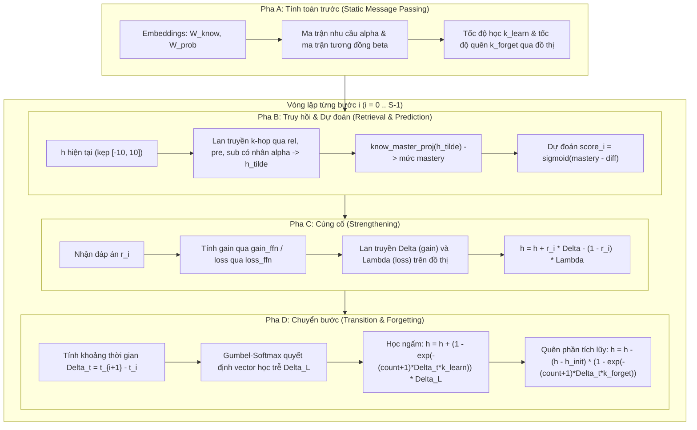

# Chi tiết Mã nguồn Module GRKT (Graph-based Retrieval-Knowledge Tracing)

Tài liệu này phân tích chi tiết toàn bộ mã nguồn của thư mục [`GRKT/`](file:///root/Knowledge-Tracing/GRKT), bao gồm mô hình **GRKT** (Cui et al., KDD 2024), cấu trúc 4 pha forward, cơ chế xây dựng đồ thị hai quan hệ ($rel\_map$ và $pre\_map$), động học học trễ và quên theo thời gian thực $\Delta t$, và danh mục 15 điểm rò rỉ dữ liệu cùng các nhược điểm trong mã nguồn upstream.

---

## 1. Bản đồ File và Vai trò từng Module

Mã nguồn trong `GRKT/` là bản đã được vendor hóa và sửa đổi có kiểm soát từ kho lưu trữ gốc của tác giả (`JJCui96/GRKT`):

| File | Vai trò | Các lớp / Hàm chính |
|---|---|---|
| [`GRKT/model/GRKT.py`](file:///root/Knowledge-Tracing/GRKT/model/GRKT.py) | Định nghĩa toàn bộ kiến trúc mô hình GRKT 4 pha. | [`GRKT`](file:///root/Knowledge-Tracing/GRKT/model/GRKT.py#L44), [`Positive_Linear`](file:///root/Knowledge-Tracing/GRKT/model/GRKT.py#L30), `positive_activate` |
| [`GRKT/BaseModel.py`](file:///root/Knowledge-Tracing/GRKT/BaseModel.py) | Khung sườn huấn luyện, tối ưu hóa và đánh giá. | `BaseModel`, `train_an_epoch`, `eval_an_epoch`, `fit`, `test`, `get_feed_dict` |
| [`GRKT/Runner.py`](file:///root/Knowledge-Tracing/GRKT/Runner.py) | Vòng lặp chia K-fold và huấn luyện upstream (⚠️ có rò rỉ người học). | `Runner.run` |
| [`GRKT/Training.py`](file:///root/Knowledge-Tracing/GRKT/Training.py) | Entry point dòng lệnh upstream (đã thêm registry và chặn dataset không hợp lệ). | `main()`, parser args |
| [`GRKT/metric.py`](file:///root/Knowledge-Tracing/GRKT/metric.py) | Tính toán các chỉ số đánh giá toàn cục. | `AUC`, `ACC` |
| [`GRKT/utils.py`](file:///root/Knowledge-Tracing/GRKT/utils.py) | Tiện ích chuyển đổi batch, đệm dữ liệu, tính geometric mean. | `feature2tensor`, `get_performance`, `reset_seed` |
| `GRKT/data/assist09/` | Xử lý dữ liệu ASSIST09 gốc. | `assist09_preprocess.py`, `assist09.bin` |

---

## 2. Định dạng Dữ liệu và Không gian Chỉ số

Khác hoàn toàn với GKT (0-based), trong GRKT:
- **Tất cả các định danh (ID) đều là 1-based**: Index **0** được dành riêng cho giá trị đệm (padding).
- Số khái niệm: $NK = \text{n\_knows} + 1$ (ví dụ: với ASSIST09 có 123 khái niệm thì tensor kích thước 124).
- Số câu hỏi: $NP = \text{n\_probs} + 1$.
- Chiều vector biểu diễn câu hỏi/khái niệm: $DH = \text{d\_hidden} = 128$.
- Chiều vector trạng thái thành thạo (mastery) của khái niệm: $KH = \text{k\_hidden} = 16$.

### 2.1 Cấu trúc mẫu tương tác
Trong tệp dữ liệu đóng gói `assist09.bin`, mỗi tương tác là một bộ 5 phần tử:
```python
(prob, knows, corr, timestamp, timelag)
```
- `prob`: ID câu hỏi (1-based integer).
- `knows`: Danh sách ID khái niệm tri thức liên kết (1-based list; với ASSIST09 là list 1 phần tử).
- `corr`: Kết quả làm bài (boolean / int: 0 hoặc 1).
- `timestamp`: Thời điểm làm bài (trong upstream là `order_id` thô).
- `timelag`: Thời gian phản hồi (`ms_first_response_time`, upstream không sử dụng trong forward).

### 2.2 Tensor trong Batch (`feed_dict`)
Hàm `BaseModel.get_feed_dict` và `utils.feature2tensor` tổ chức một batch kích thước $B$, độ dài chuỗi $S$:

| Key | Tensor Shape | Ý nghĩa | Padding |
|---|---|---|---|
| `probs` | $[B, S]$ | ID câu hỏi | 0 |
| `knows` | $[B, S, K]$ | ID các khái niệm tri thức của câu hỏi ($K=1$) | 0 |
| `corrs` | $[B, S]$ | Nhãn đúng (1) hoặc sai (0) | `False` / 0 |
| `times` | $[B, S]$ | Mốc thời gian làm bài | 0 |
| `filt` | $[B, S-1]$ | Mặt nạ lọc vị trí hợp lệ: `probs[:, 1:] > 0` | `False` |
| `labels` | $[N_{\text{valid}}]$ | Nhãn thực tế tại các vị trí hợp lệ: `corrs[:, 1:][filt]` | — |

---

## 3. Cấu trúc Đồ thị Hai Quan hệ: `rel_map` và `pre_map`

GRKT sử dụng hai đồ thị khái niệm có kích thước $[NK, NK]$:
1. `rel_map` (Relevance Graph): Quan hệ đồng xuất hiện tương đồng (thường làm cùng nhau và có cùng kết quả).
2. `pre_map` (Prerequisite Graph): Quan hệ tiên quyết (học khái niệm $i$ trước rồi mới làm đúng khái niệm $j$). Quan hệ ngược chiều là `sub_map = pre_map.T`.

### 3.1 Thuật toán thống kê 4 bộ đếm
Đối với mỗi người học, thuật toán duy trì hai vector lịch sử: $t[c]$ (số lần làm đúng khái niệm $c$) và $f[c]$ (số lần làm sai khái niệm $c$) tính đến trước bước hiện tại.

Khi học sinh làm câu hỏi thuộc khái niệm $k$ với kết quả $corr$:
```python
if corr:
    tt[:, k] += t;  tt[k, :] += t      # i đúng trước đó, k đúng bây giờ -> Cùng đúng
    ft[:, k] += f;  tf[k, :] += f      # i sai trước đó,  k đúng bây giờ -> Lật sai -> đúng
else:
    ff[:, k] += f;  ff[k, :] += f      # i sai trước đó,  k sai bây giờ  -> Cùng sai
    tf[:, k] += t;  ft[k, :] += t      # i đúng trước đó, k sai bây giờ  -> Lật đúng -> sai

# Cập nhật số lần tích lũy sau cùng
if corr:
    t[k] += 1
else:
    f[k] += 1
```

### 3.2 Công thức tính ma trận và lọc ngưỡng
$$\text{rel}[i, j] = \frac{tt[i, j] + ff[i, j]}{tt[i, j] + ff[i, j] + tf[i, j] + ft[i, j]}$$
$$\text{pre}[i, j] = \frac{ft[i, j]}{tf[i, j] + ft[i, j]}$$

- **Lọc lạnh (Cold threshold)**:
  - Cạnh `rel` chỉ được giữ nếu tổng số lần đồng xuất hiện $\ge 4 \times \text{cold\_thresh}$ (mặc định $\ge 20$).
  - Cạnh `pre` chỉ được giữ nếu số lần lật kết quả $\ge 2 \times \text{cold\_thresh}$ (mặc định $\ge 10$).
- **Nhị phân hóa (Binarization)**:
  Ma trận được đưa về dạng nhị phân $0/1$ qua ngưỡng: `rel_bin = (rel >= 0.6).astype(float)`. Toàn bộ đường chéo chính và hàng/cột padding 0 bị xóa về 0.

### 3.3 Trọng số lan truyền chuẩn hóa
Mô hình không nhân ma trận kề trực tiếp mà kết hợp với ma trận tương đồng học được $\beta \in \mathbb{R}^{NK \times NK}$:
$$\beta = \sigma(W_{\text{req}} W_{\text{know}}^T) \quad (\text{với } W_{\text{know}} = \text{know\_embedding.weight} \in \mathbb{R}^{NK \times DH})$$
$$\beta_{\text{rel}} = \frac{\beta \odot \text{rel\_map}}{\text{rowsum}(\text{rel\_map})}$$
Tương tự tính cho $\beta_{\text{pre}}$ và $\beta_{\text{sub}}$.

---

## 4. Kiến trúc và Lớp Cơ sở `Positive_Linear`

Trong [`GRKT/model/GRKT.py`](file:///root/Knowledge-Tracing/GRKT/model/GRKT.py#L30):
```python
class Positive_Linear(nn.Module):
    def __init__(self, d_in, d_out, mode):
        super(Positive_Linear, self).__init__()
        self.weight = nn.Parameter(torch.randn(d_in, d_out))
        self.mode = mode

    def forward(self, input_tensor):
        return input_tensor.matmul(positive_activate(self.mode, self.weight))
```
- Khi `mode = "softmax"`, ma trận trọng số luôn dương và tổng mỗi cột bằng 1.
- Mọi phép biến đổi trạng thái thành thạo trên đồ thị đều đảm bảo **không âm**, giữ cho giá trị mastery không bị đảo lộn dấu một cách vô lý.

Các tham số chính:
- `init_hidden`: Tham số học được $[NK, KH]$, là mức mastery khởi tạo của từng khái niệm (dùng chung cho mọi học sinh).
- `know_master_proj`: Chiếu từ vector $KH$ kênh thành 1 scalar mastery duy nhất.
- `prob_diff_mlp`: Dự đoán độ khó câu hỏi từ embedding câu hỏi và khái niệm.
- `gain_ffn` và `loss_ffn`: Ước lượng lượng kiến thức nhận thêm khi làm đúng / mất đi khi làm sai.
- `decision_mlp`: Mạng nơ-ron kết hợp lấy mẫu Gumbel-Softmax quyết định có kích hoạt cơ chế học trễ hay không.

---

## 5. Luồng Forward 4 Pha của GRKT

Mô hình duy trì trạng thái mastery của batch $h \in \mathbb{R}^{B \times NK \times KH}$, khởi tạo bằng cách sao chép `init_hidden`.



### Pha A — Tính toán trước (Precomputations)
Chạy một lần duy nhất trước vòng lặp thời gian:
1. **Ma trận nhu cầu của câu hỏi**:
   $$\alpha[b, s] = \sigma(W_{\text{req}} \cdot \text{prob\_emb}[p_{b, s}] \cdot W_{\text{know}}^T) \in \mathbb{R}^{B \times S \times NK}$$
   $\alpha[b, s, c]$ phản ánh mức độ mà câu hỏi tại bước $s$ đòi hỏi kiến thức về khái niệm $c$.
2. **Tốc độ học và quên**:
   Được suy luận từ cấu trúc đồ thị qua $k\_hop$ vòng truyền tin:
   $$k_{\text{learn}} = \text{softplus}(\text{MessagePassing}(W_{\text{know}}; \beta_{\text{rel}}, \beta_{\text{pre}}, \beta_{\text{sub}})) \times \text{alpha\_const}$$
   $$k_{\text{forget}} = \text{softplus}(\text{MessagePassing}(W_{\text{know}}; \beta_{\text{rel}}, \beta_{\text{pre}}, \beta_{\text{sub}})) \times \text{alpha\_const}$$
   *(Lưu ý: `alpha_const` là siêu tham số `--alpha=0.01`, phân biệt với ma trận nhu cầu $\alpha$).*

### Pha B — Truy hồi và Dự đoán (Retrieval & Prediction)
Tại bước $i$, với câu hỏi $p_i$ và các khái niệm liên quan $q_i$:
1. Lan truyền trạng thái $h$ qua đồ thị có điều kiện bởi nhu cầu $\alpha$:
   $$\tilde{h} = h + \sum_{\text{rel, pre, sub}} \beta \cdot (\text{Positive\_Linear}(h) \odot \alpha[:, i, :, \text{None}])$$
2. Tổng hợp mastery của các khái niệm trong câu hỏi:
   $$\text{master\_full} = \text{know\_master\_proj}(\tilde{h}) \in \mathbb{R}^{B \times NK}$$
   $$\text{master} = \frac{1}{|q_i|} \sum_{c \in q_i} \text{master\_full}[b, c]$$
3. Dự đoán xác suất làm đúng:
   $$\text{diff} = \text{MLP\_diff}([\text{know\_emb} \,\|\, \text{prob\_emb}])$$
   $$\text{score}_i = \sigma(\text{master} - \text{diff})$$
   *Điểm cốt tử: $\text{score}_i$ được tính toán hoàn toàn TRƯỚC khi mô hình biết kết quả $r_i$, loại bỏ triệt để khả năng rò rỉ nhãn tại bước hiện tại.*

### Pha C — Củng cố trạng thái (Strengthening)
Sau khi học sinh đưa ra câu trả lời $r_i \in \{0, 1\}$:
1. Tính lượng biến thiên trực tiếp cho từng khái niệm $c \in q_i$:
   $$\text{gain}_c = \text{gain\_ffn}([\text{embed} \,\|\, h[c]]) \in \mathbb{R}^{KH}$$
   $$\text{loss}_c = \text{loss\_ffn}([\text{embed} \,\|\, h[c]]) \in \mathbb{R}^{KH}$$
2. Lan truyền biến thiên sang các khái niệm láng giềng theo đồ thị $rel, pre, sub$ để tạo ra $\Delta$ (tổng gain) và $\Lambda$ (tổng loss).
3. Cập nhật trạng thái thành thạo:
   $$h \leftarrow h + r_i \cdot \Delta - (1 - r_i) \cdot \Lambda$$

### Pha D — Chuyển bước, Học trễ và Quên (Transition)
Chỉ thực hiện khi $i < S - 1$:
1. Ghép nối thông tin hai bước liên tiếp $z_i, z_{i+1}$ và trạng thái ẩn $h$:
   $$\text{decision} = \text{GumbelSoftmax}(\text{decision\_mlp}(\text{feat}), \tau, \text{hard}=\text{True})$$
   $$\text{learn} = \text{learn\_mlp}(\text{feat}) \odot \text{decision}$$
   Lan truyền biến thiên học trễ qua đồ thị để thu được $\Delta L \in \mathbb{R}^{B \times NK \times KH}$.
2. Tính khoảng cách thời gian giữa hai lượt làm bài:
   $$\Delta t = \text{clamp}(t_{i+1} - t_i, \min=0)$$
3. Động học học trễ (kiến thức ngấm dần theo thời gian):
   $$e_{\text{learn}} = \exp\left( - (count[c] + 1) \cdot \Delta t \cdot k_{\text{learn}}[c] \right)$$
   $$h \leftarrow h + (1 - e_{\text{learn}}) \odot \Delta L$$
4. Động học quên (chỉ quên phần gain đã tích lũy):
   $$e_{\text{forget}} = \exp\left( - (count[c] + 1) \cdot \Delta t \cdot k_{\text{forget}}[c] \right)$$
   $$\text{hist\_gain} = \text{clamp}(h - h_{\text{init}}, \min=0)$$
   $$h \leftarrow h - \text{hist\_gain} \odot (1 - e_{\text{forget}}) \quad \text{tại các khái niệm có } \Delta L = 0$$

---

## 6. Danh mục 15 Điểm Rò rỉ, Lỗi và Gotchas trong Upstream GRKT

| # | Vị trí code | Vấn đề trong Upstream GRKT | Mức độ | Hậu quả & Cách khắc phục trong `level2` |
|---|---|---|---|---|
| 1 | `Runner.py:36-52` | Chia K-Fold trên **các cửa sổ cắt 100 tương tác**, không chia theo người học. Tập valid lấy 10% cửa sổ cuối của train. | **Nghiêm trọng** (Rò rỉ dữ liệu) | Cùng một người học xuất hiện ở cả train và test (ở các cửa sổ khác nhau). Thổi phồng AUC thực nghiệm. `level2` loại bỏ hoàn toàn `Runner.py`, chia theo người học cố định seed 42. |
| 2 | `assist09_preprocess.py:58-92` | Đếm ma trận kề $rel\_map$ và $pre\_map$ trên **toàn bộ dữ liệu** (bao gồm cả test). | **Nghiêm trọng** (Rò rỉ cấu trúc) | Mô hình biết trước cấu trúc liên kết kỹ năng của tập kiểm thử. `level2/grkt_data.py` chỉ đếm trên tập train. |
| 3 | `assist09_preprocess.py:40`, `GRKT.py:502` | `times = order_id` (chênh lệch giữa 2 tương tác chỉ là 1) trong khi `--alpha=0.01`. | **Cao** | $\exp(-(n+1) \cdot 1 \cdot 0.01) \approx 0.99 \rightarrow 1 - e \approx 0.01$. Pha học trễ và quên gần như **không hoạt động**. `level2` đổi sang phút cộng dồn có chặn 240 phút. |
| 4 | `GRKT.py:508-509` | Cổng quên kiểm tra điều kiện `(total_learn == 0).all(-1, True)` — so sánh **chính xác bằng 0** sau hàm kích hoạt ReLU. | **Trung bình** | Do sai số dấu phẩy động của GPU, giá trị tensor hiếm khi bằng 0 tuyệt đối, khiến cơ chế quên gần như bị vô hiệu hóa. |
| 5 | `GRKT.py:472` | Phép toán `scatter(-2, total_know_index, learn_3)` bị trùng chỉ số khi câu hỏi hiện tại và câu kế tiếp cùng chung khái niệm tri thức ($K=1$). | **Trung bình** | Thao tác scatter trên CUDA sẽ thực hiện ghi đè (last-write-wins) thay vì cộng dồn, làm mất mát vector học của câu hỏi trước đó. |
| 6 | `GRKT.py:217-513` | Không dùng `pack_padded_sequence`; toàn bộ các bước padding của chuỗi ngắn trong batch vẫn chạy đủ cả 4 pha. | **Thấp** (Hiệu năng) | Gây lãng phí tài nguyên tính toán GPU đáng kể trên các chuỗi có độ dài chênh lệch lớn. |
| 7 | `GRKT.py:223-224` | `prob_embedding[0] = 0` $\rightarrow$ tại các vị trí padding, ma trận nhu cầu $\alpha = \sigma(0) = 0.5$ thay vì bằng 0. | **Thấp** | Trạng thái ẩn tại các bước padding vẫn nhận thông tin lan truyền dù sau đó bị mặt nạ `filt` loại bỏ khi tính loss. |
| 8 | `GRKT.py:77` | Khai báo `self.rel_matrix = nn.Linear(DH, DH)` nhưng **hoàn toàn không được gọi** trong hàm `forward`. | **Thấp** | Để lại 16.384 tham số chết (Dead parameters) không được cập nhật gradient. |
| 9 | `GRKT.py:53, 69` | Tham số `--pos_mode` nhận giá trị từ CLI nhưng trong code toàn bộ các lớp `Positive_Linear` đều bị gán cứng chế độ `"softmax"`. | **Thấp** | Cờ dòng lệnh vô tác dụng. |
| 10 | `BaseModel.py:53` | Xây dựng tensor `lags` trong batch nhưng mô hình GRKT không sử dụng giá trị này. | **Thấp** | Lãng phí bộ nhớ truyền tải dữ liệu giữa CPU và GPU. |
| 11 | `BaseModel.py:151-152` | Gán `best_model = deepcopy(self)` **ngay trước khi bắt đầu huấn luyện**. | **Trung bình** | Nếu mô hình không cải thiện được chỉ số ở bất kỳ epoch nào, mô hình được đem đi test sẽ là trọng số khởi tạo ngẫu nhiên. |
| 12 | `BaseModel.py:175` | Kiểm tra điều kiện dừng sớm `stop_counter == early_stop` (so sánh bằng tuyệt đối). | **Thấp** | Dễ gây lỗi vô hạn nếu luồng tăng biến đếm bị nhảy cóc qua giá trị ngưỡng. |
| 13 | `BaseModel.py:49-53` | Các tensor trong batch được chuyển device dựa trên `self.args.device` lưu cố định lúc khởi tạo. | **Thấp** | Lỗi lệch thiết bị nếu người dùng chuyển mô hình bằng `.to(device)` sau khi khởi tạo. |
| 14 | `assist09_preprocess.py:97-99` | Cắt chuỗi thành các cửa sổ 100 tương tác cố định, bỏ phần dư $< 10$. | **Trung bình** | Học sinh từ cửa sổ thứ 2 trở đi bị mất hoàn toàn lịch sử tích lũy từ cửa sổ trước. |
| 15 | `GRKT.py:497` | `history_gain = (h - h_init).clamp(0)` — cơ chế chỉ cho phép quên phần tri thức thặng dư dương. | — | Đây là chủ ý thiết kế của tác giả nhằm bảo vệ "tri thức nền" ban đầu không bị suy giảm dưới mức khởi điểm. |
