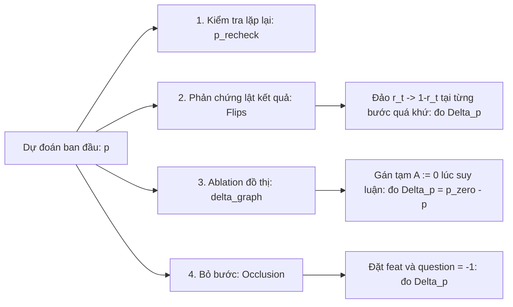

# Chi tiết Mã nguồn Module `level1/` (Wrapper & Pipeline Cấp độ 1)

Module [`level1/`](file:///root/Knowledge-Tracing/level1) đóng vai trò là tầng API điều phối thực nghiệm Cấp độ 1, bao bọc mã nguồn upstream [`GKT/`](file:///root/Knowledge-Tracing/GKT), sửa chữa triệt để các lỗi kỹ thuật cốt tử, bảo đảm tính tái lập khoa học và cung cấp các công cụ giải thích mô hình (xAI) cùng giao diện giám sát học sinh (Learner Dashboard).

---

## 1. Bản đồ File và Vai trò từng Module

| File | Vai trò | Các hàm / Lớp chính |
|---|---|---|
| [`level1/paths.py`](file:///root/Knowledge-Tracing/level1/paths.py) | Quản lý đường dẫn gốc repo và chèn `GKT/` vào `sys.path`. | [`repo_root`](file:///root/Knowledge-Tracing/level1/paths.py#L6), [`ensure_gkt_on_path`](file:///root/Knowledge-Tracing/level1/paths.py#L9) |
| [`level1/pipeline.py`](file:///root/Knowledge-Tracing/level1/pipeline.py) | Toàn bộ API nạp dữ liệu, chia tập, dựng mô hình, huấn luyện và đánh giá. | [`load_kt_data`](file:///root/Knowledge-Tracing/level1/pipeline.py#L40), [`save_split`](file:///root/Knowledge-Tracing/level1/pipeline.py#L94), [`build_model`](file:///root/Knowledge-Tracing/level1/pipeline.py#L105), [`train_one`](file:///root/Knowledge-Tracing/level1/pipeline.py#L184), [`evaluate`](file:///root/Knowledge-Tracing/level1/pipeline.py#L225), [`run_experiment`](file:///root/Knowledge-Tracing/level1/pipeline.py#L249), [`run_level1`](file:///root/Knowledge-Tracing/level1/pipeline.py#L386) |
| [`level1/explain.py`](file:///root/Knowledge-Tracing/level1/explain.py) | xAI: Thu thập 10 case study và tính toán bằng chứng phản chứng định lượng. | [`collect_cases`](file:///root/Knowledge-Tracing/level1/explain.py#L191), [`annotate_evidence`](file:///root/Knowledge-Tracing/level1/explain.py#L111), [`format_cases`](file:///root/Knowledge-Tracing/level1/explain.py#L354) |
| [`level1/dashboard.py`](file:///root/Knowledge-Tracing/level1/dashboard.py) | Xuất dữ liệu dashboard và biểu đồ trạng thái tri thức theo khái niệm. | [`export_learner_view`](file:///root/Knowledge-Tracing/level1/dashboard.py#L22), [`render_learner_view`](file:///root/Knowledge-Tracing/level1/dashboard.py#L92), [`interactive_learner_view`](file:///root/Knowledge-Tracing/level1/dashboard.py#L121) |
| `level1/gikt.py` | Bản port thử nghiệm mô hình GIKT (không nằm trên luồng chạy chính). | `run_gikt_experiment` (`NotImplementedError`) |

---

## 2. Cơ chế Import Upstream: `level1/paths.py`

Mã nguồn trong thư mục `GKT/` sử dụng kiểu import tuyệt đối (ví dụ: `from models import GKT`, `from processing import load_dataset`). Để gọi được các module này từ bất kỳ vị trí thực thi nào mà không làm thay đổi mã gốc:

```python
def ensure_gkt_on_path() -> Path:
    gkt_dir = repo_root() / "GKT"
    if str(gkt_dir) not in sys.path:
        sys.path.insert(0, str(gkt_dir))
    return gkt_dir
```
Hàm chèn thư mục `<repo_root>/GKT` lên đầu danh sách `sys.path`.
*(Lưu ý rủi ro: Điều này khiến các tên file `models.py`, `processing.py`, `metrics.py` của GKT trở thành tên module toàn cục. Do đó `GRKT/` và `level2/` được thiết kế dùng import tương đối để tránh xung đột tên).*

---

## 3. Quy trình Huấn luyện & Đánh giá Chuẩn: `level1/pipeline.py`

### 3.1 Nạp dữ liệu và Cố định Split (`load_kt_data`)
Hàm [`load_kt_data`](file:///root/Knowledge-Tracing/level1/pipeline.py#L40) bọc hàm `load_dataset` của GKT nhưng thiết lập các ràng buộc bảo vệ:
1. `resolve_data_file`: Tự động tìm kiếm file CSV trong thư mục hiện tại hoặc trong `GKT/data/`.
2. Phân chia tập người học bằng generator độc lập với `seed=42`:
   $$N_{\text{users}} \xrightarrow{60\%} \text{train}, \quad N_{\text{users}} \xrightarrow{20\%} \text{val}, \quad N_{\text{users}} \xrightarrow{20\%} \text{test}$$
3. Đồ thị `Transition` chỉ được tính toán dựa trên danh sách chỉ số của `train_dataset.indices`, ngăn ngừa tuyệt đối rò rỉ cạnh từ tập `val` và `test`.
4. Trả về cấu trúc **Bundle**:
   ```python
   {
       "concept_num": int,          # Ví dụ: 123
       "graph": torch.Tensor,        # Ma trận kề [C, C] hoặc None
       "train_loader": DataLoader,
       "val_loader": DataLoader,
       "test_loader": DataLoader,
       "data_path": str,
   }
   ```

Hàm [`save_split`](file:///root/Knowledge-Tracing/level1/pipeline.py#L94) lưu danh sách User ID của từng tập vào `split.json` phục vụ việc kiểm tra và đối chiếu.

### 3.2 Khắc phục lỗi kích thước One-Hot (`build_model`)
Hàm [`build_model`](file:///root/Knowledge-Tracing/level1/pipeline.py#L105) sửa lỗi nghiêm trọng số 1 của upstream GKT:
```python
if model_type == "DKT":
    return DKT(feature_dim=2 * concept_num, hidden_dim=hid_dim, output_dim=concept_num, ...)
elif model_type == "GKT":
    return GKT(
        concept_num, hid_dim, emb_dim, edge_types=edge_types,
        graph_type=graph_type, graph=graph,
        binary=True,  # BẮT BUỘC: sửa lỗi upstream để res_len = 2 thay vì 12
        has_cuda=device.type == "cuda",
    )
```
Việc truyền tường minh `binary=True` đảm bảo `emb_x` có kích thước chính xác là $2 \times C \times E$, tiết kiệm 6 lần dung lượng bộ nhớ GPU và số phép nhân ma trận so với upstream.

### 3.3 Vòng lặp Huấn luyện và Đánh giá Toàn cục
Trong [`train_one`](file:///root/Knowledge-Tracing/level1/pipeline.py#L184) và [`_epoch_loop`](file:///root/Knowledge-Tracing/level1/pipeline.py#L129):
1. **Gradient Clipping**: Áp dụng `clip_grad_norm_(model.parameters(), 10.0)` giúp ổn định gradient qua các chuỗi dài 200 bước của GRU.
2. **Early Stopping theo Val AUC toàn cục**:
   Khác với upstream dừng theo val loss hoặc tính trung bình batch AUC, `level1` gom toàn bộ nhãn thực và xác suất dự đoán của toàn bộ tập validation:
   ```python
   # real shape: [B, S-1], questions shape: [B, S-1]
   mask = (real != -1) & (questions[:, 1:] != -1)
   val_auc = roc_auc_score(all_labels[all_mask], all_preds[all_mask])
   ```
   Nếu sau `patience=5` epoch mà `val_auc` không cải thiện, dừng huấn luyện sớm.
3. **Lưu trữ CPU Snapshot an toàn**:
   Mỗi khi đạt đỉnh `val_auc` mới, mô hình lưu bản sao state dict trên CPU:
   `best_state = {k: v.detach().cpu().clone() for k, v in model.state_dict().items()}`
   Điều này ngăn chặn việc tràn VRAM do lưu trữ nhiều bản sao mô hình trên GPU. Khi kết thúc, nạp lại đúng trọng số tốt nhất này để đánh giá trên tập test.

---

## 4. xAI: Phản chứng và Bằng chứng Định lượng (`level1/explain.py`)

Module [`level1/explain.py`](file:///root/Knowledge-Tracing/level1/explain.py) chịu trách nhiệm cung cấp tính minh giải khoa học cho mô hình GKT thông qua 10 case study cụ thể:

### 4.1 Thuật toán chọn Case study (`collect_cases`)
Hàm [`collect_cases`](file:///root/Knowledge-Tracing/level1/explain.py#L191) duyệt qua toàn bộ tập kiểm thử `test_loader`:
1. Gom các dự đoán vào hai rổ: **Đúng** (`y_true == round(p)`) và **Sai** (`y_true != round(p)`).
2. Sắp xếp các mẫu theo độ tự tin giảm dần:
   $$\text{confidence} = |p - 0.5|$$
3. Chọn ra 5 ca đúng chắc chắn nhất và 5 ca sai ngạc nhiên nhất, kèm thuật toán tham lam ưu tiên các ca thuộc các khái niệm tri thức khác nhau để đa dạng hóa phân tích.

### 4.2 Tính toán Bằng chứng Thực nghiệm (`annotate_evidence`)
Với mỗi case được chọn, hàm [`annotate_evidence`](file:///root/Knowledge-Tracing/level1/explain.py#L111) thực hiện 4 phép đo định lượng có kiểm soát:



1. **Kiểm tra lặp lại (`p_recheck`)**: Chạy lại đúng batch chứa case đó trên GPU, kiểm tra $|p - p_{\text{recheck}}| < 0.02$ để loại trừ hoàn toàn lỗi lệch chỉ mục batch.
2. **Phản chứng lật kết quả (Counterfactual Flips)**:
   Lần lượt duyệt qua các tương tác trong quá khứ của học sinh đó. Tại bước $t < \text{target}$, lật kết quả của học sinh:
   $$\text{feature}_t = q_t \times 2 + (1 - r_t)$$
   Chạy forward lại mô hình và đo độ biến thiên: $\Delta p = p_{\text{new}} - p_{\text{orig}}$.
   Bước nào có $|\Delta p|$ lớn nhất chính là **tương tác có ảnh hưởng nhân quả mạnh nhất** tới dự đoán hiện tại.
3. **Ablation đồ thị tại ca dự đoán (`delta_graph`)**:
   Tạm thời gán ma trận kề của mô hình về 0: `model.graph.data = torch.zeros_like(...)`.
   Chạy forward và đo $\Delta p_{\text{graph}} = p_{A=0} - p$. Nếu $\Delta p_{\text{graph}} \approx 0$, điều này chứng minh dự đoán của học sinh tại bước đó hoàn toàn không phụ thuộc vào liên kết đồ thị mà chỉ dựa trên lịch sử bản thân (self-update).
4. **Bỏ hẳn một bước (Occlusion)**:
   Thay thế một tương tác quá khứ bằng giá trị padding $-1$, đo mức độ phụ thuộc vào sự tồn tại của bước đó.
5. **Trích xuất cạnh đồ thị liên quan**:
   Tìm 5 cạnh có trọng số lớn nhất trong ma trận $A$ kết nối với khái niệm mục tiêu (cả chiều đi vào và đi ra), ghi lại lịch sử học sinh đã từng tương tác với các khái niệm láng giềng này hay chưa.

---

## 5. Bảng Điều khiển Người học (`level1/dashboard.py`)

Module [`level1/dashboard.py`](file:///root/Knowledge-Tracing/level1/dashboard.py) hiện thực hóa tính năng theo dõi quá trình học tập:

### 5.1 Trích xuất Trạng thái Ẩn `state_norm`
Hàm [`export_learner_view`](file:///root/Knowledge-Tracing/level1/dashboard.py#L22) gọi forward mô hình với cờ `return_state=True`.
Tại mỗi bước $t$, mô hình GKT trả về ma trận ẩn $h_t \in \mathbb{R}^{B \times C \times H}$.
Hàm tính toán **chuẩn Frobenius theo từng khái niệm**:
$$\text{state\_norm}[c] = \| h_t[b, c] \|_2 = \sqrt{\sum_{k=1}^H (h_t[b, c, k])^2} \quad \forall c \in \{0, \dots, C-1\}$$
Vector `state_norm` (chiều $C$) biểu diễn độ lớn của vector ẩn tương ứng với từng khái niệm, đóng vai trò như một đại lượng đại diện (proxy) cho mức độ kích hoạt tri thức của học sinh.

### 5.2 Định dạng Tệp `learner_view.json`
Tệp xuất ra có cấu trúc mảng JSON, mỗi phần tử là một học sinh trong tập test:
```json
[
  {
    "user_id": 1284,
    "steps": [
      {
        "t": 0,
        "skill": 42,
        "skill_name": "Multiplication and Division",
        "y_true": 1,
        "y_prob": 0.7845,
        "y_pred": 1,
        "state_norm": [0.12, 0.05, 1.45, ...]
      }
    ]
  }
]
```
Giao diện widget tương tác [`interactive_learner_view`](file:///root/Knowledge-Tracing/level1/dashboard.py#L121) cho phép người dùng chọn học sinh qua Dropdown và vẽ đồ thị xác suất dự đoán $\hat{p}$ cùng đường cong biến thiên của `state_norm` theo thời gian.

---

## 6. Danh mục Sản phẩm (Artifacts) của Module Level 1

Khi chạy hoàn chỉnh pipeline qua `kaggle_level1_full.ipynb` hoặc `level1/pipeline.py`, các sản phẩm được tổ chức chuẩn hóa trong thư mục output:

| Tệp sản phẩm | Định dạng | Nội dung chi tiết |
|---|---|---|
| `split.json` | JSON | Danh sách các User ID được phân bổ vào tập train, val, test (chứng minh tính phân tách). |
| `leak_report.txt` | Text | Báo cáo chi tiết chứng minh đồ thị chỉ đếm từ train và nhãn dịch 1 bước. |
| `level1_metrics.csv` | CSV | Bảng tổng hợp các chỉ số test (AUC, ACC, NLL, Val AUC, Params, Time) tại seed 42. |
| `multiseed_metrics.csv` | CSV | Giá trị trung bình và độ lệch chuẩn ($\text{mean} \pm \text{std}$) qua 5 seed huấn luyện. |
| `paired_tests.csv` | CSV | Bảng kết quả kiểm định thống kê paired t-test, khoảng tin cậy Bootstrap 95%, và Cohen's $d_z$. |
| `graph_coverage.csv` | CSV | Tỉ lệ phần trăm các câu hỏi test có khái niệm đích thực sự có cạnh trên đồ thị Transition. |
| `graph_inference_ablation.csv`| CSV | Kết quả đo lường độ sụt giảm $\Delta \text{AUC}$ và $\text{mean}|\Delta p|$ khi gán $A := 0$ lúc suy luận. |
| `calibration.csv` | CSV | Các chỉ số hiệu chỉnh xác suất: Brier score, ECE, ACE, Over-prediction. |
| `cases.md` / `cases.json` | MD/JSON | 10 case study chi tiết kèm bằng chứng phản chứng lật bước và độ nhạy đồ thị. |
| `learner_view.json` | JSON | Dữ liệu chuỗi dự đoán và chuẩn trạng thái ẩn từng bước của học sinh. |
| `checkpoints/*.pt` | PyTorch | Toàn bộ trọng số mô hình đã huấn luyện (được đặt tên theo cấu hình và seed). |
| `runs_progress.json` | JSON | Sổ theo dõi tiến độ từng cặp (model, seed) phục vụ tính năng resume. |
| `report_summary.md` | Markdown | Báo cáo tự động tổng hợp toàn bộ bảng biểu và kết luận khoa học. |
