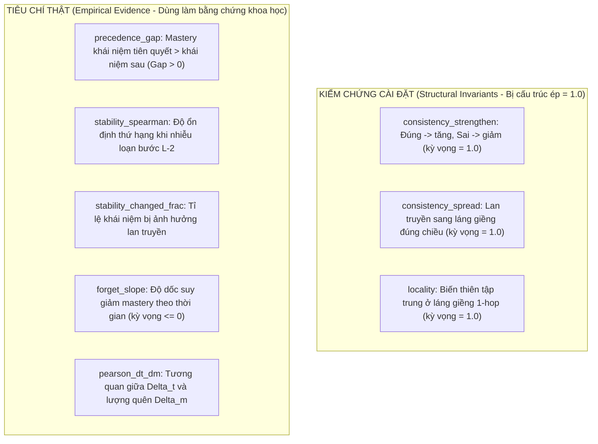

# Chi tiết Mã nguồn Module `level2/` (Pipeline & Quỹ đạo Tri thức Cấp độ 2)

Module [`level2/`](file:///root/Knowledge-Tracing/level2) là hệ thống điều phối toàn diện cho bài toán Knowledge Tracing trên nhiều tập dữ liệu (ASSISTments 2009 và Junyi Academy), tích hợp mô hình **GRKT** (KDD 2024), liên kết kiểm chứng với Cấp độ 1, phân tích quỹ đạo thành thạo $m(u, c, t)$, đo lường hiệu chỉnh xác suất và phòng chống rủi ro ngắt quãng phiên chạy 12 giờ trên Kaggle.

---

## 1. Bản đồ File và Vai trò từng Module

| File | Dòng | Vai trò kỹ thuật |
|---|---:|---|
| [`level2/dataset_spec.py`](file:///root/Knowledge-Tracing/level2/dataset_spec.py) | 1.086 | Hợp đồng 8 cột dữ liệu, chuẩn hóa dữ liệu theo mảnh (chunked processing), dò file Kaggle, hàng rào `.meta.json`. |
| [`level2/grkt_data.py`](file:///root/Knowledge-Tracing/level2/grkt_data.py) | 590 | Chuyển đổi sang định dạng chuỗi GRKT 1-based, kiểm tra đối chiếu từng người học (`_assert_align`), đếm $rel/pre$ chỉ từ train. |
| [`level2/grkt_api.py`](file:///root/Knowledge-Tracing/level2/grkt_api.py) | 756 | Thay thế `GRKT/Runner.py`: `train_grkt` hỗ trợ lưu checkpoint giữa epoch, fingerprint cấu hình, cơ chế ném `TrainingPaused`. |
| [`level2/baselines.py`](file:///root/Knowledge-Tracing/level2/baselines.py) | 688 | Chạy các mô hình đường nền DKT và GKT trên cùng split người học; truy nguyên nguồn gốc seed qua `checkpoint_seed`. |
| [`level2/trajectory.py`](file:///root/Knowledge-Tracing/level2/trajectory.py) | 897 | Ghi nhận quỹ đạo 3 mốc ($m_{\text{pre}}, m_{\text{tilde}}, m_{\text{strong}}$); tính tiêu chí thật và kiểm chứng cài đặt; xuất npz/CSV/PNG. |
| [`level2/calibration.py`](file:///root/Knowledge-Tracing/level2/calibration.py) | 173 | Đo lường hiệu chỉnh xác suất: ECE, ACE, Brier score và biểu đồ độ tin cậy Reliability Diagram. |
| [`level2/archive.py`](file:///root/Knowledge-Tracing/level2/archive.py) | 106 | Đóng gói zip tự chứa, luồng nền `PeriodicPackager` tự động sao lưu định kỳ chống mất phiên Kaggle. |
| [`level2/experiment.py`](file:///root/Knowledge-Tracing/level2/experiment.py) | 790 | Bộ điều phối 8 bước tuần tự cho từng dataset (`run_dataset`) và đa tập dữ liệu (`run_level2`). |

---

## 2. Hợp đồng Dữ liệu và Chuẩn hóa: `dataset_spec.py`

### 2.1 Hợp đồng 8 Cột Chuẩn (`CANONICAL_COLUMNS`)
Mọi tập dữ liệu thô (ASSISTments, Junyi, EdNet, v.v.) khi đưa vào hệ thống đều phải được quy chuẩn hóa về tệp CSV chứa đúng 8 cột:

| Cột | Kiểu | Ý nghĩa | Đối tượng sử dụng |
|---|---|---|---|
| `order_id` | `int` | Số thứ tự tương tác tuần tự sau khi sắp xếp thời gian. | Đối chiếu, kiểm toán dữ liệu. |
| `user_id` | `int` / `str` | Định danh học sinh. | Phân chia split, nhóm chuỗi (`groupby`). |
| `problem_id` | `int` / `str` | Định danh câu hỏi / bài tập. | GRKT `probs` embedding (1-based). |
| `skill_id` | `int` / `str` | Mã khái niệm tri thức (KC). | Chuyển đổi sang `knows` (1-based) và `skill` (0-based). |
| `skill_name` | `str` | Tên hiển thị của khái niệm. | Trực quan hóa dashboard, case study. |
| `correct` | `int` (0/1) | Kết quả làm bài (0: sai, 1: đúng). | Nhãn giám sát (`corrs`). |
| `ms_first_response` | `float` | Thời gian làm bài tính bằng mili-giây. | `time_mode="duration_ms"` (ASSIST09). |
| `timestamp_ms` | `int` | Mốc thời gian tuyệt đối (Unix epoch ms). | `time_mode="timestamp_ms"` (Junyi). |

### 2.2 Xử lý Dữ liệu Lớn theo Mảnh (`ensure_canonical`)
Tệp log gốc của Junyi (`Log_Problem.csv`) có quy mô ~16,2 triệu dòng (3 GB). Hàm [`ensure_canonical`](file:///root/Knowledge-Tracing/level2/dataset_spec.py#L664) giải quyết bài toán tràn RAM bằng kỹ thuật streaming:
1. Đọc từng mảnh `chunksize=2_000_000` dòng.
2. Mã hóa chuỗi định danh thành số nguyên ngay trong từng mảnh qua bộ nhớ tra cứu `_CodeMap`, giữ cho mức sử dụng RAM luôn dưới 3 GB.
3. **Quy tắc gán nhãn pyKT**: Nếu log không có cột nhãn trực tiếp mà chỉ có `count_attempts`: 1 lần thử $\rightarrow$ Đúng; $\ge 3$ lần $\rightarrow$ Sai; 2 lần $\rightarrow$ Bỏ qua (không xác định).
4. **Lọc top khái niệm (Transductive Concept Cap)**: Lọc giữ lại top 200 khái niệm phổ biến nhất (`top_concepts=200`) để khống chế kích thước đồ thị $A \in \mathbb{R}^{201 \times 201}$ vừa với dung lượng 15 GB VRAM của GPU Tesla T4.
5. **Lấy mẫu người học có seed (`subsample_seed=42`)**: Lấy mẫu tập con 3.000 học sinh (`MAX_USERS=3000`) sau khi đã lọc $\ge 10$ tương tác, đảm bảo thời gian chạy trong giới hạn 1 phiên Kaggle.

### 2.3 Hàng rào Bảo vệ `.meta.json`
Khi tạo file `canonical.csv`, hàm luôn ghi kèm một tệp `.meta.json` lưu trữ: `max_users`, `min_interactions`, `top_concepts`, `raw_file_hash`.
Nếu người dùng chạy smoke test (`MAX_USERS=300`), sau đó chạy bản đầy đủ (`MAX_USERS=3000`), hệ thống sẽ phát hiện sự không khớp tham số và ném lỗi `RuntimeError` ngay lập tức, ngăn chặn việc sử dụng nhầm tệp dữ liệu cũ đã được cache.

---

## 3. Dựng Chuỗi và Chống Rò rỉ: `grkt_data.py`

### 3.1 Dựng chuỗi và Đối chiếu Chặt chẽ (`_assert_align`)
Hàm [`build_grkt_data`](file:///root/Knowledge-Tracing/level2/grkt_data.py#L170) chuyển đổi dữ liệu chuẩn hóa sang cấu trúc chuỗi GRKT:
- `knows = [[skill + 1]]`: Khái niệm 1-based ($K=1$).
- `probs = [prob + 1]`: Câu hỏi 1-based.
- `times`: Tính toán thời gian tích lũy theo phút qua hàm `_cumulative_times`:
  $$\Delta t = \min\left(\frac{t_{i+1} - t_i}{60000}, \, 240\right)$$
  Việc chặn ở 240 phút ngăn ngừa hiện tượng underflow số mũ $\exp(-(count+1)\Delta t \cdot k)$ khiến mô hình quên sạch kiến thức chỉ sau một đêm không làm bài.

Hàm [`_assert_align`](file:///root/Knowledge-Tracing/level2/grkt_data.py#L297) so sánh từng học sinh giữa chuỗi của Cấp độ 2 với Bundle của Cấp độ 1:
```python
assert str(u2) == str(u1), f"Lệch user tại vị trí {idx}"
assert list(skills0) == list(q1_valid), f"Lệch chuỗi câu hỏi tại user {u2}"
assert list(corrs) == list(ans1_valid), f"Lệch chuỗi đáp án tại user {u2}"
```
Đảm bảo rằng dữ liệu học tập của từng học sinh ở cả hai cấp độ là **đồng nhất 100%**.

### 3.2 Đồ thị Hai Quan hệ Chỉ Xây từ Tập Huấn luyện
Hàm [`build_relevance_maps`](file:///root/Knowledge-Tracing/level2/grkt_data.py#L328) chỉ nhận danh sách chuỗi thuộc `train_sequences` để đếm 4 trạng thái $tt, tf, ft, ff$.
- `rel_map`: Đo mức độ đồng xuất hiện cùng kết quả.
- `pre_map`: Đo mức độ quan hệ tiên quyết (sai khái niệm $i$ rồi làm đúng khái niệm $j$).
- `leak_report.txt`: Tự động tính toán và xuất báo cáo kiểm tra:
  - Xác nhận $\text{train} \cap \text{val} = \text{train} \cap \text{test} = \text{val} \cap \text{test} = \emptyset$.
  - Đo lường số lượng cạnh sinh ra nếu dùng toàn bộ tập dữ liệu so với chỉ dùng tập train (chứng minh đồ thị không bị nhìn thấy tương lai).

---

## 4. Huấn luyện Bền vững & Checkpoint Fingerprint: `grkt_api.py`

### 4.1 Thay thế `Runner.py` bằng `train_grkt`
Upstream `GRKT/Runner.py` bị loại bỏ hoàn toàn vì hai lỗi lớn: chia k-fold trên cửa sổ cắt (rò rỉ người học) và `deepcopy(self)` gây tràn VRAM GPU.
Hàm [`train_grkt`](file:///root/Knowledge-Tracing/level2/grkt_api.py#L252) thay thế với các tính năng:
1. **Shuffle có kiểm soát**: `RandomState(seed * 1000 + epoch).permutation(n_items)`.
2. **Quản lý Hạn giờ (Deadline Management)**:
   Nếu `time.time() + 1.1 * epoch_time > deadline`, mô hình lập tức dừng vòng lặp, ghi checkpoint và ném ngoại lệ `TrainingPaused`.
3. **Resume chính xác tới từng Batch**:
   Lưu cả `epoch`, `batch_pos`, mảng hoán vị `order`, và các biến cộng dồn `loss_sum`. Khi phiên mới bắt đầu, mô hình chạy tiếp đúng vị trí batch đang dở của epoch trước đó.

### 4.2 Cấu trúc Fingerprint Chống Trộn Lần Chạy
Mỗi checkpoint được bảo vệ bởi một mã định danh cấu hình:
```python
fingerprint = {
    "dataset": "assist2009",
    "graph_kind": "train",
    "n_knows": 124,
    "n_probs": 26689,
    "n_train": 2330, "n_val": 776, "n_test": 778,
    "batch_size": 32, "d_hidden": 128, "k_hidden": 16,
    "k_hop": 1, "alpha": 0.01, "tau": 0.2, "thresh": 0.5,
    "seed": 42, "lr": 0.001,
    "edges_rel": 312, "edges_pre": 184,
}
```
Khi nạp lại checkpoint, nếu bất kỳ trường nào trong `fingerprint` bị sai lệch (ví dụ: thay đổi batch size hoặc nạp nhầm checkpoint của tập khác), hệ thống lập tức báo lỗi thay vì âm thầm trộn hai lần chạy.

---

## 5. Phân tích Quỹ đạo Tri thức $m(u, c, t)$: `trajectory.py`

Nhiệm vụ bắt buộc của Cấp độ 2 là theo dõi động học tiến trình học tập. Hàm [`record_trajectories`](file:///root/Knowledge-Tracing/level2/trajectory.py#L59) cài đặt các hook thu thập 3 mốc mastery tại mỗi bước $i$:
1. $m_{\text{pre}}[i]$: Mức độ thành thạo trước khi làm bài (dùng để dự đoán).
2. $m_{\text{tilde}}[i]$: Mức độ thành thạo sau khi truy xuất và lan truyền thông tin qua đồ thị.
3. $m_{\text{strong}}[i]$: Mức độ thành thạo sau khi được củng cố bởi kết quả đúng/sai.

Hai hiệu số phản ánh hai cơ chế cốt lõi:
- **Biến thiên do củng cố**: $\Delta m_{\text{strong}} = m_{\text{strong}}[i] - m_{\text{pre}}[i]$
- **Biến thiên do thời gian**: $\Delta m_{\text{time}} = m_{\text{pre}}[i+1] - m_{\text{strong}}[i]$

### Phân định Rõ ràng: Tiêu chí Thật vs. Kiểm chứng Cài đặt

Bảng tổng kết trong [`trajectory_metrics_table`](file:///root/Knowledge-Tracing/level2/trajectory.py#L540) phân tách rạch ròi hai nhóm chỉ số (đóng khoảng trống GAP F1):



1. **Kiểm chứng Cài đặt (Installation Checks)**:
   - `consistency_strengthen`, `consistency_spread`, `locality`: Do các trọng số trong `Positive_Linear` luôn dương (qua hàm `softmax`) và hàm lan truyền dùng `ReLU`, các giá trị này **luôn bằng 1.0 theo cấu trúc toán học**. Giá trị khác 1.0 là lỗi hook; bằng 1.0 **không chứng minh được** đồ thị mang lại giá trị thực nghiệm.
2. **Tiêu chí Thật (Real Empirical Criteria)**:
   - `precedence_gap`: Đo độ chênh lệch giữa mastery của khái niệm tiên quyết $c$ so với khái niệm phụ thuộc $d$ (khi làm đúng $d$). Giá trị $\text{gap} > 0$ chứng minh mô hình học được thứ tự tri thức logic.
   - `stability_spearman` & `stability_changed_frac`: Đảo nhãn đúng/sai tại bước áp chót ($L-2$), chạy lại forward và đo độ biến thiên thứ tự ở bước cuối. Mô hình có đồ thị (`train`) phải cho `stability_changed_frac` cao hơn mô hình cắt bỏ cạnh (`zero`), chứng minh tri thức lan tỏa theo cấu trúc mạng.
   - `forget_slope`: Hệ số hồi quy của lượng suy giảm tri thức theo khoảng cách thời gian $\Delta t$. Kỳ vọng $\le 0$ (càng lâu không học càng bị quên).

---

## 6. Hiệu chỉnh Xác suất: `level2/calibration.py`

Hàm [`calibration_table`](file:///root/Knowledge-Tracing/level2/calibration.py#L90) đánh giá độ tin cậy của xác suất dự đoán $\hat{p}$:
1. **Brier Score**: $\text{Brier} = \frac{1}{N} \sum_{i=1}^N (\hat{p}_i - y_i)^2$.
2. **Expected Calibration Error (ECE)**: Chia khoảng xác suất $[0, 1]$ thành $B=10$ ngăn bằng nhau:
   $$\text{ECE} = \sum_{b=1}^{10} \frac{|B_b|}{N} \left| \text{acc}(B_b) - \text{conf}(B_b) \right|$$
3. **Adaptive Calibration Error (ACE)**: Trung bình không trọng số của khoảng lệch trên từng ngăn, giúp phát hiện lệch ở các vùng xác suất thưa dữ liệu.
4. Xuất biểu đồ **Reliability Diagram** (`reliability.png`) đối chiếu đường cong dự đoán thực tế với đường chéo hoàn hảo $y = x$.

---

## 7. Cơ chế Chống Timeout 12 Giờ trên Kaggle: `level2/archive.py`

Kaggle tự động ngắt phiên chạy và có thể xóa toàn bộ `/kaggle/working` sau 12 giờ hoặc khi hết hạn mức GPU 30 giờ/tuần. Module `archive.py` thiết lập cơ chế bảo vệ 3 lớp:

1. **Luồng nền Đóng gói Định kỳ (`PeriodicPackager`)**:
   [`PeriodicPackager`](file:///root/Knowledge-Tracing/level2/archive.py#L60) khởi chạy một luồng độc lập (`threading.Thread`), cứ sau mỗi `PACK_EVERY_MIN=20` phút tự động nén toàn bộ thư mục output thành tệp zip.
2. **Ghi Nguyên tử (Atomic Write)**:
   Quá trình nén zip luôn ghi ra tệp tạm `.zip.part`, sau khi kiểm tra tính toàn vẹn bằng `zipfile.testzip()` mới gọi `os.replace` sang tệp đích. Nếu phiên chạy bị kill cứng bất ngờ, tệp zip hoàn chỉnh của chu kỳ trước vẫn được bảo toàn 100%.
3. **Quy tắc Lọc Dung lượng Thông minh**:
   - Tự động bỏ qua các tệp CSV tạm thời dung lượng lớn của Junyi (~1 GB).
   - Bảo lưu toàn bộ các tệp checkpoint `.pt` và `.npz` để phiên sau có thể resume ngay lập tức.
   - Chống tấn công Zip-Slip bằng cách kiểm tra đường dẫn an toàn trước khi giải nén.

---

## 8. Chuỗi Điều phối Toàn cục: `level2/experiment.py`

Hàm [`run_dataset`](file:///root/Knowledge-Tracing/level2/experiment.py#L92) thực hiện tuần tự 8 bước tiêu chuẩn cho một tập dữ liệu:

```
[B1] ensure_canonical -> load_kt_data -> save_split (seed 42)
  │
[B2] build_grkt_data -> _assert_align (so từng người với Level 1) -> split_sequences
  │
[B3] build_relevance_maps (chỉ train) -> graph_variant (train/zero) -> leak_report
  │
[B4] run_grkt_experiment -> train_grkt (checkpoint định kỳ, dừng theo deadline)
  │
[B5] level1_baseline -> train/load DKT, GKT-Transition, GKT-Zero trên cùng split
  │
[B6] record_trajectories -> tính tiêu chí thật, kiểm chứng cài đặt, xuất npz/heatmap
  │
[B7] calibration_table -> tính ECE, Brier, vẽ reliability diagram
  │
[B8] multi_seed -> huấn luyện 3 seed cho assist2009
```

Hàm [`run_level2`](file:///root/Knowledge-Tracing/level2/experiment.py#L527) điều phối nhiều tập dữ liệu (ASSIST09 và Junyi) dưới một ngân sách thời gian duy nhất (`time_budget_min`). Nếu tập đầu tiên tiêu tốn phần lớn thời gian, tập tiếp theo sẽ dừng an toàn và ném `TrainingPaused` trước khi vượt quá giới hạn phiên, cho phép người dùng tải zip về và tiếp tục ở phiên kế tiếp.
