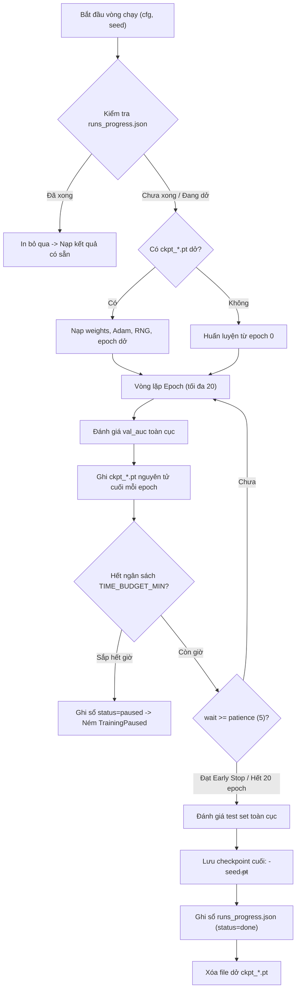

# Chi tiết Notebook Thực nghiệm `kaggle_level1_full.ipynb`

Tài liệu này phân tích chi tiết từng cell, cấu trúc thực nghiệm, cơ chế toán học và phương pháp kiểm định trong notebook [`kaggle_level1_full.ipynb`](file:///root/Knowledge-Tracing/kaggle_level1_full.ipynb) (Cấp độ 1 — Kiến trúc đồ thị Knowledge Tracing bản đầy đủ cho báo cáo).

---

## 1. Tổng quan Thiết kế và Mục tiêu

Notebook `kaggle_level1_full.ipynb` được thiết kế nhằm giải quyết triệt để toàn bộ các khoảng trống khoa học được ghi nhận trong `GAP_LEVEL1.md`:

| Mục tiêu thực nghiệm | Giải pháp trong `kaggle_level1_full.ipynb` |
|---|---|
| **Đa seed, split cố định** | Khởi chạy các cấu hình trong `TRAIN_MODELS` qua **5 seed** (`[42, 123, 456, 789, 1011]`) trên cùng một split người học (seed 42). |
| **Vai trò của cấu trúc đồ thị (E3)** | Kiểm định ghép cặp **Paired t-test + Bootstrap CI 95% + Cohen's $d_z$**; thực hiện **Ablation đồ thị lúc suy luận ($A := 0$)** và đo lường độ phủ đồ thị (`graph_coverage`). |
| **Bảo toàn bậc hàng (P1.8)** | Bổ sung biến thể `ShuffledRow`: hoán vị ngẫu nhiên đỉnh đích **trong từng hàng**, giữ nguyên bậc ra (out-degree) của từng khái niệm tri thức. |
| **xAI có bằng chứng định lượng (P1.6)** | Chọn 10 case study phân tầng theo độ tự tin, tính toán định lượng: phản chứng lật kết quả ($\Delta p_{\text{flip}}$), ablation đồ thị ($\Delta p_{\text{graph}}$), occlusion ($\Delta p_{\text{occ}}$), và chuẩn trạng thái ẩn $\|h_t\|_2$. |
| **Giám sát học sinh (D4)** | Giới hạn 25 học sinh kiểm thử, xuất `learner_view.json`, tóm tắt thống kê, vẽ biểu đồ song trục xác suất dự đoán $p$ và chuẩn tri thức $\|h_t\|$. |
| **Chống mất kết quả khi quá 12h** | Lưu checkpoint cuối mỗi epoch, ghi sổ tiến độ `runs_progress.json`, tự dừng theo ngân sách `TIME_BUDGET_MIN`, tự đóng gói zip, và hỗ trợ chế độ `EVAL_ONLY`. |

---

## 2. Phân tích Chi tiết Từng Phần (Section Walkthrough)

### §0. Khởi tạo Môi trường & Khôi phục Phiên chạy

#### Cell 0-02 & Cell 0-04: Thiết lập Repo và Môi trường
- Tự động phát hiện môi trường Kaggle (`/kaggle/working`), thực hiện `git clone --depth 1` từ kho chứa.
- Chèn thư mục gốc repo và `GKT/` vào đầu danh sách `sys.path`.
- **Nguyên tắc an toàn thư viện**: Kiểm tra danh sách thư viện (`numpy`, `pandas`, `scipy`, `sklearn`, `torch`, `matplotlib`, `tqdm`, `ipywidgets`), **tuyệt đối không chạy `pip install torch`** để tránh ghi đè bản PyTorch CUDA sẵn có của Kaggle bằng bản CPU.

#### Cell 0-06: Cấu hình Thực nghiệm
- `QUICK_RUN = False`: Sử dụng tệp dữ liệu đầy đủ `skill_builder_data.csv` (ASSISTments 2009).
- `SEEDS = [42, 123, 456, 789, 1011]`: 5 seed huấn luyện.
- `TRAIN_MODELS = ["DKT", "GKT-MHA"]`: Cấu hình mặc định gồm một baseline không đồ thị (DKT) và một mô hình đồ thị suy luận động (GKT-MHA) nhằm tối ưu thời gian GPU. (Đặt `TRAIN_MODELS = None` để chạy toàn bộ 8 cấu hình).
- `EPOCHS = 20`, `PATIENCE = 5`, `BATCH_SIZE = 32`, `MAX_SEQ_LEN = 200`, `LR = 1e-3`, `HID_DIM = 32`, `EMB_DIM = 32`.
- `TIME_BUDGET_MIN = 540`: 9 giờ (chừa 2 giờ an toàn cho các tác vụ xAI và nén zip).

#### Cell 0-06b: §0.3 Khôi phục Zip, Khoá Cấu hình và Tính Ngân sách
1. **Khôi phục từ Dataset**: Tự động dò tìm tệp `level1_output.zip` trong `/kaggle/input/`, giải nén có kiểm tra an toàn chống zip-slip (`..` hoặc đường dẫn tuyệt đối), bỏ qua các tệp đã có mtime mới hơn.
2. **Khoá cấu hình (`run_config.json`)**:
   Lưu hash SHA-256 của file dữ liệu, các siêu tham số `epochs`, `batch_size`, `seeds`, `model_names`. Nếu phát hiện phiên trước chạy cấu hình khác, mô hình ném lỗi `RuntimeError` để ngăn ngừa việc trộn lẫn hai thực nghiệm.
3. **Đồng hồ phiên Kaggle**:
   Đọc thời gian uptime từ `/proc/uptime` và `/proc/1/stat` của container Kaggle, tính toán chính xác số phút còn lại trước mốc 12 giờ và tự động hạ `TIME_BUDGET_MIN` nếu cần:
   $$\text{TIME\_BUDGET\_MIN} = \min(\text{TIME\_BUDGET\_MIN}, \, 720 - \text{elapsed\_min} - 45)$$
4. **Chế độ `EVAL_ONLY` (§0.4)**:
   Nếu đặt `EVAL_ONLY = True`, cell sẽ kiểm tra sự tồn tại của `runs_progress.json` cùng các tệp checkpoint seed 42 (`DKT.pt`, `GKT-MHA.pt`). Nếu đủ, notebook bỏ qua hoàn toàn bước huấn luyện ở §3 và chuyển thẳng sang đánh giá ở §4–§10.

---

### §1. Khám phá Dữ liệu (EDA)

#### Cell 1-08: Thống kê và Biểu đồ Chuỗi
- Tính toán hash SHA-256 của file `skill_builder_data.csv`.
- Thống kê: Số dòng (525.534), số học sinh (4.217), số khái niệm (123), tỉ lệ làm đúng (65.9%).
- Xuất tệp `dataset_stats.csv` và vẽ biểu đồ phân phối độ dài chuỗi tương tác `figures/eda_sequence_length.png`.

---

### §2. Chia Tập, Xây Đồ thị & Kiểm tra Chống Rò rỉ

#### Cell 2-10: Chia Split theo Người học
- Gọi [`load_kt_data`](file:///root/Knowledge-Tracing/level1/pipeline.py#L40) với `seed=42`, tỉ lệ 0.6 / 0.2 / 0.2.
- Lưu `split.json` và kiểm tra xác nhận tính phân tách tuyệt đối:
  $$\text{train} \cap \text{val} = \text{train} \cap \text{test} = \text{val} \cap \text{test} = \emptyset$$
- Xuất bảng tóm tắt số lượng học sinh và số tương tác `tables/split_summary.csv`.

#### Cell 2-12: Các Biến thể Đồ thị & Biến thể `ShuffledRow`
- Nạp các bundle đồ thị: `Transition`, `Dense`, `Identity`, `Zero`, `Shuffled`.
- **Hàm `row_degree_preserving_shuffle`**:
  ```python
  def row_degree_preserving_shuffle(graph, seed=42):
      # Hoán vị đích trong từng hàng, giữ nguyên out-degree của mỗi khái niệm
      for i in range(g.shape[0]):
          cols = np.nonzero(g[i])[0]
          if cols.size > 0:
              out[i, rng.permutation(cols)] = g[i, cols]
  ```
  Biến thể `ShuffledRow` phá hủy quan hệ chuyển tiếp ngữ nghĩa nhưng giữ nguyên bậc ra của từng kỹ năng, giúp kiểm định xem mô hình hưởng lợi từ cấu trúc cạnh thật hay chỉ nhờ mật độ liên kết.
- Xuất thống kê đồ thị `tables/graph_stats.csv`.

#### Cell 2-14: Đo lường Độ phủ Đồ thị và Báo cáo Chống Rò rỉ
- **Độ phủ đồ thị (`graph_coverage.csv`)**:
  Tính toán tỉ lệ phần trăm các câu hỏi trong tập kiểm thử mà khái niệm mục tiêu có cạnh đi ra ($\text{out-degree} > 0$), cạnh đi vào ($\text{in-degree} > 0$), hoặc ít nhất một cạnh trong đồ thị `Transition` xây từ train.
- **Kiểm tra rò rỉ chuyển tiếp**:
  Đối chiếu ma trận chuyển tiếp tập train với toàn bộ dữ liệu: Khối lượng chuyển tiếp chỉ xuất hiện ở tập kiểm thử chiếm tỉ lệ bao nhiêu và xác nhận các cạnh này hoàn toàn vắng mặt trong đồ thị huấn luyện.
- Xác nhận ngẫu nhiên trên 200 chuỗi: $\text{feature}_t = 2 \times \text{skill}_t + \text{correct}_t$.
- Ghi toàn bộ kết luận vào tệp [`leak_report.txt`](file:///root/Knowledge-Tracing/leak_report.txt).

---

### §3. Huấn luyện Đa Seed Bền vững & Sổ Tiến độ

#### Cell 3-16: Cơ chế `train_one_resumable`
Cell này điều phối quá trình huấn luyện $M$ cấu hình $\times$ 5 seed = $5M$ lượt chạy:



1. **Thứ tự ưu tiên**: Chạy toàn bộ cấu hình với `seed=42` trước tiên để có số liệu cho bảng chính và model cho §4–§8, sau đó mới chạy các seed 123, 456, 789, 1011.
2. **Checkpoint từng epoch**: Lưu tệp `checkpoints/ckpt_<model>-seed<s>.pt` gồm: `state_dict`, `optim`, `epoch`, `best_auc`, `best_state`, `history`, `rng` (bao gồm cả trạng thái RNG của CPU, CUDA, Numpy, Python).
3. **Sổ tiến độ `runs_progress.json`**:
   Cập nhật ngay lập tức sau mỗi lượt chạy thành công, lưu lại `test_auc`, `test_acc`, `test_loss`, `best_val_auc`, `n_params`, `elapsed_s`.
4. **Ngoại lệ `TrainingPaused`**:
   Khi chạm deadline, mô hình lưu trạng thái và ném ngoại lệ có kiểm soát. Khối `except` bắt ngoại lệ, tự động gọi `package_dir` nén tệp `level1_output.zip` trước khi phiên Kaggle kết thúc.

---

### §4. Bảng Kết quả, Đa Seed & Kiểm định Thống kê

#### Cell 4-18: Bảng Chính & Kiểm định Thống kê Ghép cặp
1. **Bảng chính (Seed 42)**: Xuất `level1_metrics.csv` và `tables/metrics.json`.
2. **Bảng đa seed**: Tính toán $\text{mean} \pm \text{std}$ của AUC, Accuracy và NLL trên 5 seed (`tables/multiseed_metrics.csv`).
3. **Kiểm định thống kê ghép cặp (`paired_test`)**:
   Với $n=5$ seed trên cùng một split, hàm thực hiện:
   - **Paired Student's t-test**: Tính $t$-statistic và $p$-value hai phía giữa mô hình $A$ và mô hình $B$.
   - **Khoảng tin cậy Bootstrap 95%**: Lấy mẫu lại 5.000 lần với hoàn lại trên vector độ chênh lệch $d = x_A - x_B$ để ước lượng phân phối $[2.5\%, 97.5\%]$.
   - **Kích thước ảnh hưởng Cohen's $d_z$**:
     $$d_z = \frac{\bar{d}}{s_d}$$
   Xuất bảng chi tiết vào `tables/paired_tests.csv`.

#### Cell 4-19: Biểu đồ Đường cong Học tập & So sánh
- Vẽ biểu đồ validation loss và validation AUC theo epoch (`figures/learning_curves.png`).
- Vẽ biểu đồ cột so sánh Test AUC và Test NLL kèm thanh sai số $\pm \text{std}$ (`figures/model_comparison.png`).

---

### §5. Hiệu chỉnh Xác suất (Probability Calibration)

#### Cell 5-21: Brier Score, ECE, ACE & Reliability Diagram
- Hàm `collect_predictions`: Thu thập nhãn thực $y$ và xác suất $\hat{p}$ trên toàn bộ test set với cùng mặt nạ hợp lệ.
- Hàm `ece_ace_brier`:
  - Chia xác suất vào 10 ngăn đều $[0.0, 0.1), \dots, [0.9, 1.0]$.
  - Tính toán **Brier Score**: $\frac{1}{N} \sum (\hat{p} - y)^2$.
  - Tính toán **ECE** (Expected Calibration Error) và **ACE** (Adaptive Calibration Error).
  - Tính toán độ lệch dự đoán thừa: $\text{Over-prediction} = \text{mean}(\hat{p}) - \text{mean}(y)$.
- Xuất dữ liệu vào `tables/calibration.csv` và `tables/calibration_bins.csv`.
- Vẽ biểu đồ độ tin cậy `figures/calibration_reliability.png`.

---

### §6. Ablation Đồ thị Lúc Suy luận ($A := 0$)

#### Cell 6-23: Phép thử Đóng góp Thực tế của Đồ thị
Đây là nội dung trả lời trực tiếp câu hỏi nghiên cứu **E3** trong `GAP_LEVEL1.md`:
1. Giữ nguyên trọng số đã học của mô hình đồ thị, tạm thời gán ma trận kề $A := 0$ khi suy luận trên test set qua hàm `predict_with_graph(..., zero_graph=True)`.
2. Đo lường:
   $$\Delta \text{AUC} = \text{AUC}(A := 0) - \text{AUC}(A \text{ gốc})$$
   $$\Delta \text{NLL} = \text{NLL}(A := 0) - \text{NLL}(A \text{ gốc})$$
   $$\text{mean}|\Delta p| = \frac{1}{N} \sum |p_{A:=0} - p|$$
3. Nếu $\text{mean}|\Delta p| \approx 0$ và $\Delta \text{AUC} \approx 0$, điều này chứng minh mô hình khi được huấn luyện xong **không phụ thuộc vào cạnh đồ thị** để đưa ra quyết định mà chỉ dựa vào cập nhật bản thân.
4. Xuất bảng `tables/graph_inference_ablation.csv`, vẽ biểu đồ `figures/graph_inference_ablation.png` và `figures/graph_coverage.png`.

---

### §7. Case Study: 10 Ca Dự đoán Kèm Bằng chứng Định lượng

#### Cell 7-25: Thu thập và Phân tích Phản chứng
1. Thu thập 5 ca dự đoán đúng và 5 ca dự đoán sai phân tầng theo độ tự tin $|p - 0.5|$.
2. Với mỗi ca, ghi nhận:
   - Lịch sử 8 bước gần nhất của học sinh và tỉ lệ đúng cùng kỹ năng.
   - 5 láng giềng mạnh nhất trên đồ thị `Transition`.
   - **Phản chứng lật bước (Flips)**: $\max |\Delta p|$ khi đảo nhãn 1 bước trong quá khứ.
   - **Ablation đồ thị tại ca**: $|\Delta p_{\text{graph}}|$ khi đặt $A := 0$.
   - **Occlusion**: $\max |\Delta p_{\text{occ}}|$ khi bỏ hẳn 1 bước tương tác.
   - **Chuẩn trạng thái ẩn $h_t$**: Độ lớn $\|h_t[q]\|_2$, thứ hạng của khái niệm mục tiêu trong toàn bộ $C$ khái niệm, và chuẩn của các láng giềng đồ thị.
3. Xuất tệp giải thích chi tiết [`cases.md`](file:///root/Knowledge-Tracing/cases.md), tệp dữ liệu `cases.json`, bảng tóm tắt `tables/case_study_summary.csv`, và biểu đồ so sánh mức độ ảnh hưởng nhân quả `figures/case_evidence.png`.

---

### §8. Dashboard Giám sát Học sinh

#### Cell 8-29: Xuất Dữ liệu và Biểu đồ Trực quan
- Gọi [`export_learner_view`](file:///root/Knowledge-Tracing/level1/dashboard.py#L22) trên mô hình đồ thị đại diện (`GKT-Transition` hoặc `GKT-MHA`), giới hạn tối đa `DASHBOARD_MAX_LEARNERS = 25` học sinh.
- Xuất tệp `learner_view.json`, bảng tóm tắt `tables/learner_view_summary.csv`, và tệp văn bản mẫu `learner_example.txt`.
- Vẽ biểu đồ song trục (`figures/learner_<user_id>.png`): Trục trái vẽ xác suất dự đoán đúng $\hat{p}$ (đánh dấu chấm tròn xanh khi thực tế đúng, dấu x đỏ khi thực tế sai); trục phải vẽ đường nét đứt biểu diễn chuẩn Frobenius $\|h_t\|_2$ của khái niệm chủ đạo.
- Hiển thị widget Dropdown tương tác `interactive_learner_view` để người dùng có thể duyệt từng học sinh ngay trong notebook.

---

### §9. Manifest Tái lập & Báo cáo Tự động

#### Cell 9-31: Sinh Tự động `report_summary.md`
- Đọc lại toàn bộ số liệu trực tiếp từ các tệp CSV trong `tables/` (không đọc từ biến trong RAM) để đảm bảo tính đồng nhất tuyệt đối giữa báo cáo và dữ liệu trên đĩa.
- Xuất `environment.txt` (nền tảng hệ điều hành, Python, PyTorch, CUDA, GPU).
- Xuất `run_manifest.json` (toàn bộ siêu tham số, commit Git, hash dữ liệu).
- Sinh tệp báo cáo tổng hợp [`report_summary.md`](file:///root/Knowledge-Tracing/report_summary.md) chứa:
  - Bản đối chiếu 14 yêu cầu và khoảng trống GAP.
  - Các bảng số liệu định dạng Markdown.
  - Các đoạn văn bản kết luận khoa học tự động được suy luận từ kết quả kiểm định.
  - Mục lưu ý trung thực về các giới hạn của mô hình trên tập dữ liệu ASSISTments 2009.

---

### §10. Đóng gói Kép và Hướng dẫn Tiếp tục Phiên chạy

#### Cell 10-33: Đóng gói Hai Tệp Zip
1. `level1_output.zip`: Chứa toàn bộ artifact gồm bảng biểu, hình vẽ, case study, dashboard, manifest, cùng thư mục `checkpoints/` (chứa trọng số của mọi run đã hoàn thành và file dở dang `ckpt_*.pt`). Tệp này dùng để lưu trữ đầy đủ và dùng để **Resume** hoặc chạy **`EVAL_ONLY`** ở phiên sau.
2. `level1_report_pack.zip`: Bản zip rút gọn chỉ chứa các file báo cáo Markdown, tệp JSON, CSV và hình ảnh PNG (không chứa các file trọng số `.pt` nặng), dùng để nộp bài hoặc gửi báo cáo nhanh.

#### §10.1: Quy trình 4 bước Resume sau 12 giờ
1. Khi phiên chạy chạm ngưỡng `TIME_BUDGET_MIN`, cell §3 tự động dừng và đóng gói `level1_output.zip`.
2. Tải `level1_output.zip` từ tab **Output** của Kaggle về máy.
3. Tạo một Kaggle Dataset mới (Private), tải tệp zip lên, và chọn **Add Input** vào notebook ở phiên mới.
4. Bấm **Run All**: Cell §0.3 tự động giải nén khôi phục các tệp; cell §3 tự động bỏ qua các run đã hoàn thành và tiếp tục huấn luyện đúng epoch đang dở của run trước đó.
