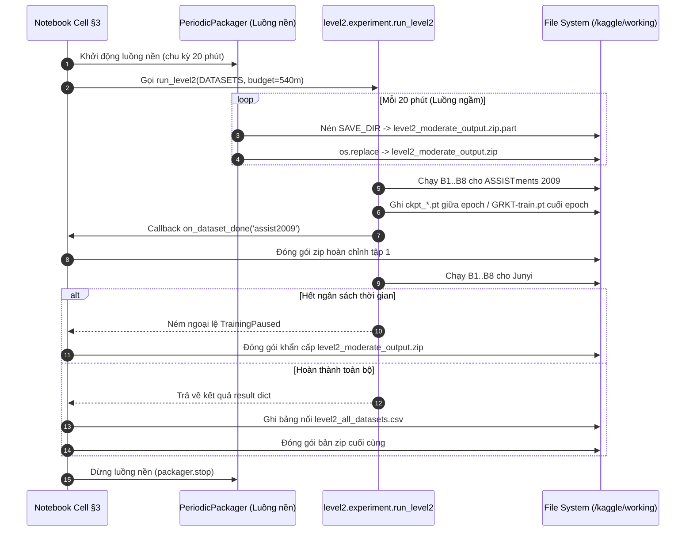

# Chi tiết Notebook Thực nghiệm `kaggle_level2_full.ipynb`

Tài liệu này phân tích chi tiết từng cell, cấu trúc thực nghiệm, cơ chế liên kết với Cấp độ 1, phân tích quỹ đạo thành thạo $m(u, c, t)$ và cơ chế phòng chống timeout 12 giờ trong notebook [`kaggle_level2_full.ipynb`](file:///root/Knowledge-Tracing/kaggle_level2_full.ipynb) (Cấp độ 2 — GRKT KDD 2024 với tập con Junyi vừa phải và liên kết Cấp độ 1).

---

## 1. Tổng quan Thiết kế và Mục tiêu

Notebook `kaggle_level2_full.ipynb` được viết lại hoàn toàn nhằm giải quyết dứt điểm các khoảng trống kỹ thuật được nêu trong `GAP_LEVEL2.md`:

| Mục tiêu thực nghiệm | Giải pháp trong `kaggle_level2_full.ipynb` |
|---|---|
| **Junyi tập con vừa phải (F3)** | Lấy mẫu tập con **3.000 học sinh** (`JUNYI_MAX_USERS=3000`) có seed 42 sau khi lọc $\ge 10$ tương tác và giữ 200 bài phổ biến, khống chế thời gian chạy trong 1 phiên Kaggle và báo cáo minh bạch. |
| **Liên kết Cấp độ 1 có kiểm chứng (F2)** | Sử dụng cùng seed split 42, cùng `max_seq_len=200`, cùng hàm `load_kt_data`. Đối chiếu tập người học với `outputs/level1/split.json`, kiểm tra dung sai AUC đường nền, và đo riêng checkpoint C1 cũ. |
| **Tiêu chí quỹ đạo thật (F1)** | Tách bạch hoàn toàn bảng **Tiêu chí thật** (`precedence_gap`, `stability_spearman`, `forget_slope`, `pearson_dt_dm`) khỏi các **Kiểm chứng cài đặt** bị cấu trúc ép $\equiv 1.0$. |
| **Ngân sách epoch công bằng (F4)** | GRKT và đường nền DKT/GKT cùng có trần 20 epoch (`EPOCHS=20`, `BASELINE_EPOCHS=20`) và cùng `patience=5`, ghi nhận số epoch thực tế. |
| **Theo dõi Provenance (F5)** | Bổ sung `run_config.json` (khoá cấu hình), `run_sessions.json` (nhật ký phiên và history), `environment.txt`, và vẽ learning curves thật. |
| **Dashboard Cấp độ 2 (F7)** | Xây dựng dashboard hoàn chỉnh ở §9 từ file `traj_train.npz` kết hợp dự đoán `predict_grkt`, xuất JSON, CSV tóm tắt, CSV chi tiết từng bước và biểu đồ song trục. |
| **Đóng gói định kỳ chống timeout 12h** | Khởi chạy luồng nền `PeriodicPackager` tự động nén `level2_moderate_output.zip` nguyên tử mỗi 20 phút trong suốt thời gian huấn luyện. |

---

## 2. Phân tích Chi tiết Từng Phần (Section Walkthrough)

### §0. Khởi tạo, Cấu hình Thực nghiệm & Kiểm soát Cấu hình

#### Cell 0-03 & Cell 0-04: Thiết lập Repo và Dọn dẹp Module
- Thực hiện `git clone` hoặc đồng bộ commit mới nhất từ nhánh `main`.
- Chèn repo root và `GKT/` vào `sys.path`.
- **Dọn dẹp `sys.modules`**: Tự động loại bỏ các module `level1`, `level2`, `GRKT`, `GKT` đã nạp trong bộ nhớ Python trước đó, đảm bảo khi chạy lại notebook từ giữa chừng vẫn luôn nhận mã nguồn mới nhất trên đĩa.
- Thử chạy `git lfs pull --include outputs/level1/*` để lấy bản thật của `split.json` phục vụ đối chiếu tập người học.
- Kiểm tra danh sách thư viện tuỳ chọn, chỉ cài đặt gói thực sự thiếu.

#### Cell 0-06: Cấu hình Thực nghiệm & Chặn Cấu hình Sai Sớm (P0 Check)
- `DATASETS = ["assist2009", "junyi"]` (khi `QUICK_RUN=False`).
- `JUNYI_MAX_USERS = 3000`: Tập con vừa phải cho Junyi; `JUNYI_TOP_CONCEPTS = 200`; `JUNYI_MIN_INTERACTIONS = 10`.
- `EPOCHS = 20`, `PATIENCE = 5`, `BASELINE_EPOCHS = 20`, `BATCH_SIZE = 32`, `MAX_SEQ_LEN = 200`, `SPLIT_SEED = 42`.
- `D_HIDDEN = 128`, `K_HIDDEN = 16`, `K_HOP = 1`, `ALPHA = 0.01`, `GAP_CAP_MIN = 240`.
- `VARIANTS_BY_DATASET = {"assist2009": ("train", "zero"), "junyi": ("train",)}`: Chạy ablation bỏ cạnh `zero` trên tập ASSIST09; Junyi chỉ chạy 1 biến thể `train` để tiết kiệm thời gian GPU.
- `MULTI_SEED_DATASETS = ("assist2009",)`: Chạy đa seed (3 seed) trên ASSIST09; Junyi chỉ chạy 1 seed.
- `TIME_BUDGET_MIN = 540`, `PACK_EVERY_MIN = 20`.
- **Khối P0 Check**: Kiểm tra tự động tính hợp lệ của cấu hình trước khi chạy: nếu `MAX_SEQ_LEN != 200` hoặc `SPLIT_SEED != 42` hoặc thiếu biến thể `zero` trên ASSIST09, notebook ném lỗi `RuntimeError` ngay lập tức để người dùng không lãng phí hàng giờ GPU với cấu hình sai.

#### Cell 0-08: §0.3 Khôi phục Zip, Cách ly Artifact Cũ và Khoá Cấu hình
1. **Khôi phục từ Zip**: Dò tìm `level2_moderate_output.zip` trong `/kaggle/input/`, giải nén các file nếu chưa tồn tại hoặc cũ hơn file trong zip.
2. **Cách ly artifact Junyi cũ (`_quarantine_junyi`)**:
   Nếu phát hiện thư mục `SAVE_DIR/junyi/` chứa các tệp từ lần chạy toàn bộ dữ liệu trước đó (ví dụ: `split.json` có số người $> 3600$), hàm tự động chuyển toàn bộ vào thư mục `junyi/stale_<timestamp>/` kèm tệp `QUARANTINE.json`. Điều này ngăn chặn việc trộn lẫn số liệu giữa bản toàn bộ và bản tập con.
3. **Khoá cấu hình (`run_config.json`)**:
   Lưu trữ toàn bộ cấu hình đã khoá. Nếu phát hiện resume với các tham số khác nhau, mô hình dừng lại và cảnh báo.
4. **Nhật ký phiên (`run_sessions.json`)**: Ghi nhận thời điểm bắt đầu phiên chạy và môi trường thực thi.

---

### §1. Cơ sở Thuật toán GRKT & 7 Sửa đổi So với Upstream

Trình bày ngắn gọn cơ chế 3 giai đoạn của GRKT (Truy xuất $\rightarrow$ Củng cố $\rightarrow$ Học/Quên theo thời gian thực) và bảng tổng kết 7 sửa đổi quan trọng mà repo đã thực hiện so với mã nguồn gốc upstream (import tương đối, bỏ Runner chia cửa sổ, đếm đồ thị chỉ từ train, đổi trục thời gian sang phút cộng dồn, kẹp ngưỡng nhị phân 0.5, hook thu thập quỹ đạo mastery, và registry mô hình an toàn).

---

### §2. Kiểm tra Dữ liệu & Chuẩn hóa CSV

#### Cell 2-11: Chuẩn hóa Canonical & EDA
1. Dò tìm file log gốc của Junyi (`Log_Problem.csv`) trong `/kaggle/input/`.
2. Đọc header thực tế của tệp thô để xác nhận cấu trúc cột.
3. Gọi [`ensure_canonical`](file:///root/Knowledge-Tracing/level2/dataset_spec.py#L664):
   - Đọc và xử lý theo mảnh 2.000.000 dòng.
   - Lọc giữ 200 bài phổ biến nhất (`top_concepts=200`).
   - Lấy mẫu đúng 3.000 học sinh có $\ge 10$ tương tác với seed 42.
   - Ghi tệp chuẩn hóa `junyi_canonical.csv` và metadata `junyi_canonical.csv.meta.json`.
4. In thống kê tương tác, số người học, số câu hỏi, tỉ lệ làm đúng, và vẽ biểu đồ phân phối số tương tác mỗi người cùng top 20 khái niệm thường gặp (`figures/eda_<dataset>.png`).

---

### §3. Chuỗi Thực nghiệm Điều phối Toàn cục: `run_level2`

#### Cell 3-13: Thực thi Huấn luyện Bền vững

1. **Khởi động `PeriodicPackager`**: Luồng nền chạy ngầm độc lập, cứ 20 phút lại ghi nguyên tử tệp `level2_moderate_output.zip.part` rồi đổi tên sang `.zip`. Nếu kernel bị Kaggle ngắt đột ngột giữa chừng, tổn thất tối đa chỉ là 20 phút huấn luyện.
2. **Kiểm tra `EVAL_ONLY`**: Nếu bật chế độ này, notebook kiểm tra đủ các file checkpoint `GRKT-train.pt`, `GRKT-zero.pt`, các seed 123/456, và checkpoint đường nền trong `baselines/`. Nếu đủ, hàm `run_level2` sẽ bỏ qua bước train và chuyển thẳng sang đánh giá.
3. **Thực thi `run_level2`**: Điều phối tuần tự các bước từ B1 đến B8 cho ASSIST09 và Junyi.
4. **Bắt ngoại lệ `TrainingPaused`**: Khi hết thời gian, mô hình lưu checkpoint và ném ngoại lệ có kiểm soát; cell bắt ngoại lệ và đóng gói zip trước khi dừng.
5. **Tái dựng bảng tổng hợp (`_rebuild_combined`)**: Đọc lại mọi tệp `level2_metrics.csv` hiện có trên đĩa, ghép thành `level2_all_datasets.csv`.

#### Cell 3-15: §3.1 Kiểm tra Sản phẩm Bắt buộc (P0 Checklist)
Duyệt qua các file trên đĩa để xác nhận:
- Có đủ dòng `graph=zero` trên ASSIST09 (P0-2).
- Mọi dòng đường nền đều có `seed` và `checkpoint_seed` (P0-4).
- Tệp `trajectory_metrics.csv` chứa đủ các cột tiêu chí thật (P0-1).
- Tệp `summary.json` của Junyi chứng minh quy mô người học $\le 3150$ (tập con).
- Tệp `multiseed_metrics.csv` có đủ $n_{\text{seed}} \ge 3$ (P0-3).

---

### §4. Provenance: Môi trường, Lịch sử Huấn luyện & Learning Curves

#### Cell 4-17: Xuất Provenance và Vẽ Đường cong Học tập
- Xuất tệp `environment.txt` (hệ điều hành, Python, PyTorch, GPU, Git HEAD).
- Trích xuất lịch sử huấn luyện từ các mô hình được huấn luyện trong phiên hiện tại:
  - Nếu mô hình được nạp từ checkpoint (resume/EVAL_ONLY), `history` để trống và `resumed_from` ghi rõ đường dẫn checkpoint cũ (không bịa lại đường cong học tập).
- Vẽ đường cong học tập thật (`figures/learning_curves_<dataset>.png`) gồm Validation AUC và Train/Val Loss theo epoch cho các mô hình có lịch sử $\ge 2$ epoch.
- Xuất tệp `run_provenance.json` và cập nhật tệp `run_sessions.json`.

---

### §5. So sánh Mô hình & Liên kết Kiểm chứng với Cấp độ 1

#### Cell 5-19: Bảng Kết quả So sánh và Đối chiếu Split
1. Hiển thị bảng so sánh chính `level2_all_datasets.csv` cho từng tập dữ liệu: Model, Graph, AUC, ACC, Loss, Val AUC, $N_{\text{test}}$, Seed, Checkpoint Seed, Seconds.
2. Vẽ biểu đồ cột so sánh Test AUC giữa DKT, GKT và GRKT (`figures/model_comparison.png`).
3. **Đối chiếu tập người học với Cấp độ 1**:
   Đọc tệp `outputs/level1/split.json` và `SAVE_DIR/assist2009/split.json`. So sánh danh sách User ID của từng tập:
   $$\text{Set}(U_{\text{train}}^{(1)}) \stackrel{?}{=} \text{Set}(U_{\text{train}}^{(2)}), \quad \text{Set}(U_{\text{val}}^{(1)}) \stackrel{?}{=} \text{Set}(U_{\text{val}}^{(2)}), \quad \text{Set}(U_{\text{test}}^{(1)}) \stackrel{?}{=} \text{Set}(U_{\text{test}}^{(2)})$$
   Xác nhận tính **trùng khớp hoàn toàn 100%**.
4. **Đối chiếu AUC đường nền**:
   So sánh kết quả DKT và GKT được huấn luyện lại trong Cấp độ 2 với kết quả đã công bố trong `level1_metrics.csv`:
   - Với DKT: Yêu cầu tái hiện $\text{AUC} \approx 0.7866 \pm 0.02$.
   - Độ chênh lệch nhỏ chứng minh rằng dữ liệu và cửa sổ chuỗi của hai cấp độ hoàn toàn tương đương nhau.
5. Ghi nhận toàn bộ bằng chứng vào tệp `diagnostics/level1_linkage.json`.

#### Cell 5-21: §5.2 Chẩn đoán Checkpoint Cấp độ 1 Đã Commit (GAP F2)
- Các tệp checkpoint `outputs/level1/*.pt` ban đầu được commit ngày 16/10/2026, trước khi repo bổ sung hậu tố `-seed{s}`.
- Cell này chỉ nạp và **đo lường trực tiếp** các checkpoint cũ này trên tập kiểm thử (không ghi đè, không train lại).
- Nếu checkpoint cũ không tái hiện được bảng số liệu seed 42 của Cấp độ 1 (do đã bị vòng đa seed ghi đè bằng seed 456), kết luận GAP F2 được xác nhận: Bảng chính Cấp độ 2 bắt buộc phải sử dụng đường nền được huấn luyện lại với seed 42. Kết quả xuất vào `diagnostics/legacy_ckpt_eval.csv`.

---

### §6. Quỹ đạo Mastery $m(u, c, t)$ và Tiêu chí Hợp lý

#### Cell 6-23: Phân tích Động học Tri thức
1. Nạp dữ liệu từ `trajectories/traj_<kind>.npz`.
2. Hiển thị bảng **Tiêu chí thật** (Empirical Evidence):
   - `precedence_gap`: Đo chênh lệch mastery của khái niệm tiên quyết so với khái niệm phụ thuộc. Giá trị dương chứng minh đồ thị tiên quyết hoạt động đúng logic.
   - `stability_spearman` & `stability_changed_frac`: Phản ánh mức độ lan truyền biến thiên khi nhiễu loạn bước $L-2$.
   - `forget_slope`: Độ dốc suy giảm tri thức theo thời gian $\Delta t$ (kỳ vọng $\le 0$).
   - `pearson_dt_dm`: Hệ số tương quan Pearson giữa khoảng cách thời gian và lượng suy giảm mastery.
3. Hiển thị bảng **Kiểm chứng cài đặt** (Installation Checks):
   - `consistency_strengthen`, `consistency_spread`, `locality` đều bằng 1.0 do cấu trúc toán học của mạng nơ-ron dương (`Positive_Linear` softmax).
4. Hiển thị bảng **Phân tách giai đoạn**:
   - `abs_delta_retrieval`: Độ biến thiên trung bình do truy xuất đồ thị gây ra.
   - `abs_delta_strengthen`: Độ biến thiên do kết quả làm bài đúng/sai.
   - `abs_delta_learn_forget`: Độ biến thiên do khoảng thời gian $\Delta t$.
5. **So sánh Ablation đồ thị**: Tính toán $\Delta \text{AUC} = \text{AUC}(\text{train}) - \text{AUC}(\text{zero})$ trên ASSIST09.
6. Hiển thị biểu đồ Heatmap biến thiên mastery theo thời gian (`trajectories/heatmap_<kind>.png`).

---

### §7. Hiệu chỉnh Xác suất (Probability Calibration)

#### Cell 7-25: Bảng Hiệu chỉnh & Biểu đồ Độ tin cậy
- Gọi kết quả từ `calibration.csv`: Đánh giá Brier score, ECE, ACE, và Over-prediction cho từng mô hình trên cả hai tập dữ liệu.
- Hiển thị biểu đồ độ tin cậy `reliability.png` đối chiếu đường cong xác suất với đường chéo hoàn hảo.

---

### §8. Đánh giá Đa Seed trên ASSISTments 2009

#### Cell 8-27: Tổng hợp Đa Seed GRKT
- Hiển thị kết quả 3 seed huấn luyện (`seed=42, 123, 456`) của GRKT trên tập dữ liệu ASSISTments 2009 từ tệp `multiseed_metrics.csv`.
- Tính toán giá trị trung bình mẫu và độ lệch chuẩn mẫu: $\text{mean} \pm \text{std}$ (với $\text{ddof}=1$).
- Vẽ biểu đồ cột Test AUC kèm thanh sai số $\pm \text{std}$ (`figures/multiseed_assist2009.png`).
- Ghi chú minh bạch: Junyi chỉ chạy 1 seed do giới hạn tài nguyên GPU, không giả lập số liệu đa seed.

---

### §9. Dashboard Giám sát Học sinh Cấp độ 2

#### Cell 9-29: Xây dựng Dashboard Hoàn chỉnh
Cell này giải quyết khoảng trống **GAP F7**, kết hợp dữ liệu mastery thô từ file numpy `.npz` và xác suất dự đoán từ hàm `predict_grkt`:
1. Duyệt qua các học sinh kiểm thử trong `traj_<kind>.npz`:
   - Trích xuất vector $m_{\text{pre}}[i]$ và $m_{\text{tilde}}[i]$.
   - Dự đoán xác suất $\hat{p}_i$ qua mô hình GRKT.
   - **Bằng chứng lịch sử**: Trích xuất tối đa 3 lần làm bài gần nhất của học sinh đối với chính khái niệm đó (ví dụ: `t2:đúng; t5:sai`).
   - **Mastery láng giềng 1-hop**: Tính trung bình mức mastery trước bước $i$ của toàn bộ các khái niệm có liên kết với câu hỏi hiện tại trên đồ thị kề `adj`.
2. Xuất dữ liệu:
   - `dashboard/learner_dashboard_summary.csv`: Thống kê tổng hợp từng học sinh (số bước, độ chính xác thực tế, xác suất trung bình, Brier score cá nhân, AUC cá nhân, mastery bước đầu vs bước cuối).
   - `dashboard/learner_dashboard_steps.csv`: Bảng chi tiết từng bước làm bài của học sinh.
   - `dashboard/learner_dashboard.json`: Tệp JSON có cấu trúc.
3. Vẽ biểu đồ song trục (`figures/dashboard_<dataset>.png`) minh họa 4 học sinh tiêu biểu: đường màu xanh vẽ xác suất dự đoán $\hat{p}$ (chấm xanh khi đúng, chấm đỏ khi sai); đường nét đứt màu vàng vẽ mức mastery trước bước làm bài $m_{\text{pre}}$.
4. Tích hợp widget Dropdown tương tác `ipywidgets` để chọn và xem dữ liệu từng học sinh.

---

### §10. Kiểm kê Sản phẩm & Đối chiếu Fingerprint Checkpoint

#### Cell 10-31: Kiểm kê Dung lượng & Fingerprint
1. Duyệt qua toàn bộ cây thư mục `SAVE_DIR`, tính dung lượng từng nhóm và xuất bảng kiểm kê `tables/artifacts.csv`.
2. Đọc payload của toàn bộ các checkpoint `GRKT-*.pt` và `ckpt_*.pt`:
   - Trích xuất thông tin `fingerprint`: `seed`, `n_train`, `n_test`, `batch_size`, `d_hidden`, `edges_rel`, `edges_pre`.
   - Xuất bảng trạng thái checkpoint `tables/checkpoint_status.csv`.
3. Đối chiếu tự động:
   - Xác nhận `seed` trong checkpoint khớp với seed ghi trên tên file (`SPLIT_SEED=42` hoặc các seed phụ 123, 456).
   - Xác nhận `n_train` của Junyi $\le 3600$ để chứng minh checkpoint không phải là tệp tồn dư của lần chạy toàn bộ dữ liệu.

---

### §11. Báo cáo Tự động `report_summary.md` Sinh từ Đĩa

#### Cell 11-33: Sinh Tự động Báo cáo Markdown
- Đọc lại toàn bộ số liệu trực tiếp từ các tệp CSV và JSON đã lưu trên đĩa (không dùng biến trong RAM).
- Sinh tệp báo cáo tổng hợp [`report_summary.md`](file:///root/Knowledge-Tracing/results/level2_moderate/report_summary.md) gồm:
  - Bảng cấu hình đã khoá `run_config.json`.
  - Quy mô dữ liệu và số cạnh đồ thị của từng tập.
  - Các bảng kết quả chính AUC / ACC / Loss.
  - Phân tích chi tiết tiêu chí quỹ đạo thật vs kiểm chứng cài đặt.
  - Bảng đối chiếu đầy đủ các yêu cầu §5–§8 và các khoảng trống F1–F7 kèm bằng chứng đọc từ đĩa.
  - Mục kết luận tự động và công bố minh bạch 6 giới hạn khoa học của nghiên cứu.

---

### §12. Đóng gói Kép Tự chứa

#### Cell 12-35: Nén Zip Phục vụ Báo cáo và Đánh giá lại
1. **`level2_moderate_output.zip`**:
   - Chứa toàn bộ artifact: trọng số mô hình `GRKT-*.pt`, các checkpoint đường nền `baselines/*.pt`, các tệp quỹ đạo `traj_*.npz`, và các tệp CSV chuẩn hóa `*_canonical.csv` kèm `.meta.json`.
   - Tệp này có tính chất **tự chứa (self-contained)**: Khi tải lên Kaggle để chạy ở chế độ `EVAL_ONLY = True`, người dùng **không cần phải đính kèm lại tệp dữ liệu thô Junyi 3 GB**, tiết kiệm hàng chục phút tiền xử lý dữ liệu.
2. **`level2_moderate_report_pack.zip`**:
   - Bản zip nhẹ loại bỏ toàn bộ các file `.pt`, `.npz` và CSV chuẩn hóa lớn (sử dụng danh sách bỏ qua `LIGHT_SKIP`), chỉ giữ lại bảng CSV, hình ảnh PNG và báo cáo Markdown để gửi báo cáo.
3. Xuất tệp văn bản hướng dẫn `README_pack.txt`.

---

### §13 & §14. Xử lý Sự cố Thường gặp & Checklist Sau Chạy

Bảng hướng dẫn chi tiết các tình huống thường gặp trên môi trường Kaggle:
- Cách khắc phục lỗi `FileNotFoundError` khi chưa Agree/Subscribe tập dữ liệu Junyi.
- Cách xử lý khi gặp ngoại lệ `RuntimeError: run_config.json khác cấu hình`.
- Hướng dẫn quy trình 4 bước khi cell §3 chạm mốc `TrainingPaused`: tải zip về, tạo Dataset Kaggle Private mới, Add Input và bấm Run All ở phiên tiếp theo để tiếp tục chạy chính xác từ batch đang dở.
- Danh mục kiểm tra đối chiếu bắt buộc trước khi trích dẫn số liệu vào bài báo hoặc báo cáo đề tài.
