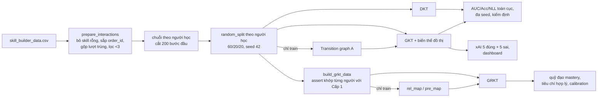

# Báo cáo kiến trúc mã nguồn — Knowledge Tracing trên đồ thị (Cấp độ 1 + 2)

> **Phạm vi:** mô tả *đúng như mã đang chạy* trên branch `fix/assist2009-leak-batchnorm`
> (gồm 4 commit sửa lỗi tiền xử lý/BatchNorm). Mọi con số kiến trúc dưới đây được đọc trực
> tiếp từ mã hoặc đo lại trên dữ liệu đã sửa; mỗi mục có đường dẫn tới file/dòng để tự kiểm.
>
> **Bản gốc dùng để đối chiếu:**
> - GKT: <https://github.com/jhljx/GKT> (bản PyTorch không chính thức của bài Nakagawa et al., WI 2019).
> - GRKT: <https://github.com/JJCui96/GRKT> (mã của tác giả, KDD 2024).
>
> So sánh "khác bản gốc" được làm bằng cách clone hai repo trên, chuẩn hoá định dạng cả hai
> phía bằng `black`, rồi `git diff` — nên phần khác biệt liệt kê ở §6 và §9 là khác biệt
> **logic**, không tính khác biệt định dạng.
>
> ✅ **Số liệu trong `results/` đã chạy lại trên dữ liệu sạch**: Cấp 1 ở commit `edef1b3`,
> Cấp 2 ở commit `8a875ea` (GRKT-train và GRKT-zero đều 3 seed). Bảng kết quả đầy đủ, cách đọc
> từng con số, mẫu dữ liệu thật và các điểm yếu đã biết nằm trong
> [ON_TAP_BAO_VE.md](ON_TAP_BAO_VE.md). File này tập trung vào kiến trúc.

---

## Mục lục

0. [Tóm tắt 1 trang](#0-tóm-tắt-1-trang)
1. [Bức tranh tổng thể](#1-bức-tranh-tổng-thể)
2. [Dữ liệu và tiền xử lý](#2-dữ-liệu-và-tiền-xử-lý)
3. [Đồ thị khái niệm của Cấp độ 1](#3-đồ-thị-khái-niệm-của-cấp-độ-1)
4. [GKT — kiến trúc chi tiết](#4-gkt--kiến-trúc-chi-tiết)
5. [DKT — baseline không đồ thị](#5-dkt--baseline-không-đồ-thị)
6. [GKT trong repo khác bản gốc thế nào](#6-gkt-trong-repo-khác-bản-gốc-thế-nào)
7. [Huấn luyện, đánh giá, đa seed, kiểm định](#7-huấn-luyện-đánh-giá-đa-seed-kiểm-định)
8. [GRKT — kiến trúc chi tiết (Cấp độ 2)](#8-grkt--kiến-trúc-chi-tiết-cấp-độ-2)
9. [GRKT trong repo khác bản gốc thế nào](#9-grkt-trong-repo-khác-bản-gốc-thế-nào)
10. [Giải thích (xAI) — 5 đúng + 5 sai](#10-giải-thích-xai--5-đúng--5-sai)
11. [Nhiệm vụ 2 — quỹ đạo tri thức và tiêu chí hợp lý](#11-nhiệm-vụ-2--quỹ-đạo-tri-thức-và-tiêu-chí-hợp-lý)
12. [Tổng hợp cải tiến so với bản gốc](#12-tổng-hợp-cải-tiến-so-với-bản-gốc)
13. [Hạn chế phải nói thật](#13-hạn-chế-phải-nói-thật)
14. [Bộ câu hỏi vấn đáp dự kiến](#14-bộ-câu-hỏi-vấn-đáp-dự-kiến)

---

## 0. Tóm tắt 1 trang

| Hạng mục | Nội dung |
|---|---|
| Bài toán | Nhánh A: dự đoán xác suất trả lời **đúng** câu kế tiếp, từ lịch sử (khái niệm, đúng/sai) |
| Dữ liệu | ASSISTments 2009 `skill_builder_data.csv` (Cấp 1 + 2); Junyi (tập con 3.000 người, Cấp 2) |
| Baseline không đồ thị | **DKT**: LSTM 1 tầng, hidden 32 |
| Mô hình đồ thị Cấp 1 | **GKT**: mỗi khái niệm có trạng thái ẩn riêng; mỗi bước thời gian lan truyền **1 hop** từ khái niệm vừa làm sang mọi khái niệm theo ma trận kề $A$, rồi erase–add gate + GRUCell |
| Ablation đồ thị | Transition (thật), Dense, Identity, Zero, Shuffled, ShuffledRow, MHA (đồ thị học bằng attention) |
| Mô hình ≥2024 Cấp 2 | **GRKT** (KDD 2024): 3 giai đoạn mỗi bước — *truy xuất* trên 3 đồ thị (rel/pre/sub) rồi *dự đoán* kiểu IRT → *củng cố* (gain/loss) → *học/quên* theo Δt |
| Chống rò rỉ | Chia theo **người học** (60/20/20, seed 42); đồ thị chỉ đếm từ **train**; sắp theo `order_id` + gộp lượt trùng (sửa trên branch này); nhãn dịch đúng 1 bước |
| Chỉ số | AUC, Accuracy, NLL/BCE (toàn cục trên cả tập test); Brier/ECE/ACE; mean ± std nhiều seed; paired t-test + CI |
| Điểm khác bản gốc lớn nhất | (1) sửa giao thức đánh giá của GRKT (bản gốc cắt cửa sổ 100 + k-fold làm cùng người học nằm ở train lẫn test, đồ thị đếm trên toàn bộ dữ liệu); (2) thêm ablation + kiểm định; (3) sửa lỗi BatchNorm/NaN/thiết bị; (4) hook ghi quỹ đạo mastery cho Nhiệm vụ 2; (5) sửa rò rỉ thứ tự/lượt trùng của ASSIST2009 |

---

## 1. Bức tranh tổng thể

### 1.1. Cấu trúc thư mục (chỉ phần chạy thật)

```
GKT/                 mã GKT + DKT (vendored từ jhljx/GKT, đã sửa)
  processing.py      đọc CSV -> chuỗi theo người học -> split -> đồ thị -> DataLoader
  models.py          class GKT, class DKT, MultiHeadAttention, VAE (VAE không dùng)
  layers.py          MLP (2 tầng + BatchNorm), EraseAddGate, ScaledDotProductAttention
  utils.py           build_dense/identity/zero/shuffled_graph
  metrics.py         KTLoss (NLL có mặt nạ)
GRKT/                mã GRKT (vendored từ JJCui96/GRKT, sửa tối thiểu)
  model/GRKT.py      class GRKT (toàn bộ mô hình)
level1/              API Cấp 1 mà notebook gọi
  pipeline.py        load_kt_data, build_model, train_one, evaluate, run_experiment
  explain.py         chọn 5 đúng + 5 sai, bằng chứng phản chứng
  dashboard.py       learner_view.json (chọn người học xem p, lịch sử, trạng thái)
level2/              API Cấp 2
  dataset_spec.py    mô tả/chuẩn hoá tập dữ liệu (ASSIST2009, Junyi)
  grkt_data.py       dựng chuỗi GRKT khớp Cấp 1, đếm rel/pre map từ train, leak report
  grkt_api.py        dựng/huấn luyện/đánh giá GRKT, resume
  baselines.py       DKT/GKT trên cùng split để so sánh
  trajectory.py      ghi quỹ đạo mastery + các tiêu chí hợp lý (Nhiệm vụ 2)
  calibration.py     Brier, ECE, ACE, reliability diagram
  experiment.py      run_level2: điều phối toàn bộ Cấp 2
kaggle_level1_full.ipynb / kaggle_level2_full.ipynb   notebook chạy trên Kaggle GPU
```

### 1.2. Luồng dữ liệu



Điểm thiết kế quan trọng: **Cấp 2 không tự chia dữ liệu lại**. `build_grkt_data`
([level2/grkt_data.py](../level2/grkt_data.py)) nhận đúng `bundle` của Cấp 1, chạy lại cùng
hàm làm sạch, và `_assert_align` kiểm tra **từng người học, từng khái niệm, từng nhãn** trùng
với Cấp 1. Vì vậy DKT, GKT, GRKT được so sánh trên cùng tập người học, cùng mục tiêu dự đoán.

---

## 2. Dữ liệu và tiền xử lý

### 2.1. ASSISTments 2009 (`skill_builder_data.csv`)

| Thông số | Giá trị (sau khi sửa) |
|---|---|
| Dòng gốc | 525.534 |
| Dòng có `skill_id` | 459.208 (bỏ 66.326 dòng không gắn kỹ năng) |
| Dòng sau khi gộp lượt trùng + lọc người < 3 lượt | 282.619 |
| Người học | 3.852 |
| Khái niệm (kỹ năng) | 112 |
| Câu hỏi (`problem_id`, chỉ GRKT dùng) | 17.737 |
| Độ dài chuỗi (sau cắt 200) | trung bình 51,5; trung vị 23; 323 người chạm trần 200 |
| Tỉ lệ đúng | 63,7% |
| Train / Val / Test (người học) | 2.311 / 770 / 771 |
| Số bước dự đoán (tổng 3 tập) | 194.492 |

### 2.2. Các bước trong `prepare_interactions` + `load_dataset` ([GKT/processing.py](../GKT/processing.py))

1. `dropna(skill_id)`.
2. **Sắp theo `order_id` trong từng người học** (giữ thứ tự xuất hiện của người học để split ổn
   định), tie-break theo `skill_id`.
3. **Giữ 1 dòng cho mỗi cặp `(user_id, order_id)`** — dòng có `skill_id` nhỏ nhất.
4. Bỏ người có < `min_seq_len = 3` lượt.
5. `pd.factorize(skill_id, sort=True)` → chỉ số khái niệm 0..C−1.
6. Mã hoá đầu vào: **`x_t = 2·skill_t + correct_t`** (one-hot 2C chiều: cùng khái niệm nhưng
   đúng/sai là hai "token" khác nhau).
7. Gom theo người học, **cắt 200 lượt đầu** (`max_seq_len=200`; phần sau bị bỏ, *không* cắt
   thành nhiều cửa sổ — khác pyKT).
8. `torch.utils.data.random_split` với `Generator().manual_seed(42)` → 60/20/20 **theo người học**.
9. DataLoader: train `shuffle=True`, val/test `shuffle=False`; padding `-1`; batch 32.

### 2.3. Vì sao phải sửa bước 2–3 (rò rỉ dữ liệu)

File gốc **xếp theo kỹ năng, không theo thời gian**, và câu gắn k kỹ năng được lưu thành k
dòng cùng `order_id`. Đo trên mã cũ (trước branch này):

| Triệu chứng | Mã cũ | Mã mới |
|---|---|---|
| Người học có thứ tự trong file khác thời gian | 2.893 / 4.163 | đã sắp lại |
| Bước dự đoán có **tương tác tương lai** trong lịch sử | **70,6%** | 0 |
| Bước dự đoán là **bản sao** của lượt ngay trước (cùng lượt làm bài, cùng nhãn) | **8,9%** | 0 |

Cả hai đều vi phạm §6 của đề ("chỉ dùng các tương tác trước thời điểm cần dự đoán"). Bản
GRKT gốc thì *có* sắp theo `order_id` (nó dùng file `assistments_2009_2010.csv` với cột
`list_skills`), nên đây là lỗi do repo tự đưa vào khi chuyển sang `skill_builder_data.csv`.
Leak report của cả hai cấp giờ có thêm dòng đếm hai triệu chứng này và notebook Cấp 1 `assert`
chúng bằng 0.

176.103 dòng bị bỏ ở bước 3 gồm **121.207 dòng lặp y hệt** (cùng người, cùng lượt, cùng kỹ
năng) và **54.896 dòng kỹ năng phụ** của câu nhiều kỹ năng — không chỉ "câu nhiều kỹ năng".

**Đánh đổi:** giữ 1 kỹ năng mỗi lượt làm mất 11 khái niệm chỉ xuất hiện như kỹ năng "phụ"
(123 → 112; ví dụ Slope, Linear Equations, Intercept, Mode). Muốn giữ đủ phải dùng Q-matrix đa khái niệm — GKT không hỗ trợ, GRKT thì có
(`knows` là danh sách) nhưng `build_grkt_data` hiện chỉ cho `max_concepts=1`.

### 2.4. Junyi (chỉ Cấp 2) — [level2/dataset_spec.py](../level2/dataset_spec.py)

- Khái niệm = cột bài tập (`ucid`/`exercise`), câu hỏi = `upid`; sắp theo
  `(user_id, timestamp_ms)` (đúng thời gian thật), `order_id` được gán lại tăng dần.
- Giữ **200 khái niệm phổ biến nhất** (để vừa VRAM T4, vì GRKT giữ trạng thái `[B, K+1, 16]`
  cho mọi khái niệm ở mọi bước và hai ma trận `(K+1)²`).
- Lấy mẫu **3.000 người học** (seed 42), lọc ≥ 10 lượt.
- **Hạn chế:** top-200 được chọn trên **toàn bộ log** (transductive); số Junyi chỉ đại diện
  cho tập con 4,1% người học.

---

## 3. Đồ thị khái niệm của Cấp độ 1

Mọi đồ thị là ma trận $A \in \mathbb{R}^{C\times C}$ cố định (`requires_grad=False`,
[GKT/models.py](../GKT/models.py) dòng ~56).

| Tên | Cách dựng | Ý nghĩa ablation |
|---|---|---|
| **Transition** | đếm $n(i\to j)$ = số lần khái niệm $j$ đi **ngay sau** $i$ trong chuỗi của người học **thuộc tập train**; bỏ đường chéo; chuẩn hoá hàng: $A_{ij}=n(i\to j)/\sum_j n(i\to j)$ | đồ thị "thật" |
| **Dense** | $A_{ij}=1/(C-1)$ với $i\ne j$ | có cạnh nhưng không có cấu trúc |
| **Identity** | $A=I$ | chỉ self-loop |
| **Zero** | $A=0$ | bỏ mọi cạnh |
| **Shuffled** | giữ nguyên tập hàng và giá trị khác 0 của Transition, **hoán vị toàn cục** chỉ số cột, chuẩn hoá lại | phá cấu trúc, giữ số cạnh (≈) |
| **ShuffledRow** | xáo cột **trong từng hàng** (định nghĩa trong notebook) | phá cấu trúc, giữ đúng out-degree từng đỉnh |
| **MHA** | không có $A$ cố định; attention giữa embedding khái niệm vừa làm và mọi khái niệm (§4.6) | đồ thị học được |

Thống kê Transition **sau khi sửa dữ liệu** (đo lại): 112 đỉnh, **2.665 cạnh** (mật độ 21,4%),
108 hàng có cạnh ra, out-degree trung bình 23,8. Lưu ý **76,6% bước chuyển trong train là cùng
một kỹ năng** (đường chéo, bị bỏ) — tức chỉ ~23% bước có thông tin "khái niệm A → khái niệm B".
(Trước khi sửa, đồ thị chỉ có 884 cạnh vì file xếp theo kỹ năng nên gần như không có chuyển
tiếp giữa các kỹ năng.)

**Vì sao Identity ≡ Zero trong GKT?** Ở bước gộp láng giềng (§4.3), vị trí của *chính khái niệm
đang làm* luôn bị ghi đè bằng `f_self(...)` (dòng `m_next[...].index_put(self_index_tuple,
self_features)`). Đường chéo $A_{ii}$ chỉ tác động lên đúng vị trí đó → bị ghi đè → Identity
và Zero cho **cùng một hàm số**. Số liệu cũ trùng đến 4 chữ số là bằng chứng.

---

## 4. GKT — kiến trúc chi tiết

Tài liệu gốc: Nakagawa, Iwasawa, Matsuo, *Graph-based Knowledge Tracing: Modeling Student
Proficiency Using Graph Neural Network*, IEEE/WIC/ACM WI 2019. Mã: [GKT/models.py](../GKT/models.py).

### 4.1. Siêu tham số thực tế

| Tham số | Giá trị | Ở đâu |
|---|---|---|
| `concept_num` C | 112 (ASSIST2009 sau sửa) | dữ liệu |
| `hidden_dim` (trạng thái mỗi khái niệm) | 32 | `level1/pipeline.build_model` |
| `embedding_dim` | 32 | như trên |
| `edge_type_num` | 2 (đồ thị tĩnh: chiều ra + chiều vào; MHA: 2 head) | như trên |
| `binary` / `res_len` | True / 2 | → `emb_x` có 2C dòng |
| dropout | 0.0 | |
| Số tham số huấn luyện | **33.073** (đồ thị tĩnh), **37.169** (MHA) | đo lại với C=112 |

### 4.2. Trạng thái

Mỗi người học có một **ma trận trạng thái** $H_t \in \mathbb{R}^{C\times 32}$: mỗi khái niệm
một vector 32 chiều. Khởi tạo $H_0 = 0$.

### 4.3. Một bước thời gian $t$ (vòng `for i in range(seq_len)` trong `forward`)

Số vòng lặp thời gian = độ dài chuỗi dài nhất trong batch (≤ 200). **Mỗi bước có đúng 1 lần
lan truyền 1-hop** — GKT *không* xếp chồng nhiều tầng GNN. Gọi $i = q_t$ là khái niệm vừa làm.

**(a) Aggregate** (`_aggregate`): ghép trạng thái với embedding

$$
\tilde h_c =
\begin{cases}
[\,h_i \,\|\, E_x(x_t)\,] & c = i \quad (E_x\text{: embedding của } 2i+\text{đúng/sai})\\
[\,h_c \,\|\, E_c(c)\,] & c \ne i \quad (E_c\text{: embedding khái niệm})
\end{cases}
\qquad \tilde h_c \in \mathbb{R}^{64}
$$

**(b) Gộp láng giềng — "hàm aggregation trong graph"** (`_agg_neighbors`):

$$
m_i = f_{\text{self}}(\tilde h_i)
$$
$$
m_j = A_{ij}\, f_{\text{out}}\big([\tilde h_i \,\|\, \tilde h_j]\big) + A_{ji}\, f_{\text{in}}\big([\tilde h_i \,\|\, \tilde h_j]\big), \quad j\ne i
$$

- $f_{\text{self}}, f_{\text{out}}, f_{\text{in}}$: mỗi cái là **MLP 2 tầng** (Linear → ReLU →
  Linear → ReLU → BatchNorm1d), đầu ra 32 chiều ([GKT/layers.py](../GKT/layers.py) `MLP`).
- **Kiểu gộp**: *tổng có trọng số theo cạnh* (không phải mean, không phải attention, không phải
  max). Thực chất mỗi khái niệm $j$ chỉ nhận **một** thông điệp — từ khái niệm vừa làm $i$ —
  với trọng số $A_{ij}$ (cạnh ra) và $A_{ji}$ (cạnh vào). Không có thông điệp giữa hai khái
  niệm không được làm ở bước này → đây là lan truyền **hình sao từ $i$**, đúng 1 hop.
- Hai hướng cạnh dùng hai MLP riêng ($f_{\text{out}}$, $f_{\text{in}}$) — đó là lý do
  `edge_type_num = 2`.

**(c) Erase–add gate** (`EraseAddGate`), áp lên **mọi** khái niệm:

$$
e_c=\sigma(W_e m_c+b_e),\quad a_c=\tanh(W_a m_c+b_a),\quad
m'_c = m_c - w_c\, e_c\odot m_c + w_c\, a_c
$$

$w_c$ là một vô hướng học được **cho mỗi khái niệm** (vector `weight` dài C).

**(d) GRU** (`nn.GRUCell(32, 32)`), áp lên **mọi** khái niệm:

$$
h_c^{(t+1)} = \text{GRU}(m'_c,\ h_c^{(t)})
$$

**(e) Dự đoán** (`_predict` + `_get_next_pred`):

$$
\hat y_c = \sigma(w^\top h_c^{(t+1)} + b)\ \ \forall c,\qquad
\hat p_{t+1} = \hat y_{q_{t+1}}
$$

Chỉ **danh tính** khái niệm kế tiếp $q_{t+1}$ được dùng để chọn đầu ra — không dùng nhãn
$r_{t+1}$. Đầu ra là xác suất cho bước $t+1$; chuỗi dài $T$ cho $T-1$ dự đoán.

### 4.4. Hệ quả quan trọng (hay bị hỏi)

1. **Đồ thị Zero vẫn cập nhật mọi khái niệm.** Với $A=0$, $m_j=0$ nhưng erase–add gate cho
   $m'_j = w_j\tanh(b_a)\ne 0$ và GRU vẫn chạy trên $h_j$ → trạng thái mọi khái niệm vẫn trôi
   theo thời gian (giống một nhịp "đồng hồ" chung). Vì vậy GKT-Zero **không** phải "mỗi khái
   niệm độc lập hoàn toàn" và có thể học được nhiều tín hiệu toàn cục — một lý do Transition
   khó vượt Zero.
2. **Chỉ khái niệm vừa làm gửi thông điệp**, nên đồ thị chỉ ảnh hưởng đến khái niệm $j$ khi
   $A_{q_t j}$ hoặc $A_{j q_t}$ khác 0.
3. **Độ phức tạp mỗi bước**: $O(B\cdot C\cdot d)$ cho MLP láng giềng (tính cho mọi $j$ kể cả
   khi $A_{ij}=0$) + GRU trên $B\cdot C$ vector → GKT chậm hơn DKT khoảng 40–100 lần (lần chạy
   cũ: DKT 35 s, GKT-Transition ~1.380 s cho 20 epoch trên GPU).
4. **Trạng thái tri thức hiển thị trên dashboard** là chuẩn $\|h_c\|_2$ — một *proxy*, không
   phải xác suất thành thạo. Xác suất thành thạo đúng nghĩa của GKT là $\hat y_c$ ở (e).

### 4.5. Lỗi BatchNorm (đã sửa trên branch này)

`MLP.batch_norm` của bản gốc **bỏ qua BatchNorm khi đầu vào chỉ có 1 hàng**, kể cả lúc eval.
$f_{\text{self}}$ chạy trên tensor `[số người học còn hoạt động, 32]` → ở các bước mà trong
batch chỉ còn 1 người học chưa hết chuỗi, BN bị bỏ → **cùng một người học nhưng xác suất dự
đoán phụ thuộc vào việc người đó nằm chung batch với ai** (sai lệch tới 0,056 khi BN có thống kê
như mô hình đã train; sau sửa: 6·10⁻⁸). Lỗi này cũng làm mọi phép kiểm tra phản chứng ở case
study thất bại. Sửa: chỉ bỏ BN khi đang **train** với 1 hàng; eval luôn dùng running stats.

### 4.6. Biến thể GKT-MHA (đồ thị học bằng attention)

- `MultiHeadAttention(n_head=2, input_dim=32, d_k=32)`; query = $E_c(q_t)$, key = $E_c(\text{mọi khái niệm})$.
- Điểm $\frac{QK^\top}{\sqrt{32}}$, che chính $q_t$, **softmax theo trục khái niệm** → mỗi head
  cho một hàng kề $A^{(k)}_{q_t,\cdot}$; thông điệp láng giềng là trung bình 2 head:
  $m_j=\tfrac12\sum_k A^{(k)}_{q_t j} f_k([\tilde h_i\|\tilde h_j])$ (không có nhánh cạnh vào).
- **Khác bản gốc**: jhljx softmax theo trục *head* (`dim=0`, có ghi chú "dim=-1 không tốt bằng").
  Repo đổi sang `dim=-1` để mỗi hàng là phân phối trên láng giềng (cùng thang với Transition đã
  chuẩn hoá hàng); thêm `nan_to_num`. Đây là **thay đổi có chủ đích**, phải khai báo.

---

## 5. DKT — baseline không đồ thị

[GKT/models.py](../GKT/models.py) `class DKT`; Piech et al., NeurIPS 2015.

| Thành phần | Chi tiết |
|---|---|
| Đầu vào | one-hot $x_t$ kích thước $2C = 224$ |
| Lõi | `nn.LSTM(224, 32, 1 tầng)`, `pack_padded_sequence` theo độ dài thật |
| Đầu ra | `Linear(32, C)` + sigmoid → xác suất đúng cho **mọi** khái niệm |
| Dự đoán | lấy cột $q_{t+1}$ của đầu ra tại bước $t$ |
| Tham số | **36.720** (C=112) |

Khác với GKT: DKT có **một** vector trạng thái 32 chiều cho cả người học, không có trạng thái
riêng mỗi khái niệm, không có cấu trúc đồ thị — quan hệ giữa khái niệm được học ngầm trong
trọng số LSTM/Linear. Sửa so với bản gốc: chuyển `lengths` về CPU (yêu cầu của PyTorch mới),
`clamp(min=1)` để chuỗi rỗng không lỗi, `total_length` để giữ đúng chiều dài khi unpack.

---

## 6. GKT trong repo khác bản gốc thế nào

Đối chiếu với `jhljx/GKT` (sau khi chuẩn hoá định dạng):

| # | Thay đổi | File | Lý do / tác dụng |
|---|---|---|---|
| 1 | Thêm kiểu đồ thị `Identity`, `Zero`, `Shuffled` (+ `ShuffledRow` trong notebook) | `models.py`, `utils.py`, `processing.py` | ablation bắt buộc của đề |
| 2 | Bảng one-hot tạo theo thiết bị của input và cache | `models.py` `_one_hot_tables` | bản gốc tạo một lần lúc khởi tạo → nạp checkpoint trên CPU rồi `.to(cuda)` bị lỗi lệch thiết bị |
| 3 | `forward(..., return_state=True)` trả về $H_t$ mọi bước | `models.py` | dashboard + bằng chứng xAI |
| 4 | DKT: lengths về CPU, clamp, `total_length` | `models.py` | tương thích PyTorch mới, chuỗi rỗng |
| 5 | **BatchNorm luôn chạy khi eval** | `layers.py` | sửa lỗi phụ thuộc batch (§4.5) |
| 6 | MHA: softmax theo khái niệm (`dim=-1`), `nan_to_num` | `layers.py` | ổn định số học, thang trọng số giống đồ thị tĩnh |
| 7 | `KTLoss`: kẹp $p\in[10^{-6}, 1-10^{-6}]$, tự chia theo số vị trí hợp lệ | `metrics.py` | tránh `log(0)` và NaN khi một batch toàn padding (NaN qua `clip_grad_norm_` phá hỏng mọi trọng số) |
| 8 | Split có seed (`Generator().manual_seed`), val/test **không** shuffle | `processing.py` | bản gốc `random_split` không seed → không tái lập; val/test shuffle làm lệch vị trí case |
| 9 | `max_seq_len=200`, `min_seq_len=3` | `processing.py` | bản gốc không cắt, lọc `>1` |
| 10 | **Sắp theo `order_id` + gộp lượt trùng** (`prepare_interactions`) | `processing.py` | sửa rò rỉ §2.3 (bản gốc cũng mắc) |
| 11 | Lưu `user_ids`, `skill_lookup`, `order_ids`, `prep_stats` trên dataset | `processing.py` | truy vết case về người học thật; kiểm tra rò rỉ |
| 12 | Vòng huấn luyện mới (`level1/pipeline.py`) thay `train.py` gốc | | AUC toàn cục, early stopping theo val AUC, bỏ batch có loss/grad NaN, resume |

**Giữ nguyên bản gốc**: toàn bộ công thức aggregate / erase–add / GRU / predict; Transition graph
**đã** được đếm chỉ trên train ngay trong bản gốc (tham số `indices`), repo giữ điều đó và thêm
kiểm tra số trong leak report.

---

## 7. Huấn luyện, đánh giá, đa seed, kiểm định

### 7.1. Vòng huấn luyện ([level1/pipeline.py](../level1/pipeline.py))

| Thành phần | Giá trị |
|---|---|
| Hàm mất mát | NLL (= BCE) trên các vị trí có nhãn, bỏ padding |
| Optimizer | Adam, lr = 1e-3, không weight decay, không lr decay (bản gốc có StepLR γ=0.5 mỗi 200 epoch) |
| Clip gradient | `clip_grad_norm_(…, 10.0)` |
| Epoch tối đa | 20; early stopping **patience 5 theo val AUC**; nạp lại trọng số tốt nhất |
| Batch | 32 người học |
| An toàn số học | batch có loss/gradient không hữu hạn bị bỏ bước cập nhật, có đếm và in cảnh báo |

### 7.2. Đánh giá

- **AUC/Accuracy toàn cục**: nối dự đoán của *mọi* batch rồi tính `roc_auc_score` một lần
  (không lấy trung bình AUC từng batch — cách đó nhiễu và lệch).
- Accuracy ngưỡng 0,5. NLL báo cáo là trung bình loss theo batch.
- Mặt nạ: chỉ các vị trí $t+1$ có nhãn thật và có khái niệm (khớp với `filt` của GRKT → cùng
  số mẫu test cho mọi mô hình).

### 7.3. Đa seed và kiểm định (notebook Cấp 1)

- Split **cố định** seed 42; seed khác (123, 456, …) chỉ đổi khởi tạo trọng số + thứ tự batch →
  phương sai đo được là phương sai huấn luyện, không lẫn phương sai split.
- So sánh hai mô hình: **paired t-test** trên các seed (`scipy.stats.ttest_rel`), CI 95% kiểu t,
  Cohen's $d_z$, và bootstrap CI.
- **Ablation lúc suy luận** (`graph_off`): đặt $A:=0$ trên mô hình *đã train với đồ thị*, đo
  ΔAUC, ΔNLL, mean |Δp| → trả lời "mô hình đã học dùng đồ thị bao nhiêu".
- **Độ phủ**: tỉ lệ dự đoán test có khái niệm đích có ít nhất một cạnh.
- **Hiệu chỉnh**: Brier, ECE (10 ngăn đều theo $p$, trọng số theo số mẫu), ACE (không trọng số).

### 7.4. Hạ tầng chạy dài trên Kaggle

Notebook ghi `runs_progress.json` theo từng (mô hình, seed), checkpoint cuộn mỗi epoch, đóng
gói zip định kỳ; phiên sau Add Input zip rồi chạy lại là **resume đúng epoch**. Mỗi run có
"dấu vân tay" (file dữ liệu + SHA-256, **`prep_version`**, split seed, đồ thị SHA-1, siêu tham số);
khác vân tay thì không resume — tránh trộn checkpoint của dữ liệu cũ (bị rò rỉ) với dữ liệu mới.
Từ commit `868838c`, fingerprint của checkpoint GRKT (`grkt_api`) và baseline Cấp 2
(`baselines.baseline_fingerprint`) cũng ghi `prep_version`; checkpoint cũ chưa có trường này
chỉ bị cảnh báo, không bị từ chối.

---

## 8. GRKT — kiến trúc chi tiết (Cấp độ 2)

Bài báo: Cui, Qian, Jiang, Zhang — *Leveraging Pedagogical Theories to Understand Student
Learning Process with Graph-based Reasonable Knowledge Tracing*, KDD 2024 (GRKT = Graph-based
**Reasonable** Knowledge Tracing). Mã: [GRKT/model/GRKT.py](../GRKT/model/GRKT.py) (repo
`JJCui96/GRKT`). Bảng đối chiếu từng phương trình ↔ dòng code và các chỗ code khác bài báo:
[HUONG_DAN_DOC_CODE.md](HUONG_DAN_DOC_CODE.md) §2.2 và §3.2.

### 8.1. Siêu tham số thực tế ([level2/grkt_api.py](../level2/grkt_api.py), run_config)

| Tham số | Giá trị | Ghi chú |
|---|---|---|
| `d_hidden` (embedding khái niệm/câu hỏi) | 128 | |
| `k_hidden` (trạng thái mỗi khái niệm) | 16 | |
| `k_hop` | **1** | số tầng GNN $L$ trong mỗi pha; **bài báo dùng $L=2$** (Bảng 6) — nhóm chọn 1 để vừa VRAM/thời gian Kaggle |
| `alpha` | 0,01 | hệ số thang của nhân học/quên |
| `tau` (Gumbel-softmax) | 0,2 | |
| `thresh` nội bộ | 0,5 | đồ thị đưa vào đã là 0/1 (xem §8.3) |
| `graph_thresh` (nhị phân hoá rel/pre) | 0,6 | |
| `cold_thresh` | 5 | số cặp tối thiểu để tin một cạnh |
| `gap_cap_min` | 240 phút | chặn trên Δt |
| lr / batch / epoch / patience | 1e-3 / 32 / 20 / 5 | bản gốc: 1e-3 / 128 / 500 / 20 |
| Tham số (ASSIST2009) | **2.721.235**, trong đó embedding câu hỏi 2.270.464 (83%) | đo lại |
| Tham số (Junyi, 200 khái niệm, 3.888 câu) | 961.235 | |

### 8.2. Trạng thái và đầu vào

- Trạng thái: $H\in\mathbb{R}^{(K+1)\times 16}$ mỗi người học ($K$ khái niệm + 1 hàng padding),
  khởi tạo bằng tham số học được `init_hidden`.
- Đầu vào mỗi bước $i$: câu hỏi $p_i$, danh sách khái niệm $k_i$, nhãn $r_i$, mốc thời gian
  $\tau_i$ (phút, cộng dồn, đã chặn ở 240 phút/khoảng).
- **Mastery** của khái niệm $c$: $m_c = \pi^\top h_c$ với $\pi=\text{softmax}(w)$ (`know_master_proj`
  là `Positive_Linear` — trọng số đi qua softmax nên dương và tổng bằng 1).

### 8.3. Ba đồ thị quan hệ (đếm **chỉ trên train**, [level2/grkt_data.py](../level2/grkt_data.py) `build_relevance_maps`)

Với mỗi người học, duyệt theo thời gian, giữ bộ đếm $T_c$, $F_c$ = số lần *trước đó* làm đúng/sai
khái niệm $c$. Khi gặp khái niệm $k$:

- làm **đúng** $k$: $tt[c,k]{+}{=}T_c,\ tt[k,c]{+}{=}T_c,\ ft[c,k]{+}{=}F_c,\ tf[k,c]{+}{=}F_c$
- làm **sai** $k$: $ff[c,k]{+}{=}F_c,\ ff[k,c]{+}{=}F_c,\ tf[c,k]{+}{=}T_c,\ ft[k,c]{+}{=}T_c$

Suy ra $ft[x,y]$ = số cặp (x **sai**, y **đúng**) bất kể thứ tự thời gian, $tf=ft^\top$. Rồi:

$$
\text{rel}[x,y]=\frac{tt+ff}{tt+ff+tf+ft},\qquad
\text{pre}[x,y]=\frac{ft[x,y]}{tf[x,y]+ft[x,y]}
$$

- Lọc độ tin cậy: rel cần $tt+ff+tf+ft \ge 4\cdot 5$; pre cần $tf+ft\ge 2\cdot 5$.
- Nhị phân hoá ở **0,6** → `rel_map`, `pre_map` ∈ {0,1}; `sub_map = pre_mapᵀ`.
- Số cạnh (train, dữ liệu đã sửa): rel 3.246, pre 2.609.

**Ý nghĩa chiều của `pre_map` (đã kiểm chứng bằng dữ liệu):** $\text{pre}[x,y]$ cao ⇔ trong các
cặp lệch nhau, *y đúng khi x sai* ⇔ **y là khái niệm nền/tiên quyết của x**. Trên 2.609 cạnh:
ở 86% cạnh khái niệm cột $y$ có tỉ lệ đúng cao hơn hàng $x$; ở 61% cặp người học gặp $y$ trước
$x$. Ví dụ: `pre[Equation Solving Two or Fewer Steps → Addition Whole Numbers] = 1`.
Như vậy pha truy xuất $\beta_{\text{pre}}$ cho **khái niệm $x$ lấy thông tin từ các tiên quyết $y$
của nó**, và $\beta_{\text{sub}}$ (chuyển vị) cho lấy thông tin từ khái niệm "kế tiếp".
(Xem §11.3: tiêu chí precedence hiện đang đọc ngược chiều này.)

**Trọng số cạnh học được** (tính lại mỗi forward):

$$
\alpha_{i,c}=\sigma\big((W_{\text{req}}e_{p_i})^\top e_c\big)\ \ (\text{câu } p_i \text{ liên quan khái niệm } c \text{ bao nhiêu}),\qquad
\beta_{xy}=\sigma\big((W_{\text{req}}e_x)^\top e_y\big)
$$
$$
\tilde\beta^{(g)}_{xy}=\frac{\beta_{xy}\, G^{(g)}_{xy}}{\max(1,\sum_y G^{(g)}_{xy})},\quad g\in\{\text{rel},\text{pre},\text{sub}\}
$$

→ trung bình có trọng số trên các láng giềng theo đồ thị $g$ (mean-aggregation, trọng số $\beta$ học được).

### 8.4. Tiền tính toán mỗi forward: nhân học $\kappa^{L}$ và nhân quên $\kappa^{F}$

Lan truyền embedding khái niệm qua 3 đồ thị (`k_hop` = 1 vòng), mỗi đồ thị một cặp ma trận:

$$
\kappa^{L}=\text{softplus}\Big(\textstyle\sum_{g} W^{g}_{\text{out}}\,\text{ReLU}\big(\tilde\beta^{(g)} W^{g}_{\text{in}} E\big)\Big)\cdot \alpha
\ \in\mathbb{R}^{(K+1)\times 16}
$$

(tương tự cho $\kappa^{F}$ với bộ trọng số riêng). Mỗi khái niệm có tốc độ học/quên riêng, được
làm mượt theo láng giềng trên đồ thị.

### 8.5. Vòng thời gian: với mỗi bước $i = 0..S-1$ (vòng `for i in range(S)`)

Số vòng = độ dài chuỗi dài nhất trong batch (≤ 200). Bài báo chia mỗi bước thành **3 giai
đoạn** (truy xuất — gồm cả dự đoán, củng cố, học/quên); ở đây tách "dự đoán" thành pha riêng
cho dễ đọc nên thành 4 pha. Ba pha có lan truyền đồ thị, mỗi pha **`k_hop` = 1 hop** trên
**3 đồ thị**:

**Pha 1 — Truy xuất (retrieval).** $H$ được kẹp $[-10,10]$, rồi

$$
\tilde H = H + \sum_{g\in\{\text{rel,pre,sub}\}} \tilde\beta^{(g)}\big(\,(H\,P^{g})\odot\alpha_i\big)
$$

$P^g$ là `Positive_Linear` (16×16, trọng số softmax-dương). Mọi khái niệm được bổ sung thông
tin từ láng giềng, có trọng số theo mức liên quan với câu hỏi hiện tại $\alpha_i$.

**Pha 2 — Dự đoán (kiểu IRT).**

$$
\hat m = \frac{1}{|k_i|}\sum_{c\in k_i}\pi^\top \tilde h_c,\qquad
d_i=\text{MLP}([\bar e_{k_i}\|e_{p_i}]),\qquad
\hat p_i=\sigma(\hat m - d_i)
$$

"Năng lực trừ độ khó": $d_i$ là **độ khó riêng của từng câu hỏi** (học từ embedding câu hỏi) —
đây là thông tin cấp câu hỏi mà DKT/GKT **không có** (chúng chỉ thấy khái niệm).
Dự đoán bước $i$ dùng trạng thái *trước* khi biết $r_i$; chỉ $\hat p_{1..S-1}$ được tính vào loss
(bỏ bước đầu).

**Pha 3 — Củng cố (strengthening) theo kết quả $r_i$.**

$$
g=\text{FFN}_{\text{gain}}([e_{k_i}\|e_{p_i}\|h_{k_i}]),\quad
\ell=\text{FFN}_{\text{loss}}(\cdot)
$$

đặt vào vị trí các khái niệm $k_i$, lan truyền 1 hop qua 3 đồ thị (có nhân $\alpha_i$), ReLU →
$G,\,L\ge 0$, rồi

$$
H \leftarrow H + r_i\,G - (1-r_i)\,L
$$

Đếm `learn_count[c]` += 1 cho khái niệm có gain dương khi làm đúng.

**Pha 4 — Học / quên giữa bước $i$ và $i+1$** (chỉ dùng *danh tính và thời điểm* của câu kế tiếp,
**không dùng nhãn** $r_{i+1}$):

1. Với các khái niệm của câu $i$ và câu $i+1$: `decision_mlp` → **Gumbel-softmax cứng** ($\tau$=0,2)
   chọn "có học" hay không; `learn_mlp` cho lượng học; lan truyền 1 hop qua 3 đồ thị, ReLU → $\Lambda\ge0$.
2. $\Delta t=\tau_{i+1}-\tau_i$ (phút), $n_c$ = `learn_count`:

$$
H \leftarrow H + \big(1-e^{-(n_c+1)\,\Delta t\,\kappa^{L}_c}\big)\,\Lambda_c
$$
$$
\text{nếu }\Lambda_c=0:\quad H_c \leftarrow H_c - \big(1-e^{-(n_c+1)\Delta t\,\kappa^{F}_c}\big)\,(H_c-H^{0}_c)_+
$$

($H^0$ = `init_hidden`; `learn_count` tăng thêm 1 cho khái niệm có $\Lambda_c>0$.)

Tức: khái niệm *được học* thì tăng theo hàm bão hoà của Δt; khái niệm *không được học* thì phần
"đã học được so với ban đầu" bị **quên dần theo hàm mũ** của thời gian — luyện càng nhiều ($n_c$
lớn) thì hệ số mũ càng lớn.

### 8.6. Hàm mất mát và đánh giá

- Loss: `F.binary_cross_entropy(scores, labels)` trên các bước có câu hỏi (`filt = probs[:,1:] > 0`).
- Adam, lr 1e-3, L2 = 0; early stopping patience 5 theo val AUC; 20 epoch tối đa.
- **Lưu ý ngẫu nhiên khi eval**: `F.gumbel_softmax` lấy mẫu nhiễu **cả lúc eval** → hai lần đánh
  giá cùng trọng số có thể lệch nhẹ. Repo lưu/khôi phục trạng thái RNG (Python, NumPy, Torch, CUDA)
  khi resume để kết quả nhất quán; khi báo cáo nên nói rõ điều này.

### 8.7. So sánh nhanh GKT vs GRKT

| | GKT | GRKT |
|---|---|---|
| Trạng thái | $C\times32$ | $(K{+}1)\times16$ |
| Đồ thị | 1 ma trận $A$ cố định (2 chiều in/out) | 3 đồ thị nhị phân rel/pre/sub × trọng số học $\beta$ |
| Lan truyền mỗi bước | 1 lần, chỉ từ khái niệm vừa làm | 3 pha × 3 đồ thị, giữa **mọi** cặp có cạnh |
| Dùng `problem_id` | Không | Có (độ khó + $\alpha$) |
| Thời gian | Không | Có (học/quên theo Δt) |
| Cập nhật | MLP + erase–add + GRU (hộp đen) | cộng/trừ có dấu cố định ($G, L, \Lambda \ge 0$ nhờ ReLU; phép chiếu mastery $\pi$ dương) → **hướng thay đổi diễn giải được** |
| Tham số (ASSIST2009) | ~33 nghìn | ~2,7 triệu (83% là embedding câu hỏi) |

---

## 9. GRKT trong repo khác bản gốc thế nào

### 9.1. Mô hình: **gần như giữ nguyên**

Sau khi chuẩn hoá định dạng, `GRKT/model/GRKT.py` chỉ khác bản gốc ở:

1. Import tương đối (`from ..BaseModel import ...`) — tránh nạp nhầm `utils.py`/`metric.py` của GKT.
2. **Ba hook ghi quỹ đạo** (chỉ chạy khi `feed_dict["rec"]` có mặt, không đổi hành vi huấn luyện):
   `m_pre` (trước khi cập nhật), `m_tilde` (sau truy xuất), `m_strong` (sau củng cố).

→ **Toàn bộ công thức 4 pha là của tác giả**; phần đóng góp của nhóm ở Cấp 2 là giao thức,
dữ liệu, đồ thị train-only, công cụ đo và phân tích.

### 9.2. Giao thức: **thay đổi lớn** (đây là phần cần nhấn mạnh)

| Khía cạnh | Bản gốc (`Runner.py`, `assist09_preprocess.py`) | Repo này | Vì sao |
|---|---|---|---|
| Đơn vị chia tập | cắt mỗi chuỗi thành **cửa sổ 100 lượt**, xáo cửa sổ, **5-fold** | **mỗi người học là một chuỗi**, dùng lại split theo người học của Cấp 1 | bản gốc để cùng một người học ở cả train lẫn test → vi phạm §6.4 |
| Dựng rel/pre map | trên **toàn bộ dữ liệu** | **chỉ tập train** (`build_relevance_maps`) | §6.2 |
| File ASSIST09 | `assistments_2009_2010.csv`, `list_skills` (đa khái niệm), sắp `order_id` | `skill_builder_data.csv`, 1 khái niệm/lượt, sắp `order_id` + gộp lượt trùng (sau sửa) | dùng chung dữ liệu với Cấp 1 để so sánh công bằng |
| Trục thời gian | `order_id` thô (một mã số, không phải thời gian) | phút cộng dồn từ `ms_first_response`, chặn 240 phút/khoảng; Junyi dùng timestamp thật | Δt thô cỡ hàng triệu làm $e^{-\dots}$ tràn dưới → xoá sạch trạng thái |
| Ngưỡng đồ thị | `thresh=0.6` trên ma trận tỉ lệ | nhị phân hoá ở 0,6 trước, rồi `thresh=0.5` nội bộ | tách bước dựng đồ thị ra để làm biến thể (train/zero/dense/shuffled) |
| Đánh giá | AUC trung bình theo fold | AUC/BCE **toàn cục** trên test, cùng mặt nạ với DKT/GKT | so sánh được giữa các mô hình |
| Ngân sách | 500 epoch, patience 20, batch 128 | 20 epoch, patience 5, batch 32 | GPU Kaggle; cùng ngân sách với baseline |
| Chọn mô hình từ CLI | `eval("{0}.{0}".format(args.model))` | registry tường minh | không thực thi chuỗi từ CLI |
| Resume | không | checkpoint cuộn + trạng thái Adam + RNG + vân tay cấu hình | phiên Kaggle 12 giờ |

### 9.3. Biến thể đồ thị cho ablation Cấp 2 (`graph_variant`)

`train` (đồ thị thật), `zero` (bỏ mọi cạnh — GRKT khi đó chỉ cập nhật khái niệm của câu đang
làm), `dense`, `shuffled` (giữ số cạnh ra mỗi đỉnh, xáo đích). Lần chạy đã có chỉ bật
`train` + `zero` trên ASSIST2009 (mỗi biến thể 3 seed: 42, 123, 456); Junyi chỉ `train`, 1 seed.

Quy ước tên checkpoint: seed bằng `split_seed` dùng `GRKT-<biến thể>.pt`, seed khác dùng
`GRKT-<biến thể>-seed<s>.pt`. Từ commit `868838c`, `experiment.py` truyền tên này xuống
`run_grkt_experiment(ckpt_name=...)` nên tên ghi ra luôn trùng tên mà bước resume tìm.

---

## 10. Giải thích (xAI) — 5 đúng + 5 sai

[level1/explain.py](../level1/explain.py) + notebook Cấp 1 (§7).

### 10.1. Chọn ca

1. Chạy mô hình (mặc định GKT-Transition) trên **toàn bộ test**, ghi mọi bước dự đoán.
2. Chia hai giỏ đúng/sai theo ngưỡng 0,5; độ tự tin $= |p-0{,}5|$.
3. Notebook (`select_stratified`, cell §7) **phân tầng theo 5 ngăn độ tự tin**: ≥ 0,4; 0,3–0,4;
   0,2–0,3; 0,1–0,2; < 0,1 — mỗi ngăn lấy 1 ca (thứ tự ngăn 0, 3, 1, 4, 2), nên có cả ca rất chắc
   chắn lẫn ca sát ngưỡng. API `level1/explain.collect_cases` có thêm tuỳ chọn
   `distinct_skills=True` (mỗi ca một kỹ năng khác nhau). Bản cũ chỉ lấy 5 ca tự tin nhất → 10
   ca cùng kỹ năng "Venn Diagram".

### 10.2. Bằng chứng cho mỗi ca (đều là **chạy lại mô hình thật**, không phải câu mẫu)

| Bằng chứng | Cách làm | Trả lời câu hỏi |
|---|---|---|
| Kiểm tra nhất quán | chạy lại chuỗi riêng lẻ, $|p_{\text{lại}}-p_{\text{log}}|\le 0{,}02$ mới tính tiếp | bằng chứng có đúng là của dự đoán đang xét? |
| **Lật kết quả** (counterfactual) | với từng lượt trong 8 lượt gần nhất: đổi đúng↔sai (đổi $x=2c+r$), chạy lại, đo $\Delta p$ | lượt nào trong lịch sử quyết định dự đoán? |
| **Che lượt** (occlusion) | đặt `feature` và `question` của một lượt về `-1` (padding — GKT bỏ qua bước đó, không cập nhật trạng thái), chạy lại | lượt đó có cần thiết không? |
| **Tắt đồ thị** | $A:=0$ (MHA: attention := 0), chạy lại | đồ thị đẩy $p$ lên/xuống bao nhiêu? |
| Cạnh liên quan | top-3 cạnh vào/ra của khái niệm đích, kèm lần gần nhất người học chạm khái niệm láng giềng | khái niệm nào trên đồ thị liên quan? |
| Trạng thái | $\|h_c\|$ của khái niệm đích và hạng của nó | mô hình "nghĩ" người học mạnh/yếu khái niệm này cỡ nào? |

Trước khi sửa BatchNorm, bước kiểm tra nhất quán **thất bại ở cả 10 ca** (ví dụ chạy lại
p=0,59 so với p ghi lại 0,95). Sau khi sửa và chạy lại đầy đủ (commit `edef1b3`), **cả 10 ca
`evidence_ok = True`**.

⚠️ **Lỗi còn lại ở cột occlusion** (`max_occ_abs_dp` = 2,21; 2,30… trong `report_summary.md`):
che lượt *ngay trước* bước dự đoán đặt `questions = -1`, `GKT._predict` không sigmoid hàng
`-1` nên trả **logit** → Δp > 1. Các cột lật kết quả / tắt đồ thị không bị ảnh hưởng. Sửa:
xoá hẳn lượt đó khỏi chuỗi thay vì đặt −1; chỉ cần chạy lại phần case study.

---

## 11. Nhiệm vụ 2 — quỹ đạo tri thức và tiêu chí hợp lý

[level2/trajectory.py](../level2/trajectory.py)

### 11.1. Ba mốc mastery mỗi bước (nhờ hook ở §9.1)

| Mốc | Ý nghĩa |
|---|---|
| `m_pre[i]` | mastery mọi khái niệm **trước** bước $i$ — đúng là trạng thái dùng để dự đoán $\hat p_i$ |
| `m_tilde[i]` | sau **truy xuất** (đã lan truyền qua đồ thị) |
| `m_strong[i]` | sau **củng cố** theo kết quả $r_i$ |

Tách được: $\Delta m_{\text{củng cố}} = m_{\text{strong}}[i]-m_{\text{pre}}[i]$ (tác động của làm
đúng/sai) và $\Delta m_{\text{học/quên}} = m_{\text{pre}}[i{+}1]-m_{\text{strong}}[i]$ (tác động
của thời gian). Vẽ dùng $\sigma(m)$ (đơn điệu, không đổi thứ tự).

Trực quan: heatmap khái niệm × thời gian (`heatmap_*.png`) và đường mastery theo bước
(`curves_*.png`; hiện mỗi người học chỉ vẽ một khái niệm — nên vẽ thêm khái niệm đích + láng giềng).

### 11.2. Tiêu chí: phân loại trung thực

**Nhóm "kiểm chứng cài đặt"** — bằng 1 **theo cấu trúc** GRKT (trọng số dương, cộng/trừ đã ReLU,
`k_hop=1`), *không* phải bằng chứng:

- `consistency_strengthen`: tại khái niệm vừa làm, đúng → tăng, sai → giảm.
- `consistency_spread`: tại láng giềng 1-hop, thay đổi cùng dấu với kết quả.
- `locality`: tỉ lệ $|\Delta m|$ nằm trong {khái niệm vừa làm ∪ láng giềng 1-hop}.

**Nhóm "tiêu chí thật"** — có thể sai, dùng làm bằng chứng:

| Tiêu chí | Định nghĩa trong mã | Kỳ vọng |
|---|---|---|
| `precedence` / `precedence_gap` | tỉ lệ `m_pre[i, src] ≥ m_pre[i, dst]` trên các cạnh `pre_map[src, dst]` tại bước người học làm đúng `dst` (cả hai đã từng gặp); `gap` = trừ đi giá trị khi hoán vị đích các cạnh (5 lần) | gap > 0 |
| `stability_spearman`, `stability_changed_frac` | lật đúng/sai của bước áp chót, so vector mastery cuối (Spearman trên mọi khái niệm; tỉ lệ khái niệm thay đổi) | Spearman gần 1 |
| `forget_slope`, `pearson_dt_dm` | trên các khái niệm *không* được chạm ở bước $i$, $i{+}1$: hồi quy $\Delta m_{\text{học/quên}}$ theo Δt (5 nhóm) | dốc ≤ 0 (quên theo thời gian) |

### 11.3. Phát hiện (đã sửa ở commit `10812c0`): tiêu chí precedence từng đọc **ngược chiều** cạnh

> Bài báo GRKT (App. B.1) viết "$pre_{c_i,c_j}$ xấp xỉ xác suất $c_i$ là tiên quyết của
> $c_j$", nhưng công thức của nó đếm cặp ($c_i$ sai, $c_j$ đúng) — theo chính lập luận của bài
> báo thì đó là bằng chứng $c_j$ là tiên quyết của $c_i$. Mô tả dưới đây là trạng thái **trước
> khi sửa**; code hiện tại đọc cột là tiên quyết, cần chạy lại Level 2 để có số mới.

**Số mới sau khi sửa chiều + chạy lại (commit `8a875ea`):** ASSIST2009 `precedence` = 0,510
(train) / 0,354 (zero), `precedence_gap` = −0,007 / −0,036 → vẫn **chưa đạt**; Junyi
`precedence_gap` = +0,019 (đúng chiều, nhỏ). Phần dưới giữ lại để giải thích vì sao phải sửa.

Docstring của `precedence_consistency` coi `pre_map[src, dst]=1` là "**src** là tiên quyết của
dst". Nhưng theo công thức đếm (§8.3) và kiểm chứng dữ liệu (86–87% cạnh: cột dễ hơn hàng),
`pre_map[x, y]=1` nghĩa là **y (cột) là tiên quyết của x (hàng)**. Do đó con số hiện tại

- `precedence ≈ 0,34`, `precedence_gap ≈ −0,11` (ASSIST2009, kết quả cũ)

thực chất đo "khái niệm **phụ thuộc** ≥ khái niệm **tiên quyết**" (xét tại bước người học
làm đúng khái niệm *tiên quyết*). Giá trị thấp và gap âm vì vậy gợi ý **mastery tiên quyết
thường cao hơn khái niệm phụ thuộc, hơn mức ngẫu nhiên** — ngược với kết luận "chưa đạt" trong
`report_summary.md`. Không suy được con số đúng chỉ bằng $1-x$, vì đảo chiều còn đổi luôn
*bước nào được xét* (bước làm đúng khái niệm phụ thuộc). **Chưa kiểm chứng bằng chạy lại**: cần
đổi vai `src`/`dst` trong `precedence_consistency` (~2 dòng) rồi tính lại trên quỹ đạo mới
trước khi đưa vào báo cáo.

### 11.4. Hiệu chỉnh xác suất ([level2/calibration.py](../level2/calibration.py))

- Brier $=\overline{(p-y)^2}$.
- ECE $=\sum_b \frac{n_b}{N}\,|\bar p_b-\bar y_b|$, 10 ngăn đều trên [0,1], bỏ ngăn rỗng.
- ACE = trung bình không trọng số qua các ngăn (nhạy với ngăn thưa).
- Cùng mặt nạ dự đoán cho DKT/GKT/GRKT → so sánh trực tiếp được.

---

## 12. Tổng hợp cải tiến so với bản gốc

**Tính đúng đắn của thực nghiệm**
1. Chia theo người học có seed, dùng chung cho mọi mô hình và cả hai cấp (bản gốc GKT không seed;
   bản gốc GRKT để cùng người học ở train và test).
2. Mọi đồ thị dựng **chỉ từ train** (bản gốc GRKT dựng từ toàn bộ dữ liệu), có leak report bằng số.
3. Sửa rò rỉ thứ tự + lượt trùng của ASSIST2009 (cả hai bản gốc trên `skill_builder_data.csv` đều mắc).
4. AUC toàn cục thay vì trung bình theo batch/fold; cùng mặt nạ cho mọi mô hình.

**Độ tin cậy của mã**
5. Sửa BatchNorm phụ thuộc batch khi eval (GKT).
6. Loss chống NaN, bỏ cập nhật khi gradient hỏng; one-hot theo thiết bị; DKT tương thích PyTorch mới.
7. MHA ổn định số học (softmax theo khái niệm + `nan_to_num`).
8. Trục thời gian GRKT hợp lệ (phút, có chặn) thay cho `order_id` thô.

**Phân tích bổ sung (không có trong bản gốc)**
9. Ablation đồ thị đầy đủ (Dense/Identity/Zero/Shuffled/ShuffledRow/MHA) + giải thích Identity ≡ Zero.
10. Đa seed với split cố định, paired t-test, CI, bootstrap; ablation lúc suy luận; độ phủ đồ thị.
11. Calibration (Brier/ECE/ACE + reliability).
12. xAI bằng phản chứng chạy lại mô hình (lật, che lượt, tắt đồ thị) thay vì câu mẫu.
13. Hook quỹ đạo 3 mốc trong GRKT + bộ tiêu chí hợp lý, tách rõ "kiểm chứng cài đặt" và "tiêu chí thật".
14. Dashboard chọn người học; hạ tầng resume/đóng gói cho phiên Kaggle 12 giờ.

---

## 13. Hạn chế phải nói thật

1. Cả hai cấp đã chạy lại trên dữ liệu sạch. Cấp 1 (3 seed): DKT 0,7608 ± 0,0005;
   GKT-Transition 0,7358 ± 0,0010; GKT-Shuffled 0,7290 ± 0,0045; GKT-Zero 0,7183 ± 0,0027.
2. **GKT không vượt DKT** (Δ = −0,025, p = 0,001). Transition > Zero có ý nghĩa (+0,0175,
   p = 0,009) nhưng **Transition − Shuffled = +0,0068, p = 0,19** → *chưa chứng minh được vai trò
   cấu trúc cạnh*. §4.4 (Zero vẫn cập nhật mọi khái niệm qua GRU) là một lời giải thích cơ chế.
3. **GRKT có lợi thế ngoài đồ thị**: dùng `problem_id` (độ khó từng câu) và có ~80 lần số tham số.
   So GRKT với DKT không cô lập được vai trò đồ thị; phải dựa vào **GRKT-train vs GRKT-zero**:
   +0,0143 AUC trên 3 seed (CI 95% [+0,0124; +0,0161], p = 0,0009). Chưa có GRKT-shuffled nên
   chưa tách được "có cạnh" và "cạnh đúng".
4. Gộp lượt trùng → mất 11 khái niệm (123 → 112).
5. Junyi: tập con 3.000 người, top-200 khái niệm chọn trên toàn bộ log, 1 seed, không ablation.
6. GRKT có ngẫu nhiên lúc eval (Gumbel).
7. Norm $\|h_c\|$ của GKT chỉ là proxy trạng thái, không phải xác suất thành thạo.
8. Tiêu chí precedence đã sửa chiều (§11.3); trên ASSIST2009 vẫn chưa đạt (gap −0,007).
9. Repo chạy GRKT với `k_hop=1`, bài báo dùng $L=2$.
10. Pha học/quên của GRKT gần như không hoạt động trên ASSIST2009: Δt lấy từ thời gian làm bài
    nên rất nhỏ; biên độ thay đổi do học/quên 0,0002 so với củng cố 0,063. Junyi không thấy
    hiệu ứng quên (`forget_slope` ≈ +1·10⁻⁵).
11. Cột occlusion của case study Cấp 1 có Δp > 1 (lỗi logit, §10.2).

---

## 14. Bộ câu hỏi vấn đáp dự kiến

**Q1. Hàm aggregation trên đồ thị của GKT dùng gì? Bao nhiêu vòng?**
Tổng có trọng số theo cạnh: khái niệm $j$ nhận $A_{ij}f_{\text{out}}([\tilde h_i\|\tilde h_j]) +
A_{ji}f_{\text{in}}([\tilde h_i\|\tilde h_j])$ từ khái niệm vừa làm $i$; khái niệm $i$ nhận
$f_{\text{self}}(\tilde h_i)$. Mỗi $f$ là MLP 2 tầng + BatchNorm. **1 hop mỗi bước thời gian**,
lặp qua T bước (≤ 200); không xếp chồng nhiều tầng GNN.

**Q2. Vậy GKT có phải GCN không?** Không hẳn. GCN chuẩn là $\sigma(\hat A H W)$ trên *mọi* đỉnh
cùng lúc. GKT chỉ cho **một đỉnh gửi** (khái niệm vừa làm), thông điệp là MLP của cặp
(nguồn, đích), có hai hướng cạnh riêng — gần với message passing kiểu MPNN có cạnh định hướng,
lồng trong một RNN theo thời gian.

**Q3. Mô hình thời gian ở đâu?** GKT: `GRUCell(32,32)` áp lên trạng thái của **mỗi** khái niệm,
cộng thêm erase–add gate. DKT: LSTM. GRKT: không dùng RNN; cập nhật bằng các phương trình
cộng/trừ có dấu và suy giảm hàm mũ theo Δt.

**Q4. Tại sao Identity cho kết quả y hệt Zero?** Vị trí khái niệm đang làm bị ghi đè bằng
$f_{\text{self}}$, nên đường chéo của $A$ không bao giờ được dùng (§3).

**Q5. Có rò rỉ dữ liệu không? Chứng minh?** Split theo người học (giao = 0, có assert); đồ thị
đếm trên train (so support với số đếm train trong leak report); nhãn dịch 1 bước (kiểm
`feature_t = 2·skill_t + correct_t`); chuỗi tăng ngặt theo `order_id`, không lượt trùng (assert =
0). Và nói rõ: phiên bản trước **có** rò rỉ 70,6% / 8,9% — nhóm phát hiện và sửa (§2.3).

**Q6. Tại sao không dùng pyKT?** Thực hiện các nguyên tắc tương đương (split theo người, đồ thị
từ train, sắp thời gian, gộp lượt trùng). Điểm lệch: pyKT cắt chuỗi dài thành nhiều cửa sổ, ở
đây chỉ lấy 200 lượt đầu; pyKT giữ đa khái niệm, ở đây giữ 1.

**Q7. GRKT khác GKT ở cốt lõi?** (i) 3 quan hệ (đồng xuất hiện, tiên quyết, kế tiếp) thay vì 1;
(ii) cạnh nhị phân × trọng số học được $\beta$; (iii) dự đoán kiểu IRT năng lực − độ khó câu;
(iv) học/quên theo thời gian thật; (v) trọng số dương → hướng thay đổi diễn giải được.

**Q8. `k_hop` là gì, dùng bao nhiêu?** Số lần lan truyền trên đồ thị trong mỗi pha. Dùng 1. Với
`k_hop=1`, một lần trả lời chỉ ảnh hưởng khái niệm đó và láng giềng trực tiếp — vì vậy
`locality ≡ 1`.

**Q9. `pre_map[x,y]=1` nghĩa là gì?** $y$ là tiên quyết/khái niệm nền của $x$ (cặp "x sai, y
đúng" chiếm > 60% số cặp lệch giữa hai khái niệm, có ít nhất 10 cặp).

**Q10. GRKT tốt hơn DKT là nhờ đồ thị?** Không thể kết luận chỉ từ GRKT vs DKT (GRKT có thêm
độ khó từng câu và nhiều tham số hơn). So sánh đúng là GRKT-train vs GRKT-zero (cùng mọi thứ trừ
cạnh): +0,0143 AUC, 3 seed, p = 0,0009. GRKT-zero (0,7538) đã gần DKT (0,7608).

**Q11. Tại sao chặn Δt ở 240 phút?** Hệ số $e^{-(n+1)\Delta t\kappa}$; Δt rất lớn làm mũ
tràn dưới về 0 → quên sạch, mô hình không học được gì từ pha học/quên. 240 phút = coi mọi
khoảng nghỉ dài hơn 4 giờ như nhau.

**Q12. Δt của ASSIST2009 lấy từ đâu khi không có timestamp?** Cộng dồn `ms_first_response`
(thời gian phản hồi lần đầu) của lượt trước, đổi ra phút — một xấp xỉ, chỉ phản ánh thời gian
làm bài, không phản ánh khoảng nghỉ giữa các buổi. Junyi có timestamp thật.

**Q13. Tại sao dùng nhiều seed nhưng split cố định?** Để phương sai đo được là của khởi tạo/thứ
tự batch; nếu đổi split theo seed thì lẫn phương sai do chia dữ liệu và đồ thị cũng đổi theo.

**Q14. "Trạng thái tri thức" trên dashboard là gì?** GKT: chuẩn $\|h_c\|$ (proxy) và
$\hat y_c=\sigma(w^\top h_c+b)$. GRKT: $m_c=\pi^\top h_c$ (vẽ $\sigma(m_c)$).

**Q15. Vì sao bằng chứng xAI đáng tin?** Mỗi con số là một lần chạy lại mô hình với đầu vào bị
can thiệp (lật/che lượt, tắt đồ thị), và chỉ được tính khi chạy lại tái tạo đúng dự đoán gốc
(sai số ≤ 0,02).

**Q16. Mã nào là của nhóm, mã nào lấy từ nguồn mở?** Lấy về: `GKT/` (jhljx/GKT), `GRKT/`
(JJCui96/GRKT). Của nhóm: `level1/`, `level2/`, notebook, các sửa đổi liệt kê ở §6 và §9 (mỗi
chỗ sửa trong `GRKT/` có ghi chú "SỬA so với bản gốc"). Đề yêu cầu khai báo điều này trong báo cáo.
