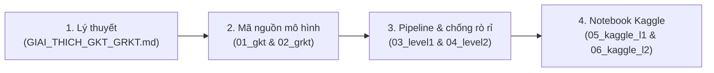

# Tài liệu kỹ thuật — Knowledge Tracing trên đồ thị

Thư mục `docs/` giải thích lý thuyết, mã nguồn và hai notebook Kaggle của đồ án. Số liệu chuẩn
nằm ở [`../results/`](../results).

## 1. Lộ trình đọc

1. **Lý thuyết** — [GIAI_THICH_GKT_GRKT.md](GIAI_THICH_GKT_GRKT.md): so sánh GKT và GRKT về toán học,
   bộ nhớ và đồ thị.
2. **Mã nguồn mô hình** — [01_gkt_module.md](01_gkt_module.md) (`f_self`, `f_in`, `f_out`,
   `EraseAddGate`, `GRUCell`) và [02_grkt_module.md](02_grkt_module.md) (các pha forward của GRKT và
   các điểm rò rỉ trong mã upstream).
3. **Pipeline** — [03_level1_module.md](03_level1_module.md) (chuẩn hoá dữ liệu, split, xAI phản chứng,
   dashboard), [04_level2_module.md](04_level2_module.md) (Junyi streaming, đồ thị `rel/pre` train-only,
   quỹ đạo mastery, đóng gói định kỳ) và [GIAI_THICH_LEVEL1_LEVEL2.md](GIAI_THICH_LEVEL1_LEVEL2.md)
   (luồng tensor từ CSV tới DataLoader).
4. **Notebook** — [05_kaggle_level1_notebook.md](05_kaggle_level1_notebook.md) và
   [06_kaggle_level2_notebook.md](06_kaggle_level2_notebook.md). Bản đã chạy kèm output nằm cạnh kết
   quả: `results/level1_out/kaggle_level1_executed.ipynb`,
   `results/level2_moderate/kaggle_level2_executed.ipynb`.

> Một số con số minh hoạ trong các tài liệu này được viết trước bản sửa tiền xử lý `order-dedup-v1`.
> Khi trích dẫn, luôn lấy số từ `results/` (bảng trong [`../README.md`](../README.md) đã cập nhật).

## 2. Tra cứu nhanh

- **Vì sao `A = I` và `A = 0` cho kết quả giống nhau trong GKT?** — mục 5.1 trong
  [01_gkt_module.md](01_gkt_module.md).
- **Vì sao DKT thắng mọi biến thể GKT trên ASSISTments 2009?** — bảng kết quả Cấp độ 1 trong
  [`../README.md`](../README.md) và `results/level1_out/report_summary.md`.
- **Làm xAI định lượng (phản chứng nếu–thì, ablation đồ thị cục bộ)?** — mục 4 trong
  [03_level1_module.md](03_level1_module.md) và [05_kaggle_level1_notebook.md](05_kaggle_level1_notebook.md).
- **Cơ chế các pha của GRKT?** — mục 3 trong [02_grkt_module.md](02_grkt_module.md).
- **Vì sao `consistency_strengthen`, `consistency_spread`, `locality` luôn bằng 1?** — mục 4.3 trong
  [04_level2_module.md](04_level2_module.md).
- **Nạp log Junyi 16,2 triệu dòng mà không tràn RAM trên Kaggle?** — mục 2 trong
  [04_level2_module.md](04_level2_module.md).
- **Lưu checkpoint và resume khi phiên Kaggle bị ngắt?** — mục 7 trong
  [04_level2_module.md](04_level2_module.md) và [06_kaggle_level2_notebook.md](06_kaggle_level2_notebook.md).
