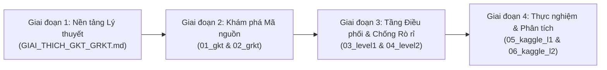

# Trung tâm Tài liệu & Cẩm nang Học tập Chuyên sâu Knowledge Tracing

Chào mừng bạn đến với hệ thống tài liệu và cẩm nang học tập toàn diện về **Knowledge Tracing (KT) trên đồ thị**. Thư mục [`docs/`](file:///root/Knowledge-Tracing/docs) được thiết kế nhằm cung cấp kiến thức nền tảng, giải thích chi tiết từng dòng mã nguồn, phân tích các cạm bẫy thực nghiệm và hướng dẫn tái lập các mô hình KT từ cơ bản đến hiện đại nhất (KDD 2024).

---

## 1. Lộ trình Học tập Khuyến nghị (Learning Progression)

Để tiếp thu kiến thức một cách bài bản và có hệ thống, bạn nên theo dõi lộ trình 4 giai đoạn sau:

1. **Giai đoạn 1 — Hiểu bản chất Toán học & Giải thuật**:
   - Đọc [**GIAI_THICH_GKT_GRKT.md**](file:///root/Knowledge-Tracing/docs/GIAI_THICH_GKT_GRKT.md) để nắm chắc sự khác biệt giữa mạng hồi quy trên đồ thị (**GKT**) và mô hình truy xuất kết hợp động học quên thời gian thực (**GRKT**).
2. **Giai đoạn 2 — Đọc hiểu Mã nguồn Cốt lõi**:
   - Đọc [**01_gkt_module.md**](file:///root/Knowledge-Tracing/docs/01_gkt_module.md) để giải phẫu từng lớp nơ-ron của GKT (`f_self`, `f_in`, `f_out`, `EraseAddGate`, `GRUCell`).
   - Đọc [**02_grkt_module.md**](file:///root/Knowledge-Tracing/docs/02_grkt_module.md) để hiểu 4 pha forward của GRKT và 15 cạm bẫy phương pháp luận trong mã nguồn upstream.
3. **Giai đoạn 3 — Thiết kế Pipeline Thực nghiệm & Phòng chống Rò rỉ**:
   - Đọc [**03_level1_module.md**](file:///root/Knowledge-Tracing/docs/03_level1_module.md) để học cách chuẩn hóa dữ liệu, cố định split, xAI phản chứng và xây dựng dashboard Cấp độ 1.
   - Đọc [**04_level2_module.md**](file:///root/Knowledge-Tracing/docs/04_level2_module.md) để học kỹ thuật xử lý dữ liệu lớn streaming, xây dựng đồ thị hai quan hệ ($rel/pre$) train-only, đo lường quỹ đạo thành thạo $m(u, c, t)$ và cơ chế nén định kỳ chống mất phiên 12 giờ.
   - Đọc [**GIAI_THICH_LEVEL1_LEVEL2.md**](file:///root/Knowledge-Tracing/docs/GIAI_THICH_LEVEL1_LEVEL2.md) để nắm rõ luồng chuyển đổi tensor từ CSV đến DataLoader và chuỗi GRKT.
4. **Giai đoạn 4 — Vận hành Thực nghiệm trên Kaggle GPU**:
   - Đọc [**05_kaggle_level1_notebook.md**](file:///root/Knowledge-Tracing/docs/05_kaggle_level1_notebook.md) để theo dõi chi tiết 39 cells của Cấp độ 1: 5 seed, paired t-test, ablation suy luận.
   - Đọc [**06_kaggle_level2_notebook.md**](file:///root/Knowledge-Tracing/docs/06_kaggle_level2_notebook.md) để theo dõi chi tiết 37 cells của Cấp độ 2: đa tập dữ liệu, đối chiếu split, quỹ đạo mastery và dashboard Cấp 2.

---

## 2. Mục lục Chi tiết Toàn bộ Hệ thống Tài liệu

| Tệp tài liệu | Độ dài | Trọng tâm nội dung | Liên kết |
|---|---:|---|---|
| [**GIAI_THICH_GKT_GRKT.md**](file:///root/Knowledge-Tracing/docs/GIAI_THICH_GKT_GRKT.md) | 43 KB | So sánh đối chiếu toàn diện về giải thuật, toán học, ký hiệu, cơ chế bộ nhớ và đồ thị giữa GKT và GRKT. | [`GIAI_THICH_GKT_GRKT.md`](file:///root/Knowledge-Tracing/docs/GIAI_THICH_GKT_GRKT.md) |
| [**GIAI_THICH_LEVEL1_LEVEL2.md**](file:///root/Knowledge-Tracing/docs/GIAI_THICH_LEVEL1_LEVEL2.md) | 57 KB | Giải thích luồng dữ liệu (dataflow), sự kết nối giữa `level1/` và `level2/`, hợp đồng dữ liệu, và quy trình resume. | [`GIAI_THICH_LEVEL1_LEVEL2.md`](file:///root/Knowledge-Tracing/docs/GIAI_THICH_LEVEL1_LEVEL2.md) |
| [**01_gkt_module.md**](file:///root/Knowledge-Tracing/docs/01_gkt_module.md) | 19 KB | Chi tiết mã nguồn `GKT/`: `models.py`, `layers.py`, `processing.py`, `metrics.py`, 9 biến thể đồ thị, và 11 lỗi upstream. | [`01_gkt_module.md`](file:///root/Knowledge-Tracing/docs/01_gkt_module.md) |
| [**02_grkt_module.md**](file:///root/Knowledge-Tracing/docs/02_grkt_module.md) | 19 KB | Chi tiết mã nguồn `GRKT/`: 4 pha forward, $rel\_map$ & $pre\_map$, động học quên $\Delta t$, và 15 điểm rò rỉ upstream. | [`02_grkt_module.md`](file:///root/Knowledge-Tracing/docs/02_grkt_module.md) |
| [**03_level1_module.md**](file:///root/Knowledge-Tracing/docs/03_level1_module.md) | 14 KB | Chi tiết mã nguồn `level1/`: API `pipeline.py`, xAI phản chứng `explain.py`, dashboard `dashboard.py`. | [`03_level1_module.md`](file:///root/Knowledge-Tracing/docs/03_level1_module.md) |
| [**04_level2_module.md**](file:///root/Knowledge-Tracing/docs/04_level2_module.md) | 17 KB | Chi tiết mã nguồn `level2/`: Hợp đồng 8 cột CSV, bộ đếm $rel/pre$ train-only, `grkt_api`, quỹ đạo mastery, `PeriodicPackager`. | [`04_level2_module.md`](file:///root/Knowledge-Tracing/docs/04_level2_module.md) |
| [**05_kaggle_level1_notebook.md**](file:///root/Knowledge-Tracing/docs/05_kaggle_level1_notebook.md) | 18 KB | Giải thích cặn kẽ 39 cells trong `kaggle_level1_full.ipynb`: 5 seed, paired t-test, ablation suy luận, 10 case study. | [`05_kaggle_level1_notebook.md`](file:///root/Knowledge-Tracing/docs/05_kaggle_level1_notebook.md) |
| [**06_kaggle_level2_notebook.md**](file:///root/Knowledge-Tracing/docs/06_kaggle_level2_notebook.md) | 21 KB | Giải thích cặn kẽ 37 cells trong `kaggle_level2_full.ipynb`: đa tập dữ liệu, đối chiếu split, quỹ đạo mastery, calibration. | [`06_kaggle_level2_notebook.md`](file:///root/Knowledge-Tracing/docs/06_kaggle_level2_notebook.md) |

---

## 3. Bản đồ Tra cứu Khái niệm Nhanh (Topic Cheat Sheet)

Khi bạn gặp một câu hỏi kỹ thuật cụ thể, hãy tra cứu ngay tại các tệp tương ứng:

- **Tại sao ma trận đơn vị $A=I$ và ma trận không $A=0$ cho kết quả giống nhau trong GKT?**  
  $\rightarrow$ Xem mục 7.2 trong [**GAP_LEVEL1.md**](file:///root/Knowledge-Tracing/GAP_LEVEL1.md#72-điểm-mù-toán-học-vì-sao-identity-và-zero-hoàn-toàn-đồng-nhất-trong-gkt) hoặc mục 5.1 trong [**01_gkt_module.md**](file:///root/Knowledge-Tracing/docs/01_gkt_module.md).
- **Tại sao DKT lại chiến thắng mọi biến thể GKT trên ASSISTments 2009?**  
  $\rightarrow$ Xem mục 7.3 trong [**GAP_LEVEL1.md**](file:///root/Knowledge-Tracing/GAP_LEVEL1.md#73-bản-chất-dữ-liệu-vì-sao-baseline-dkt-thắng-mọi-biến-thể-gkt-trên-assistments-2009) hoặc mục 3 trong [**README.md**](file:///root/Knowledge-Tracing/README.md#34-bốn-phát-hiện-khoa-học-cốt-lõi-của-cấp-độ-1).
- **Làm sao để làm xAI định lượng với mô hình KT (phản chứng nếu-thì, local graph ablation)?**  
  $\rightarrow$ Xem mục 4 trong [**03_level1_module.md**](file:///root/Knowledge-Tracing/docs/03_level1_module.md) và cell 28–30 trong [**05_kaggle_level1_notebook.md**](file:///root/Knowledge-Tracing/docs/05_kaggle_level1_notebook.md).
- **Cơ chế 4 pha của GRKT hoạt động như thế nào?**  
  $\rightarrow$ Xem mục 11.1 trong [**GAP_LEVEL2.md**](file:///root/Knowledge-Tracing/GAP_LEVEL2.md#111-dòng-dữ-liệu--toán-học-chi-tiết-của-grkt) hoặc mục 3 trong [**02_grkt_module.md**](file:///root/Knowledge-Tracing/docs/02_grkt_module.md).
- **Tại sao các chỉ số quỹ đạo `consistency_strengthen`, `consistency_spread`, `locality` luôn bằng 1.0?**  
  $\rightarrow$ Xem mục 11.3 trong [**GAP_LEVEL2.md**](file:///root/Knowledge-Tracing/GAP_LEVEL2.md#113-quỹ-đạo-tri-thức-muc-t-bằng-chứng-thật-vs-cạm-bẫy-bằng-chứng-giả) hoặc mục 4.3 trong [**04_level2_module.md**](file:///root/Knowledge-Tracing/docs/04_level2_module.md).
- **Tại sao `precedence_gap` lại âm trên cả ASSIST09 và Junyi?**  
  $\rightarrow$ Xem mục 10.5 & 11.3 trong [**GAP_LEVEL2.md**](file:///root/Knowledge-Tracing/GAP_LEVEL2.md#113-quỹ-đạo-tri-thức-muc-t-bằng-chứng-thật-vs-cạm-bẫy-bằng-chứng-giả).
- **Làm sao để nạp log Junyi 16.2 triệu dòng mà không bị tràn 3 GB RAM trên Kaggle?**  
  $\rightarrow$ Xem mục 2 trong [**04_level2_module.md**](file:///root/Knowledge-Tracing/docs/04_level2_module.md) và mục 11.5 trong [**GAP_LEVEL2.md**](file:///root/Knowledge-Tracing/GAP_LEVEL2.md#115-kỹ-thuật-xử-lý-dữ-liệu-lớn-big-data-engineering-với-junyi-academy).
- **Làm sao để lưu checkpoint và resume an toàn khi session Kaggle bị ngắt sau 12 giờ?**  
  $\rightarrow$ Xem mục 7 trong [**04_level2_module.md**](file:///root/Knowledge-Tracing/docs/04_level2_module.md) và cell 0.3 trong [**06_kaggle_level2_notebook.md**](file:///root/Knowledge-Tracing/docs/06_kaggle_level2_notebook.md).
